# 3. Mechanism of Operation — Banking Workflow

**Author:** Nguyen Van Duc  
**Section:** 3. Mechanism of Operation  
**Topic:** Digital Signature Algorithms and Their Resistance to Attacks in Banking  

---

In modern interbank and retail payment architectures—ranging from high-value wire transfers (e.g., SWIFT, Fedwire, TARGET2, or Vietnam's Interbank Electronic Payment System IBPS) to retail open-banking APIs and instant payments (e.g., SEPA Instant, ISO 20022 rails, or NAPAS 24/7)—data transmission involves crossing multiple administrative domains, untrusted networks, and intermediate application gateways [12]. In these environments, communication channel security alone is fundamentally insufficient. A compromised microservice or rogue database administrator on an intermediate node could silently tamper with transaction amounts or routing numbers without breaking the outer transport-layer encryption.

To support end-to-end integrity and attribution, financial architectures deploy **digital signature schemes** as an application-layer cryptographic primitive. When combined with Hardware Security Modules (HSMs), a robust Public Key Infrastructure (PKI), identity controls, and auditable procedures, digital signatures allow unauthorized alteration of signed financial parameters to be detected and provide evidence linking the signing key to the transaction [8], [11], [13]. Legal non-repudiation depends on the surrounding identity, authorization, certificate, and evidentiary processes.

This section presents the detailed mechanism of operation of a signature-secured banking workflow. Section 3.1 defines the cryptographic components, trust boundaries, and security roles governing the system. Section 3.2 details the sequential lifecycle phases of a transaction, tracing the exact data transformations, hardware interactions, validation gates, and bifurcated execution flows for transaction acceptance and rejection.

---

## 3.1 Cryptographic Components and Security Roles

### 3.1.1 Cryptographic Assurances in Banking Transactions

A secure banking workflow relies on digital signatures to support three security properties that channel encryption cannot deliver alone:

1. **Signer-Key Attribution:** A valid signature supports the conclusion that the message was signed with the private key corresponding to the validated public key. Attribution to a person or organization additionally depends on certificate issuance, authorization, key custody, and audit evidence.
2. **Data Integrity:** Binds all semantic parameters of the financial message (accounts, currency, amount, execution conditions) into a cryptographically immutable digest. Any bit-level modification or tampering in transit or storage invalidates the signature equation.
3. **Non-Repudiation:** Supports evidence that can be used to dispute claims that a transaction was forged or altered. Its legal effect depends on the applicable framework and the surrounding identity, authorization, certificate, and evidentiary procedures, including instruments such as the UNCITRAL Model Law on Electronic Signatures and Vietnam Law on Electronic Transactions No. 20/2023/QH15 [15], [16].

### 3.1.2 The Distinct Separation: Transport Layer Security (mTLS) vs. Application-Layer Digital Signatures

A widespread architectural misconception is assuming that Mutual Transport Layer Security (mTLS) renders application-layer digital signatures redundant, or vice versa. In production banking infrastructures, they provide different but complementary protections, as contrasted in Table 3.1.

**Table 3.1. Architectural Comparison: Transport Security (mTLS 1.3) vs. Digital Signatures**

| Dimension | Mutual TLS (mTLS 1.3) | Digital Signature (Application Layer) |
|---|---|---|
| **OSI Layer** | Layer 4 / 5 (Transport / Session) | Layer 7 (Application / Message) |
| **Scope of Protection** | Hop-by-hop (point-to-point between adjacent network nodes) | End-to-end (originator to final settlement ledger) |
| **Persistence** | Ephemeral; protection terminates immediately upon socket termination | Persistent; signature accompanies the payload into permanent WORM audit archives |
| **Intermediate Proxy Defense** | TLS terminators can access plaintext at the termination point | Modification of covered fields is detectable when canonicalization and signature verification are correctly enforced |
| **Insider Threat Defense** | Zero protection against malicious internal network operators or rogue DBAs | Strong protection; private keys remain isolated in dedicated cryptographic hardware |
| **Evidentiary Persistence** | Session evidence does not by itself bind an application message to a long-term signing identity | The signature can remain with the message as evidence; legal effect depends on identity, authorization, certificate, time, custody, and applicable law |

As demonstrated, mTLS protects channel confidentiality and integrity between authenticated endpoints [4]. In contrast, application-layer digital signatures provide persistent evidence of message integrity and signer-key attribution across multi-hop payment routing and storage, subject to correct key, identity, certificate, and audit controls.

### 3.1.3 Entities, Actors, and Trust Boundaries

The system architecture partitions operations into five isolated trust domains, illustrated conceptually in Figure 3.1.

```
+---------------------------------------------------------------------------------------------------+
| TRUST BOUNDARY 1: CLIENT DOMAIN (Low Trust)                                                       |
| [ Initiator / Corporate ERP / Mobile Client ] -- (Client Intent / Biometric MFA / FIDO2 Token)    |
+---------------------------------------------------------------------------------------------------+
                                              |
                                              | (mTLS Ingress)
                                              v
+---------------------------------------------------------------------------------------------------+
| TRUST BOUNDARY 2: ORIGINATING BANK SECURE CORE (High Trust)                                       |
| - API Gateway & Session Validation Engine                                                         |
| - Deterministic Canonicalization Engine (RFC 8785 JCS / XML C14N)                                 |
| - Multi-Party Policy & Dual-Control Decision Point ("Four-Eyes" Quorum)                           |
| - Dedicated HSM Cluster (FIPS 140-3 Level 3, PKCS#11 / REST KMS)                                   |
+---------------------------------------------------------------------------------------------------+
                                              |
                                              | (Interbank Dispatch: ISO 20022 pacs.008 over mTLS 1.3)
                                              v
+---------------------------------------------------------------------------------------------------+
| TRUST BOUNDARY 3: INTERBANK CLEARING RAILS (Zero-Trust Transport Network)                         |
| [ SWIFT Alliance Gateway / National Payment Switch / Interbank Clearing Network ]                 |
+---------------------------------------------------------------------------------------------------+
                                              |
                                              | (Inbound Payment Packet)
                                              v
+---------------------------------------------------------------------------------------------------+
| TRUST BOUNDARY 4: RECEIVING INSTITUTION / PROCESSOR (High Trust)                                  |
| - Perimeter Security Gateway & Schema Filtering                                                   |
| - PKI & Certificate Chain Validator (X.509 RFC 5280, Live OCSP / CRL Check)                        |
| - Cryptographic Signature Verification Subsystem                                                  |
| - Distributed Anti-Replay Store (In-Memory Atomic Cache with TTL) & Clock-Skew Guard              |
| - AML / Sanctions Screening & Core Banking Ledger Engine                                          |
+---------------------------------------------------------------------------------------------------+
                                              |
                                              | (Settlement & Cryptographic Proof Archival)
                                              v
+---------------------------------------------------------------------------------------------------+
| TRUST BOUNDARY 5: TAMPER-EVIDENT AUDIT VAULT (Write-Once-Read-Many / Evidence Archive)            |
| [ WORM Storage / Append-Only Merkle Tree Audit Ledger ]                                           |
+---------------------------------------------------------------------------------------------------+
```
*Figure 3.1. Cryptographic Trust Boundaries and Role Architecture in Banking Transactions.*

The primary actors and components within these boundaries include:

1. **Transaction Initiator (Client / ERP):** The end-user or corporate enterprise system initiating the financial request. Authentication is established via multi-factor authentication (MFA), FIDO2/WebAuthn hardware tokens, or client-side application certificates.
2. **Originating Financial Institution (Sender Bank):** Orchestrates the payment transaction. It validates client permissions, verifies account balances, standardizes the payload into a canonical structure, enforces discretionary limits, and requests signature generation from its internal security perimeter.
3. **Hardware Security Module (HSM):** A dedicated cryptographic module whose security controls may be assessed against standards such as FIPS 140-3 and PCI PTS HSM requirements [8], [13]. Depending on the module and deployment policy, root and operational private keys can be generated and retained inside the protected boundary so that signing occurs without exporting the private key.
4. **Public Key Infrastructure (PKI) & Certification Authorities (CA):** A hierarchical trust infrastructure (Root CA $\rightarrow$ Intermediate Issuing CA $\rightarrow$ Subscriber Certificate) governed by RFC 5280. CAs issue digital certificates binding public keys to verified identities, publish Certificate Revocation Lists (CRLs), and may provide Online Certificate Status Protocol responders as specified by RFC 6960 [2], [3].
5. **Payment Clearing Network / Interbank Switch:** Intermediary financial infrastructure (e.g., SWIFT Fin/InterAct, ISO 20022 message brokers, or national ACH switches) responsible for routing message packets between participating financial institutions.
6. **Receiving Financial Institution (Beneficiary Bank):** Ingests the incoming payment packet, executes strict multi-stage cryptographic and business verification gates, performs anti-replay checks, and commits balance credits to the beneficiary account upon complete verification.
7. **Immutable Audit Vault (WORM Archive):** A forensically sound, Write-Once-Read-Many storage system or cryptographic append-only ledger (e.g., hash-chained Merkle trees). It stores raw transaction envelopes, signature values, certificate validation paths, and timestamp proofs for 5 to 10 years to satisfy statutory audit mandates and defend against post-transaction repudiation claims.

### 3.1.4 Key Management, Dual Control, and the "Four-Eyes" Principle

In banking environments, unauthorized invocation of an HSM signing key represents a serious operational risk. Key generation, storage, use, rotation, revocation, compromise response, and destruction must therefore be governed as one lifecycle, with module-specific controls where applicable [11], [13].

- **Key Ceremony and Split Knowledge:** Master keys (Key Encrypting Keys - KEK) are generated during formal, recorded key ceremonies. No single human administrator possesses knowledge of or access to the master key. Instead, the key is partitioned into $M$-of-$N$ threshold secret shares (e.g., Shamir's Secret Sharing or physical smart card splits) distributed among distinct security officers.
- **Dual Control ("Four-Eyes Principle"):** High-value corporate payments (e.g., exceeding \$100,000 USD or institutional policy limits) cannot be signed by a single automated worker process. The orchestration engine requires two independent, cryptographically authenticated approvals (initiator + authorizing manager) before constructing the invocation token for the HSM.
- **Role-Based Access Control (RBAC):** API calls across the internal mTLS boundary into the HSM over PKCS#11 or proprietary REST APIs require mutual client authentication, restricted cryptographic function masks (e.g., allow `C_SignInit` / `C_Sign`, deny `C_DeriveKey` or `C_UnwrapKey`), and specific key handle references.

### 3.1.5 Modular Signature Algorithms in the Banking Pipeline

The signature scheme $\Sigma = (\text{KeyGen}, \text{Sign}, \text{Verify})$ implemented in this workflow is not hardcoded to a single primitive. Rather, the architecture maintains **cryptographic agility** (*crypto-agility*), allowing banks to configure or migrate between the five candidate algorithms analyzed in Section 2:

- **Ed25519 (RFC 8032):** A candidate for high-throughput retail banking APIs and microservices where the platform and policy support it. Because Ed25519 derives its nonce deterministically, it avoids dependence on fresh per-signature randomness, although seed protection and side-channel resistance remain essential. Its compact 64-byte signature reduces message overhead [5].
- **SM2 (GB/T 32918):** SM2 incorporates the signer's identity string ($Z_A$) into the digest calculation before signing over the standard 256-bit curve. It is a deployment option where policy, partners, and infrastructure require the SM2 ecosystem [14].
- **RSA-PSS (RFC 8017 / FIPS 186-5):** RSA-PSS remains widely supported in enterprise PKI. Modulus sizes of 2048 or 4096 bits produce 256- or 512-byte signatures and require an exact PSS parameter profile [6], [9].
- **ECDSA (FIPS 186-5, NIST P-256):** ECDSA P-256 provides an approximately 128-bit classical security target with compact signatures. It requires approved random nonce generation or a reviewed deterministic construction such as RFC 6979; nonce bias, reuse, or leakage can expose the private key [7], [9].
- **ML-DSA (FIPS 204):** ML-DSA is the NIST-standardized module-lattice signature family. Its larger keys and signatures require capacity testing across banking protocols, storage, certificates, and cryptographic modules [10].

---

## 3.2 System Workflow Phases

The end-to-end transaction lifecycle is partitioned into seven sequential phases, incorporating four strict validation gates and distinct execution branches for accepted and rejected transactions. 

Figure 3.2 details the complete workflow architecture.

```mermaid
flowchart TD
    %% =========================================================================
    %% END-TO-END CRYPTOGRAPHIC BANKING TRANSACTION WORKFLOW
    %% Designed by Nguyen Van Duc (Task 3: Banking Workflow)
    %% =========================================================================

    classDef clientStyle fill:#e1f5fe,stroke:#0288d1,stroke-width:1.5px,color:#01579b;
    classDef origStyle fill:#ede7f6,stroke:#5e35b1,stroke-width:1.5px,color:#311b92;
    classDef hsmStyle fill:#fff8e1,stroke:#f57f17,stroke-width:2px,color:#b78103;
    classDef railStyle fill:#eceff1,stroke:#455a64,stroke-width:1.5px,color:#263238;
    classDef recvStyle fill:#f3e5f5,stroke:#7b1fa2,stroke-width:1.5px,color:#4a148c;
    classDef decisionStyle fill:#fffde7,stroke:#fbc02d,stroke-width:1.5px,color:#f57f17;
    classDef successStyle fill:#e8f5e9,stroke:#2e7d32,stroke-width:2px,color:#1b5e20;
    classDef rejectStyle fill:#ffebee,stroke:#c62828,stroke-width:2px,color:#b71c1c;
    classDef auditStyle fill:#e0f2f1,stroke:#00695c,stroke-width:1.5px,color:#004d40;

    %% -------------------------------------------------------------------------
    %% ZONE 1: CLIENT DOMAIN
    %% -------------------------------------------------------------------------
    subgraph ClientZone ["1. Client Domain (Initiator / Corporate ERP / Mobile Client)"]
        A1["User Authentication & Intent<br/>(FIDO2 / MFA / Session Token)"]:::clientStyle
        A2["Construct Raw Transaction<br/>{AccountSrc, AccountDst, Amount, Cur, Nonce, Time}"]:::clientStyle
        A1 --> A2
    end

    %% -------------------------------------------------------------------------
    %% ZONE 2: ORIGINATING BANK PLATFORM & HSM
    %% -------------------------------------------------------------------------
    subgraph OrigBankZone ["2. Originating Bank Boundary (Sender Financial Institution)"]
        B1["Ingress Gateway & Session Validation<br/>(OAuth2 Bearer Token / Role Verification)"]:::origStyle
        B2["Canonicalization Engine<br/>RFC 8785 JCS / XML C14N<br/>m_canon = Canonicalize(Payload)"]:::origStyle
        B3["Digest Computation<br/>h = Hash(m_canon)"]:::origStyle
        B4{"Policy & Limit Check<br/>Within Discretionary Limit?<br/>Four-Eyes Approval?"}:::decisionStyle
        
        subgraph HSMZone ["Hardware Security Module (FIPS 140-3 Level 3)"]
            B5["PKCS#11 / REST KMS Request<br/>Unlock Private Key (SK_bank)"]:::hsmStyle
            B6["Generate Digital Signature<br/>sigma = Sign(SK_bank, h)<br/>(RSA-PSS / Ed25519 / SM2 / ECDSA / ML-DSA)"]:::hsmStyle
            B5 --> B6
        end
        
        B7["Assemble Signed Envelope<br/>{Payload, sigma, Cert_Chain, Alg_ID, Nonce}"]:::origStyle
        B8["Local Originator Logging<br/>(Pre-dispatch Audit Record)"]:::origStyle

        A2 -->|"mTLS 1.3 Transmission"| B1
        B1 --> B2
        B2 --> B3
        B3 --> B4
        B4 -->|"Approved / Quorum Met"| B5
        B6 --> B7
        B7 --> B8
    end

    %% -------------------------------------------------------------------------
    %% ZONE 3: INTERBANK NETWORK / CLEARING RAILS
    %% -------------------------------------------------------------------------
    subgraph InterbankRail ["3. Interbank Rail / Payment Switch (SWIFT / ISO 20022 Network / National Switch)"]
        C1["Secure Channel Transport<br/>(Mutual TLS 1.3 with Certificate Pinning)"]:::railStyle
        B8 -->|"Dispatch ISO 20022 pacs.008"| C1
    end

    %% -------------------------------------------------------------------------
    %% ZONE 4: RECEIVING FINANCIAL INSTITUTION & SETTLEMENT
    %% -------------------------------------------------------------------------
    subgraph RecvBankZone ["4. Receiving Bank Boundary (Processor / Beneficiary)"]
        D1["Perimeter Ingress Gateway<br/>Channel Authentication & Schema Validation"]:::recvStyle
        C1 --> D1

        %% Decision 1: Certificate & PKI
        D2{"Step 1: PKI Validation<br/>Trust Chain to Root CA?<br/>NotBefore <= t <= NotAfter?<br/>KeyUsage = digitalSignature?<br/>OCSP / CRL Status = Valid?"}:::decisionStyle
        D1 --> D2

        %% Decision 2: Signature
        D3["Payload Re-Canonicalization<br/>h_prime = Hash(Canonicalize(Payload))"]:::recvStyle
        D4{"Step 2: Signature Verification<br/>Verify(PK_bank, h_prime, sigma) == True?"}:::decisionStyle
        D2 -->|"Cert Valid"| D3
        D3 --> D4

        %% Decision 3: Anti-Replay & Timestamp
        D5{"Step 3: Anti-Replay & Temporal Integrity<br/>|t_sys - t_tx| <= Delta_t ?<br/>Nonce unique in Redis Distributed Cache?"}:::decisionStyle
        D4 -->|"Signature Valid"| D5

        %% Decision 4: Business Rules & Fraud
        D6{"Step 4: Business & AML Checks<br/>Beneficiary Account Active?<br/>Sanction Screening Clean?<br/>AML / Fraud Scoring Passed?"}:::decisionStyle
        D5 -->|"Nonce Fresh & In Window"| D6

        %% Branch A: Accept
        subgraph CoreSettlement ["Core Banking Ledger & Final Settlement"]
            E1["Execute Settlement & Balance Update<br/>Atomic Credit to Beneficiary Account"]:::successStyle
            E2["Store Nonce with TTL<br/>(Cache Nonce in Dedup Store)"]:::successStyle
            E3["Generate Signed Confirmation (pacs.002 ACK)<br/>sigma_ack = Sign(SK_recv, Receipt)"]:::successStyle
            E1 --> E2
            E2 --> E3
        end

        %% Branch B: Rejection Handler
        subgraph RejectHandler ["Rejection & Incident Response Subsystem"]
            R1["Generate Rejection Envelope (pacs.002 NACK)<br/>Specific ISO Error Code<br/>(CERT_REVOKED / SIGN_MISMATCH / REPLAY_DETECTED / AML_BLOCK)"]:::rejectStyle
            R2["Security Alert Dispatch<br/>Trigger SOC / SIEM Incident if Tampering / Replay"]:::rejectStyle
            R1 --> R2
        end

        D6 -->|"All Checks Pass"| E1
        
        %% Rejection Paths
        B4 -->|"Rejected: Limit Exceeded"| R1
        D2 -->|"Invalid / Expired / Revoked Cert"| R1
        D4 -->|"Signature Verification Failed"| R1
        D5 -->|"Replay Detected / Stale Time"| R1
        D6 -->|"Account Frozen / Sanction Hit"| R1
    end

    %% -------------------------------------------------------------------------
    %% ZONE 5: AUDIT & NON-REPUDIATION ARCHIVE
    %% -------------------------------------------------------------------------
    subgraph AuditLedger ["5. Immutable Audit Vault & Non-Repudiation Archive"]
        F1["WORM Storage / Tamper-Evident Merkle Ledger<br/>Persist: {Raw Message, Canonical Hash, Signature,<br/>Cert Chain, Verification Proof, Timestamp, Status}"]:::auditStyle
    end

    E3 -->|"Commit Transaction Evidence"| F1
    R2 -->|"Commit Forensic Rejection Audit"| F1

    %% Responses back to Originator
    E3 -.->|"Return Confirmation (ACK)"| A1
    R1 -.->|"Return Rejection (NACK)"| A1
```




*Figure 3.2. Detailed End-to-End Cryptographic Banking Transaction Workflow.*

---

### 3.2.1 Phase 1: Transaction Initiation and Requester Authentication

- **Actors:** End-User / Corporate Treasurer, Client Application / ERP, Originating Bank API Gateway.
- **Input Data:** User credentials, session authentication token, raw transaction parameters.
- **Process Description:**
  1. The user logs into the client banking platform. Authentication is verified through strong customer authentication (SCA), such as FIDO2/WebAuthn hardware authenticators or multi-factor biometric tokens.
  2. The client constructs the raw financial transaction intent $\mathcal{M}_{\text{raw}}$ containing the source account, destination account, transfer amount, currency code (ISO 4217), payment purpose, and local client timestamp.
  3. The request is transmitted across an authenticated mTLS 1.3 channel to the Originating Bank's Ingress Gateway, which validates the active session, OAuth 2.0 bearer token scopes, and client authorization rights.
- **Safety Conditions / Gate:** If the user session is expired, invalid, or lacks the necessary financial execution role, the gateway terminates the connection immediately.

---

### 3.2.2 Phase 2: Deterministic Data Canonicalization and Digest Binding

- **Actors:** Originating Bank Canonicalization Engine.
- **Input Data:** Raw transaction parameters $\mathcal{M}_{\text{raw}}$.
- **Process Description:**
  1. In distributed environments, equivalent data structures serialized across different programming languages (e.g., Python, Java, C++) can differ in whitespace, dictionary-key order, numeric representation, or character encoding. If hashed directly, these syntactic differences produce different digests and cause signature verification to fail.
  2. To produce a deterministic representation for verification, the payment engine subjects $\mathcal{M}_{\text{raw}}$ to standard canonicalization:
     - For JSON-based banking APIs: **RFC 8785 (JSON Canonicalization Scheme - JCS)**. JCS sorts object keys lexicographically by Unicode code points, eliminates insignificant whitespace, and standardizes numbers into IEEE 754 double-precision representation.
     - For XML-based banking rails (ISO 20022 `pain.001` / `pacs.008`): **W3C Canonical XML (C14N)**.
  3. The canonical message binds eight mandatory financial fields into the structure defined in Table 3.2:
     
     $$m_{\text{canon}} = \text{Canonicalize}(\mathcal{M}_{\text{raw}}) \tag{3.1}$$

  4. The engine computes the cryptographic message digest $h$ over the canonical byte stream:
     
     $$h = H(m_{\text{canon}}) \tag{3.2}$$
     
     where $H$ is a collision-resistant cryptographic hash function matched to the selected signature suite (e.g., SHA-256 for RSA-PSS/ECDSA, SHA-512 for Ed25519, SM3 for SM2, or SHAKE256 for ML-DSA).

**Table 3.2. Canonical Transaction Envelope Schema and Signature Binding Fields**

| Field Name | Type | Example / Format | Security Rationale & Threat Mitigated |
|---|---|---|---|
| `tx_id` | UUIDv4 / String | `urn:uuid:6ba7b810-9dad-11d1-80b4-00c04fd430c8` | Globally unique transaction reference (ISO EndToEndId); prevents transaction collision. |
| `account_source` | String (IBAN) | `VN89004000123456789012` | Binds debiting account; prevents source substitution. |
| `account_dest` | String (IBAN) | `GB29NWBK60161331926819` | Binds crediting account; prevents redirection of funds. |
| `amount` | Decimal String | `"1500000.00"` | Exact decimal string; avoids floating-point precision malleability and tampering. |
| `currency` | String (ISO 4217) | `"USD"` | Enforces transfer currency; prevents currency substitution fraud. |
| `timestamp_utc` | String (ISO 8601) | `"2026-11-08T06:50:00.000Z"` | Bounds transaction validity window; enforces freshness. |
| `nonce` | 256-bit Hex | `"a4f9b2d88c3e410bfa1e976c..."` | Cryptographically random unique scalar; thwarts replay attacks across sessions. |
| `purpose_code` | String (ISO 20022) | `"SALA"` (Salary Payment) | Semantic purpose binding; prevents diversion of institutional funds. |

```json
/* Listing 3.1. Illustrative Signed Banking Envelope adhering to RFC 8785 (JCS) */
{
  "payload": {
    "account_dest": "GB29NWBK60161331926819",
    "account_source": "VN89004000123456789012",
    "amount": "1500000.00",
    "currency": "USD",
    "nonce": "a4f9b2d88c3e410bfa1e976c81d3f02e88a6d71b402e8a159942d765e1289ab1",
    "purpose_code": "SALA",
    "timestamp_utc": "2026-11-08T06:50:00.000Z",
    "tx_id": "urn:uuid:6ba7b810-9dad-11d1-80b4-00c04fd430c8"
  },
  "signature_metadata": {
    "algorithm": "Ed25519",
    "canonicalization": "RFC8785-JCS",
    "digest_algorithm": "SHA-512",
    "signature_value": "4b63e84360e588b3941459a9bf9852f864fa920d32bb0a0494be25c00e008ff7754b5df5be7b0e77d01867dd1142502efcba8e9987817557588e3a8904",
    "signer_certificate_thumbprint": "SHA256:d48e89f2a0b1c765e31502f6bb...",
    "signing_timestamp_utc": "2026-11-08T06:50:01.124Z"
  }
}
```

---

### 3.2.3 Phase 3: Authorization Policy and HSM Digital Signature Generation

- **Actors:** Originating Bank Policy Engine, Internal Key Management Service (KMS), Hardware Security Module (HSM).
- **Input Data:** Message digest $h$, canonical message $m_{\text{canon}}$, authorization tokens.
- **Process Description:**
  1. **Policy Evaluation:** The bank's policy engine inspects the transfer amount against the originator's discretionary transaction limit. If the transaction exceeds the single-signoff threshold, the transaction is suspended pending **Dual-Control ("Four-Eyes")** cryptographic approval from an authorized supervisor:
     
     $$\text{RequiresQuorum}(\text{amount}, \text{policy}) \implies \text{VerifyApproval}(\{Auth_1, Auth_2\}) = \text{True} \tag{3.3}$$

  2. **HSM Invocation:** Upon approval, the transaction manager issues an authenticated API call across an internal isolated mTLS link to the HSM via PKCS#11 (`C_SignInit`, `C_Sign`) or RESTful KMS.
  3. **Signature Execution:** The HSM loads the non-exportable private signing key $SK_{\text{bank}}$ into its internal secure cryptographic memory and generates the digital signature $\sigma$:
     
     $$\sigma = \text{Sign}(SK_{\text{bank}}, h) \tag{3.4}$$

  4. **Signed Envelope Assembly:** The originating bank packages the payload, signature, and cryptographic metadata into an immutable transport envelope:
     
     $$\mathcal{E} = \{ m_{\text{canon}},\ \sigma,\ \text{CertChain}_{\text{orig}},\ \text{AlgorithmID},\ \text{Timestamp}_{\text{sign}} \} \tag{3.5}$$

  5. **Pre-dispatch Logging:** The originating bank records $\mathcal{E}$ into its internal pre-dispatch audit ledger to establish an indelible internal record before transmitting the payment externally.
- **Safety Conditions / Gate:** If the policy limits are violated, dual-control quorum fails, or the HSM reports a hardware fault, the transaction is halted immediately with an internal rejection alert.

---

### 3.2.4 Phase 4: Secure Transport and Perimeter Ingress

- **Actors:** Originating Bank Dispatcher, Interbank Payment Switch / Network Rails, Receiving Bank Perimeter Ingress Gateway.
- **Input Data:** Signed transaction envelope $\mathcal{E}$.
- **Process Description:**
  1. The envelope is encapsulated into the target interbank messaging standard (e.g., ISO 20022 `pacs.008.001.10` Financial Institutional Customer Credit Transfer).
  2. The message is transmitted across the interbank clearing rail over a hardened **Mutual TLS (mTLS 1.3)** connection configured with:
     - Modern cipher suites (e.g., `TLS_AES_256_GCM_SHA384` or `TLS_CHACHA20_POLY1305_SHA256`).
     - Explicit certificate pinning between the participating financial institutions' network edge routers.
  3. The Receiving Bank's perimeter gateway terminates the outer TLS transport, performs structural schema validation against the ISO 20022 XSD definitions, and forwards the encapsulated envelope $\mathcal{E}$ to the core cryptographic verification subsystem.

---

### 3.2.5 Phase 5: Multi-Stage Cryptographic and PKI Verification

At the receiving bank, every transaction must pass through a succession of mathematical and trust checks. Failure at any check triggers an immediate, unrecoverable abort.

#### Step 1: PKI and Certificate Validation
- **Action:** The verification engine parses `CertChain_orig` and validates the originating bank's X.509 certificate against the trusted Banking Root CA trust anchor:
  1. **Chain of Trust:** Verifies cryptographic signatures from the leaf certificate through intermediate CAs up to the pre-installed Root CA certificate:
     
     $$\text{VerifyChain}(\text{Cert}_{\text{leaf}}, \dots, \text{Cert}_{\text{root}}) \stackrel{?}{=} \text{True}$$

  2. **Validity Window:** Confirms that the current verification time $t_{\text{sys}}$ falls strictly within the certificate's validity bounds:
     
     $$\text{notBefore} \le t_{\text{sys}} \le \text{notAfter}$$

  3. **Key Usage Flags:** Verifies that the X.509 v3 Key Usage extension explicitly asserts the `digitalSignature` (bit 0) and `nonRepudiation` (bit 1) attributes.
  4. **Revocation Status Verification:** Executes a real-time check to confirm the certificate has not been revoked or suspended:
     - Queries the issuing CA's Online Certificate Status Protocol (OCSP) responder using an OCSP request with nonce (RFC 6960), or verifies a pre-fetched, cryptographically signed OCSP staple.
     - Fallback: Verifies the certificate serial against the latest cached Certificate Revocation List (CRL).
- **Rejection Condition:** If the certificate chain cannot be anchored, the validity period is expired, or OCSP reports status `REVOKED` or `UNKNOWN`, the transaction is rejected immediately with error code `CERT_REVOKED` or `CERT_EXPIRED`.

#### Step 2: Digital Signature Verification
- **Action:**
  1. The receiver extracts $m_{\text{canon}}$ from the envelope and independently computes the message digest using the algorithm specified in `AlgorithmID`:
     
     $$h' = H(\text{Canonicalize}(m_{\text{canon}})) \tag{3.6}$$

  2. The engine retrieves the public key $PK_{\text{bank}}$ embedded in the validated certificate and evaluates the verification relation:
     
     $$\text{Verify}(PK_{\text{bank}}, h', \sigma) \stackrel{?}{=} \text{True} \tag{3.7}$$
     
     - **RSA-PSS:** Verifies EMSA-PSS encoded hash with salt length matching hash output size.
     - **Ed25519:** Verifies equation $2^c \cdot s \cdot B = 2^c \cdot R + 2^c \cdot H(R \mathbin{\Vert} PK \mathbin{\Vert} m) \cdot PK$.
     - **SM2:** Recomputes $Z_A = \text{SM3}(\text{ENTL}_A \mathbin{\Vert} \text{ID}_A \mathbin{\Vert} a \mathbin{\Vert} b \mathbin{\Vert} x_G \mathbin{\Vert} y_G \mathbin{\Vert} x_A \mathbin{\Vert} y_A)$, hashes $\bar{M} = Z_A \mathbin{\Vert} m_{\text{canon}}$, and validates curve coordinates.
     - **ECDSA:** Verifies curve point scalar multiplication $(u_1 G + u_2 PK)_x \equiv r \pmod n$.
     - **ML-DSA:** Verifies lattice polynomial vector bounds $\|\mathbf{w}_1 - c\mathbf{s}_1\|_\infty$ and matrix commitment relations under FIPS 204.
- **Rejection Condition:** If $\text{Verify} = \text{False}$, indicating that the payload was modified in transit, corrupted, or signed by an illegitimate key, execution halts immediately with error code `SIGN_MISMATCH`.

---

### 3.2.6 Phase 6: Anti-Replay, Temporal Integrity, and Business Validation

Even a mathematically valid signature is malicious if captured by an attacker and re-submitted to cause duplicate debits (replay attack). Consequently, cryptographic verification must be coupled with stateful replay prevention and banking business logic.

#### Step 3: Anti-Replay and Clock-Skew Verification
- **Action:**
  1. **Clock-Skew Gate:** The system evaluates the difference between the receiver's synchronized atomic clock (via Network Time Protocol / PTP) and the transaction timestamp:
     
     $$|t_{\text{sys}} - t_{\text{utc}}| \le \Delta t_{\text{threshold}} \tag{3.8}$$
     
     where $\Delta t_{\text{threshold}}$ is strictly bounded (typically 300 seconds). Any transaction with a timestamp too far in the past (stale message) or in the future (clock manipulation) is rejected.
  2. **Distributed Nonce Check:** The receiver constructs a composite uniqueness key from the transaction parameters:
     
     $$K_{\text{replay}} = H(\text{tx\_id} \mathbin{\Vert} \text{nonce} \mathbin{\Vert} \text{account\_source})$$
     
     The system queries a high-performance distributed in-memory key-value cluster (e.g., Redis Enterprise configured with multi-region persistence) using an atomic `SETNX` (set if not exists) operation with an expiration Time-To-Live ($T_{\text{TTL}} = \Delta t_{\text{threshold}} + \text{buffer}$):
     
     $$\text{Exists}(K_{\text{replay}}) \stackrel{?}{=} \text{True}$$

- **Rejection Condition:** If the key already exists in the cache, the transaction is recognized as a duplicate replay attempt and rejected immediately with error code `REPLAY_ATTACK_DETECTED`.

#### Step 4: Business Rules, Balance, and AML Screening
- **Action:**
  1. **Account Status:** Checks core ledger database to ensure the destination account exists, is active, and is not frozen or restricted.
  2. **Sanctions & AML Screening:** Streams the transaction parameters through the bank's Anti-Money Laundering (AML) and Counter-Terrorist Financing (CTF) screening engines, checking sender and recipient entities against international sanctions lists (OFAC, UN, EU, national registries).
  3. **Fraud Anomaly Scoring:** Evaluates real-time velocity, geolocation anomalies, and behavioral transaction scoring.
- **Rejection Condition:** If account checks fail, sanctions hit, or the fraud risk score exceeds the allowable limit, the transaction branches to rejection with codes such as `ACCOUNT_CLOSED`, `SANCTION_BLOCK`, or `FRAUD_ALERT`.

---

### 3.2.7 Phase 7: Finality, Settlement, and Bifurcated Execution Paths

Once all cryptographic and business gates are evaluated, the workflow branches decisively into either the **Acceptance Path (Branch A)** or the **Rejection Path (Branch B)**.

#### Branch A: Transaction Acceptance and Final Settlement
1. **Atomic Ledger Execution:** The Core Banking System executes an atomic ledger settlement, debiting the sender bank's clearing account and crediting the beneficiary customer's account balance.
2. **Nonce Cache Finalization:** The unique composite key $K_{\text{replay}}$ is retained in the distributed cache until its TTL expires, ensuring duplicate submissions within the validity window remain blocked.
3. **Receipt Generation:** Where required by the selected ISO 20022 profile, the receiving bank constructs a payment-status report with the applicable acceptance code. A signature by the receiving bank can provide bidirectional message-integrity and signer-key evidence; exact message versions and status codes must follow the deployed clearing-network profile.
4. **Immutable Evidence Archival:** The complete transaction bundle—including original canonical payload $m_{\text{canon}}$, signature $\sigma$, full X.509 certificate path, OCSP validation response, timestamp proofs, and settlement receipt—is written to the **Immutable Audit Vault (WORM Storage)**.
5. **Client Notification:** A positive confirmation receipt is returned through interbank rails to the originating bank, which credits the sender's interface and issues an end-user confirmation.

#### Branch B: Transaction Rejection and Incident Response
1. **Idempotent Abort:** The settlement engine ensures that no account balances are debited, no ledger entries are posted, and any temporary authorization holds are released immediately.
2. **Rejection Notice Construction:** The receiving bank generates an ISO 20022 `pacs.002` Payment Status Report with status `RJCT` (Rejected) and includes the standardized ISO 20022 external rejection reason code, as detailed in Table 3.3.
3. **Security Incident Dispatch (SOC / SIEM):**
   - If the rejection was caused by ordinary business reasons (e.g., account closed, insufficient balance), an operational notice is logged.
   - If the rejection was triggered by **cryptographic failure** (invalid signature, corrupted hash, revoked certificate, or detected replay attack), the system automatically dispatches an alert to the bank's **Security Operations Center (SOC)** and logs an event into the Security Information and Event Management (SIEM) pipeline for forensic investigation.
4. **Forensic Audit Archival:** Even though the transaction was aborted, the complete malformed envelope, source IP address, transport headers, and verification failure proofs are persisted to the WORM audit vault. This ensures that malicious attempts cannot be denied during interbank arbitration or regulatory audit.
5. **Return Dispatch:** The rejection message is dispatched back to the originating bank to notify the user.

**Table 3.3. Failure Modes, Rejection Codes, and Audit Actions**

| Failure Point | Trigger Condition | ISO 20022 Status Code | Security Incident Level | Audit & Operational Action |
|---|---|---|---|---|
| **Phase 2 / Gate 1** | Malformed schema; missing mandatory canonical fields | `NARR` / `FF01` (Syntax Error) | Low | Reject transaction; log client parsing error. |
| **Phase 3 / Gate 2** | Originator limit exceeded; Four-Eyes quorum rejected | `AM05` (Limit Exceeded) | Medium | Cancel internal workflow; alert compliance manager. |
| **Phase 5 / Gate 1** | X.509 certificate expired or trust anchor untrusted | `ED05` / `CERT_EXPIRED` | High | Immediate reject; notify PKI administration team. |
| **Phase 5 / Gate 1** | OCSP responder returns status `REVOKED` | `ED05` / `CERT_REVOKED` | Critical | Immediate reject; flag potential compromised key; alert SOC. |
| **Phase 5 / Gate 2** | Signature verification equation fails ($\text{Verify} = \text{False}$) | `SIGN` / `SIGN_MISMATCH` | Critical | Terminate transaction; dispatch urgent SIEM alert (tamper attempt). |
| **Phase 6 / Gate 3** | Transaction timestamp skew exceeds $\Delta t_{\text{threshold}}$ | `DT02` (Invalid Date) | Medium | Reject transaction; prompt client time re-synchronization. |
| **Phase 6 / Gate 3** | Composite nonce key exists in distributed cache | `DUPL` / `REPLAY_ATTACK` | Critical | Block duplicate; trigger security alert for replay attack. |
| **Phase 6 / Gate 4** | Beneficiary account frozen or closed | `AC04` (Closed Account) | Low | Reverse hold; notify originator of incorrect account details. |
| **Phase 6 / Gate 4** | Beneficiary or sender hits international sanctions list | `RR04` (Regulatory Block) | High | Block settlement; freeze funds under AML statutory protocol; file Suspicious Activity Report (SAR). |

---

## 3.3 Summary and Implementation Safeguards

The architecture detailed above demonstrates that robust cryptographic security in banking is achieved through **defense-in-depth**:

1. **Digital signatures cannot substitute for channel encryption:** mTLS 1.3 protects network transit, while digital signatures provide persistent integrity and signer-key evidence across application hops and long-term storage when the surrounding controls are trustworthy.
2. **Digital signatures cannot substitute for business checks:** A mathematically valid signature proves who signed a payload, but cannot determine whether the account possesses sufficient balance, is permitted by compliance rules, or has exceeded daily transfer limits.
3. **Data canonicalization is required:** Without a deterministic representation such as RFC 8785 JCS for applicable JSON payloads, cross-platform syntactic variations can produce different hashes and false rejections [1].
4. **Stateful anti-replay protection is essential:** Signatures alone do not prevent an adversary from replaying an authentic signed payment. Transaction identifiers or nonces, timestamp policy, and an atomic replay store are required by this reference workflow.
5. **Private key isolation in certified HSMs:** Software-based key storage in general application memory creates a major exposure. Keeping private keys non-exportable inside an appropriately managed HSM reduces extraction risk, but access control, authorization, dual control, monitoring, and compromise response remain necessary to prevent misuse of the signing service.

---

## References

1. RFC 8785 — *JSON Canonicalization Scheme (JCS)*, Internet Engineering Task Force (IETF), 2020.
2. RFC 5280 — *Internet X.509 Public Key Infrastructure Certificate and Certificate Revocation List (CRL) Profile*, IETF, 2008.
3. RFC 6960 — *X.509 Internet Public Key Infrastructure Online Certificate Status Protocol - OCSP*, IETF, 2013.
4. RFC 9846 — *The Transport Layer Security (TLS) Protocol Version 1.3*, IETF, 2026.
5. RFC 8032 — *Edwards-Curve Digital Signature Algorithm (EdDSA)*, IETF, 2017.
6. RFC 8017 — *PKCS #1: RSA Cryptography Specifications Version 2.2*, IETF, 2016.
7. RFC 6979 — *Deterministic Usage of the Digital Signature Algorithm (DSA) and Elliptic Curve Digital Signature Algorithm (ECDSA)*, IETF, 2013.
8. NIST FIPS 140-3 — *Security Requirements for Cryptographic Modules*, National Institute of Standards and Technology, 2019.
9. NIST FIPS 186-5 — *Digital Signature Standard (DSS)*, National Institute of Standards and Technology, 2023.
10. NIST FIPS 204 — *Module-Lattice-Based Digital Signature Standard (ML-DSA)*, National Institute of Standards and Technology, 2024.
11. NIST SP 800-57 Part 1 Rev. 5 — *Recommendation for Key Management: Part 1 – General*, NIST, 2020.
12. ISO 20022 — *Financial Services — Universal Financial Industry Message Scheme*, International Organization for Standardization, 2022.
13. Payment Card Industry (PCI) Security Standards Council — *PCI PIN Transaction Security (PTS) Hardware Security Module (HSM) Modular Security Requirements v5.0*, May 2026.
14. State Cryptography Administration (SCA) of China — *Public Key Cryptographic Algorithm SM2 Based on Elliptic Curves*, GB/T 32918-2016.
15. UNCITRAL — *Model Law on Electronic Signatures with Guide to Enactment*, United Nations Commission on International Trade Law, 2001.
