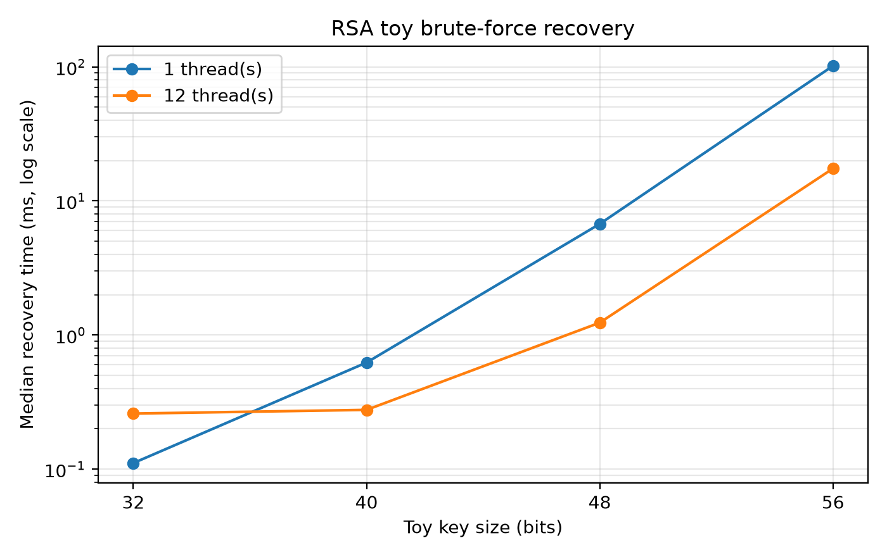
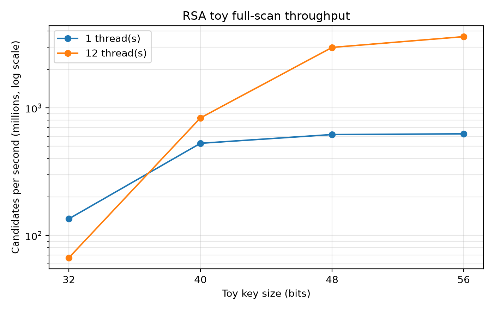
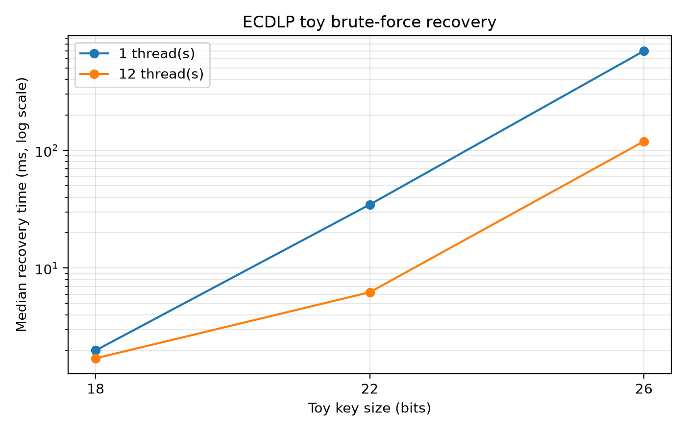
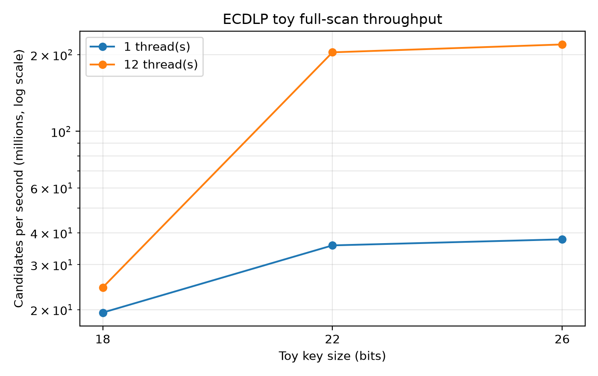
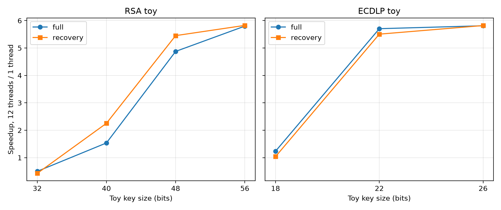
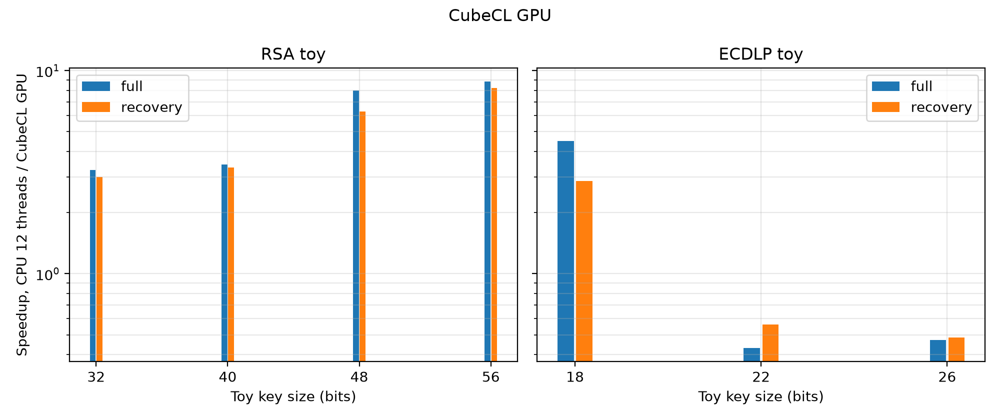

# 4.2 CPU/GPU Key-Recovery Benchmark

## 4.2.1 Bài toán và phương pháp

### RSA toy

Với modulus `n = p * q`, benchmark tìm một ước không tầm thường bằng cách thử các ứng viên `6k - 1` và `6k + 1` từ nhỏ đến `floor(sqrt(n))`. Đây là brute force có lọc theo lớp đồng dư, không phải GNFS [12]. Không gian tìm kiếm là số ứng viên trong khoảng đã nêu; mỗi ứng viên được kiểm tra bằng `n % d == 0`.

Nghiệm được xác nhận khi `p * q = n` và cả hai thừa số là số nguyên tố theo Miller-Rabin xác định. Benchmark chỉ chạy trên modulus 32, 40, 48 và 56 bit.

### ECDLP toy

Với đường cong `y^2 = x^3 + ax + b (mod p)`, điểm cơ sở `G` có bậc nguyên tố `q`, và khóa công khai `Q = dG`, benchmark tìm `d` bằng cách duyệt `k = 1, 2, ..., q - 1` và so sánh `kG` với `Q`. Phép nhân vô hướng và phép cộng điểm dùng tọa độ Jacobian; mỗi bước chỉ cần một phép cộng điểm, không cần nghịch đảo trường. Nghiệm được xác nhận bằng `dG = Q`.

Ba đường cong 18, 22 và 26 bit được sinh ngẫu nhiên; bậc nhóm được đếm bằng ký hiệu Legendre và phân tích thành nhân tử để chọn nhóm con cấp nguyên tố. Tham số nằm trong `bench/config/curves.json`.

### Chế độ đo

- **Full scan:** duyệt toàn bộ không gian, dùng để tính tốc độ xử lý ứng viên.
- **Recovery:** chọn một khóa mục tiêu ngẫu nhiên, dừng khi tìm thấy, dùng để đo thời gian khôi phục.

CPU dùng 1 và 12 luồng. GPU dùng block 256. Mỗi cấu hình có một lần warm-up và 10 lần đo; báo cáo trung vị, IQR, nhỏ nhất và lớn nhất. GPU dùng cùng không gian tìm kiếm và cùng tiêu chí xác nhận; thời gian kernel và thời gian end-to-end được báo riêng.

## 4.2.2 Kết quả CPU

### RSA toy

**Bảng 4.3. RSA toy - quét toàn bộ không gian**

| Bits | Không gian khóa | 1 luồng, trung vị (ms) | IQR (ms) | 12 luồng, trung vị (ms) | IQR (ms) | Tăng tốc | 1 luồng (triệu ứng viên/s) | 12 luồng (triệu ứng viên/s) |
|---|---|---|---|---|---|---|---|---|
| 32 | 16940 | 0.126 | 0.020 | 0.278 | 0.025 | 0.45 | 134.76 | 61.98 |
| 40 | 248744 | 0.482 | 0.167 | 0.305 | 0.081 | 1.58 | 523.79 | 820.99 |
| 48 | 4145928 | 7.059 | 0.432 | 1.399 | 0.020 | 5.05 | 589.39 | 2970.06 |
| 56 | 71706536 | 115.379 | 0.613 | 19.927 | 0.130 | 5.79 | 621.53 | 3601.08 |

**Bảng 4.4. RSA toy - thời gian khôi phục**

| Bits | Không gian khóa (xấp xỉ) | 1 luồng, trung vị (ms) | IQR (ms) | 12 luồng, trung vị (ms) | IQR (ms) | Tăng tốc |
|---|---|---|---|---|---|---|
| 32 | 16940 | 0.112 | 0.012 | 0.254 | 0.031 | 0.44 |
| 40 | 248744 | 0.656 | 0.102 | 0.286 | 0.012 | 2.29 |
| 48 | 4145928 | 6.843 | 0.719 | 1.225 | 0.055 | 5.59 |
| 56 | 71706536 | 102.098 | 20.542 | 17.667 | 3.368 | 5.78 |

*Hình 4.1. Trung vị thời gian khôi phục RSA toy với 1 và 12 luồng; trục tung dùng thang log.*

*Hình 4.2. Tốc độ xử lý ứng viên của RSA toy trong chế độ quét toàn bộ; trục tung dùng thang log.*

Ở chế độ quét toàn bộ, không gian khóa tăng khoảng 2^4 lần khi thêm 4 bit modulus. Thời gian tăng gần tương ứng ở các kích thước lớn: từ 48 lên 56 bit, không gian tăng 17.3 lần và thời gian một luồng tăng 16.3 lần. Tốc độ một luồng đạt khoảng 589–622 triệu ứng viên/giây ở 48–56 bit; ở 32 bit, thời gian quá ngắn nên chi phí khởi động và đồng hồ làm tốc độ biểu kiến thấp hơn. Ở 40 bit, tốc độ một luồng đạt 523.79 triệu ứng viên/giây.

Với 12 luồng, tốc độ đạt khoảng 2.97–3.60 tỷ ứng viên/giây ở 48–56 bit, tương ứng tăng tốc 5.05–5.79 lần. Máy có 6 lõi vật lý và 12 luồng logic; phép chia 64-bit không hưởng nhiều từ siêu phân luồng, nên mức tăng tốc thấp hơn 12 lần là hợp lý. Ở 32 bit, 12 luồng còn chậm hơn 1 luồng do chi phí tạo luồng và đồng bộ lớn hơn thời gian tìm kiếm.

Trong chế độ khôi phục, thời gian phụ thuộc vị trí của thừa số nhỏ trong miền tìm kiếm. Vì vậy IQR lớn hơn nhiều so với chế độ quét toàn bộ, đặc biệt ở 56 bit (20.5 ms). Tỷ số tăng tốc ở 48–56 bit là 5.59–5.78 lần; các giá trị ở kích thước nhỏ bị chi phối bởi chi phí khởi động và vị trí khóa.

### ECDLP toy

**Bảng 4.5. ECDLP toy - quét toàn bộ không gian**

| `p` bits | Không gian khóa | 1 luồng, trung vị (ms) | IQR (ms) | 12 luồng, trung vị (ms) | IQR (ms) | Tăng tốc | 1 luồng (triệu ứng viên/s) | 12 luồng (triệu ứng viên/s) |
|---|---|---|---|---|---|---|---|---|
| 18 | 81736 | 4.211 | 0.298 | 3.586 | 0.272 | 1.17 | 19.46 | 23.03 |
| 22 | 2609700 | 73.986 | 0.702 | 12.959 | 0.631 | 5.71 | 35.34 | 201.69 |
| 26 | 54518392 | 1450.927 | 3.171 | 249.728 | 0.327 | 5.81 | 37.58 | 218.33 |

**Bảng 4.6. ECDLP toy - thời gian khôi phục**

| `p` bits | Không gian khóa | 1 luồng, trung vị (ms) | IQR (ms) | 12 luồng, trung vị (ms) | IQR (ms) | Tăng tốc |
|---|---|---|---|---|---|---|
| 18 | 81736 | 2.002 | 0.743 | 1.715 | 0.723 | 1.17 |
| 22 | 2609700 | 34.666 | 24.694 | 6.242 | 4.145 | 5.55 |
| 26 | 54518392 | 698.090 | 705.233 | 119.226 | 121.505 | 5.86 |

*Hình 4.3. Trung vị thời gian khôi phục ECDLP toy với 1 và 12 luồng; trục tung dùng thang log.*

*Hình 4.4. Tốc độ xử lý ứng viên của ECDLP toy trong chế độ quét toàn bộ; trục tung dùng thang log.*

Thời gian quét toàn bộ tăng theo bậc của nhóm con. Từ 18 lên 22 bit, không gian tăng 31.9 lần và thời gian một luồng tăng 17.6 lần; từ 22 lên 26 bit, không gian tăng 20.9 lần và thời gian tăng 19.6 lần. Tốc độ một luồng tăng từ 19.46 lên 37.58 triệu ứng viên/giây vì ở kích thước nhỏ, chi phí cố định của mỗi lần chạy chiếm tỷ trọng lớn.

Với 12 luồng, tốc độ đạt 201.69–218.33 triệu ứng viên/giây ở 22–26 bit. Mức tăng tốc 5.71–5.81 lần phù hợp với 6 lõi vật lý; ở 18 bit, thời gian quá ngắn nên tăng tốc chỉ 1.17 lần. Chế độ khôi phục có IQR lớn vì khóa mục tiêu nằm ở vị trí ngẫu nhiên; trung vị vẫn là thống kê phù hợp để so sánh, nhưng không nên dùng một lần chạy đơn lẻ.

*Hình 4.5. Tỷ số thời gian 1 luồng / 12 luồng cho RSA và ECDLP toy. Giá trị nhỏ hơn 1 ở kích thước nhỏ phản ánh chi phí song song lớn hơn thời gian tìm kiếm.*

## 4.2.3 Kết quả GPU

Mã GPU dùng CubeCL 0.11.3 [13]: kernel viết bằng Rust `#[cube]`, host Rust, chạy qua CUDA backend [9] với `cudarc` [10]. Mỗi thread xử lý một ứng viên RSA hoặc một phép nhân vô hướng ECDLP; kết quả được xác nhận lại trên CPU bằng cùng tiêu chí với bản CPU. Trước mỗi phép đo, binary chạy một warm-up launch không tính giờ để loại chi phí JIT khỏi kết quả. Bảng 4.7 dùng số liệu CubeCL.

**Bảng 4.7. CubeCL GPU - thời gian và tăng tốc so với CPU 12 luồng**

| Case | Bits | Chế độ | GPU wall (ms) | CPU 12 luồng (ms) | GPU (triệu ứng viên/s) | Tăng tốc CPU/GPU |
|---|---|---|---|---|---|---|
| RSA | 32 | full | 0.086 | 0.278 | 196.86 | 3.23 |
| RSA | 40 | full | 0.088 | 0.305 | 2833.01 | 3.45 |
| RSA | 48 | full | 0.176 | 1.399 | 23614.10 | 7.96 |
| RSA | 56 | full | 2.250 | 19.927 | 31892.45 | 8.86 |
| RSA | 32 | recovery | 0.085 | 0.254 | - | 2.99 |
| RSA | 40 | recovery | 0.086 | 0.286 | - | 3.34 |
| RSA | 48 | recovery | 0.195 | 1.225 | - | 6.29 |
| RSA | 56 | recovery | 2.157 | 17.667 | - | 8.19 |
| ECDLP | 18 | full | 0.798 | 3.586 | 102.50 | 4.50 |
| ECDLP | 22 | full | 30.158 | 12.959 | 86.92 | 0.43 |
| ECDLP | 26 | full | 531.070 | 249.728 | 102.67 | 0.47 |
| ECDLP | 18 | recovery | 0.600 | 1.715 | - | 2.86 |
| ECDLP | 22 | recovery | 11.117 | 6.242 | - | 0.56 |
| ECDLP | 26 | recovery | 245.966 | 119.226 | - | 0.48 |

*Hình 4.6. Tỷ số thời gian CPU 12 luồng / GPU CubeCL cho RSA và ECDLP toy; trục tung dùng thang log. Giá trị nhỏ hơn 1 cho thấy GPU chậm hơn CPU.*

Với RSA, GPU nhanh hơn CPU ở mọi kích thước. Tăng tốc tăng từ 3.23 lần ở 32 bit lên 8.86 lần ở 56 bit trong chế độ quét toàn bộ; chế độ recovery cho 2.99–8.19 lần. Tốc độ GPU đạt từ 196.86 triệu ứng viên/giây ở 32 bit lên 31.89 tỷ ứng viên/giây ở 56 bit. Ở 32 bit, wall time 0.086 ms; phần lớn thời gian là phát động kernel và đọc kết quả, nhưng warm-up đã loại chi phí biên dịch JIT.

Với ECDLP, kết quả phụ thuộc mạnh vào cách cài đặt. GPU nhanh hơn CPU ở 18 bit (4.50 lần full, 2.86 lần recovery) nhưng chậm hơn ở 22 và 26 bit (0.43–0.47 lần full và 0.48–0.56 lần recovery). Nguyên nhân là GPU dùng một thread cho mỗi phép nhân vô hướng đầy đủ, còn CPU chỉ cộng thêm một điểm cho mỗi ứng viên kế tiếp. Ở 18 bit, chi phí cố định của CPU chiếm tỷ trọng lớn nên GPU có lợi; từ 22 bit, vòng lặp tăng dần của CPU hiệu quả hơn. Tốc độ GPU đạt 102.50, 86.92 và 102.67 triệu ứng viên/giây ở 18, 22 và 26 bit; CPU 12 luồng đạt 23.03, 201.69 và 218.33 triệu ứng viên/giây.

Độ phân tán của chế độ recovery phản ánh vị trí khóa mục tiêu. RSA recovery có IQR nhỏ (0.003–0.464 ms); ECDLP 26 bit có IQR 261.71 ms vì khóa mục tiêu nằm ở vị trí ngẫu nhiên trong không gian 54.5 triệu khóa.

CubeCL không tách riêng thời gian kernel trong host path này; cột GPU wall là thời gian end-to-end sau warm-up. Phép so sánh CPU/GPU là so sánh giữa hai cách cài đặt khác nhau, không chỉ khác phần cứng. CPU chịu chi phí tạo luồng; GPU chịu chi phí phát động kernel và trao đổi bộ nhớ. Vì vậy các tỷ số trong Bảng 4.7 chỉ có ý nghĩa cho đúng bài toán toy, đúng kích thước và đúng cài đặt đã đo.

## 4.2.4 Thảo luận

### Brute force toy không phải tấn công tốt nhất

Với RSA, phép thử trong mục này có chi phí xấp xỉ `sqrt(n) = 2^(b/2)` ứng viên. GNFS có độ phức tạp dưới mũ và là hướng tấn công thực tế quan trọng hơn nhiều đối với modulus lớn [8], [12]. Với ECDLP, brute force có chi phí `O(q)`; Pollard’s rho có chi phí kỳ vọng `O(sqrt(q))` [8], [11]. Vì vậy số đo toy không mô tả chi phí tấn công tốt nhất và không được dùng để suy ra thời gian phá khóa chuẩn.

### Giới hạn của phép đo

- Đường cong toy nhỏ, không phải đường cong chuẩn; kết quả chỉ phản ánh chi phí duyệt trên không gian đã chọn.
- Máy đo là laptop; tần số CPU thay đổi theo nhiệt độ và chính sách năng lượng. Không ghim CPU; warm-up, 10 lần đo và trung vị/IQR được dùng để giảm ảnh hưởng.
- Chế độ recovery có độ phân tán lớn vì vị trí khóa mục tiêu thay đổi. So sánh 1 luồng và 12 luồng trong chế độ này chỉ mang tính xu hướng.
- GPU chỉ được đo với block 256; chưa tối ưu block size, số block hay cách ánh xạ ứng viên. CPU và GPU dùng cách cài đặt khác nhau, nên tỷ số tăng tốc không phải so sánh thuần phần cứng.
- Kết quả CubeCL gắn với phiên bản 0.11.3, CUDA backend, driver 615.78.08 và GPU RTX 4050 Laptop; chưa kiểm tra portability sang GPU khác.
- CPU và GPU được đo trên nguồn AC. Trạng thái nguồn có thể ảnh hưởng tần số và kết quả giữa các phiên.
- Kết quả correctness C1–C8 chỉ xác nhận thư viện hoạt động đúng, không phải benchmark hiệu năng.

## 4.2.5 Kết luận của mục

Trong phạm vi tham số toy, thời gian khôi phục tăng nhanh khi tăng kích thước khóa. RSA toy tăng gần theo `2^(b/2)`; ECDLP toy tăng gần theo bậc của nhóm con. Song song hóa bằng 12 luồng cho mức tăng tốc khoảng 5.05–5.81 lần ở các kích thước đủ lớn, phù hợp với 6 lõi vật lý của máy. GPU CubeCL nhanh hơn CPU cho RSA (3.23–8.86 lần full; 2.99–8.19 lần recovery) và ECDLP 18 bit (4.50 lần full; 2.86 lần recovery), nhưng chậm hơn cho ECDLP 22–26 bit do mỗi thread GPU thực hiện nhân vô hướng đầy đủ, trong khi CPU chỉ cộng điểm mỗi ứng viên. Các kết quả này minh họa chi phí tìm kiếm vét cạn và cho thấy lợi thế GPU phụ thuộc bài toán lẫn cách cài đặt; chúng không chứng minh khả năng phá khóa chuẩn và không thay thế phân tích GNFS, Pollard’s rho hay tấn công nonce.

## Tài liệu tham khảo của mục

Các trích dẫn `[1]`–`[13]` được liệt kê trong `references.md` của thư mục này.
