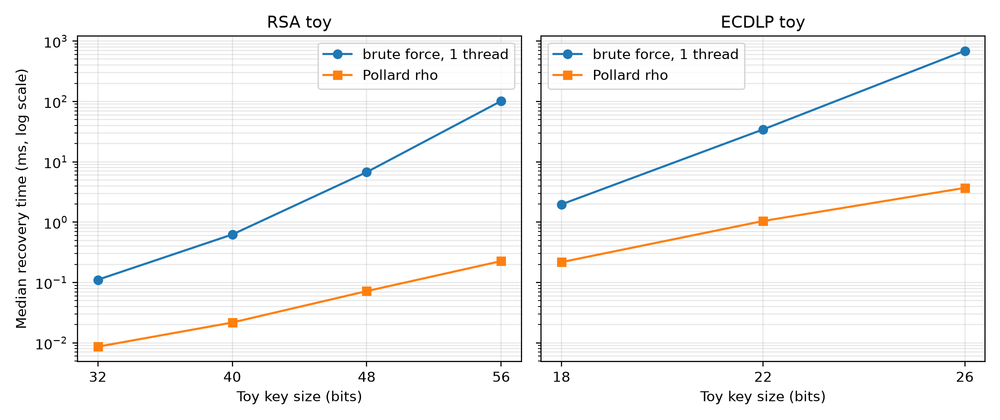

# 4.2 CPU/GPU Key-Recovery Benchmark

## 4.2.1 Bài toán và phương pháp

### RSA toy

Với modulus $n = p \cdot q$, benchmark tìm một ước không tầm thường bằng cách thử các ứng viên $6k - 1$ và $6k + 1$ từ nhỏ đến $\lfloor\sqrt{n}\rfloor$. Đây là brute force có lọc theo lớp đồng dư, không phải GNFS [[12]](references.md#ref-12). Không gian tìm kiếm là số ứng viên trong khoảng đã nêu; mỗi ứng viên được kiểm tra bằng $n \bmod d = 0$.

Nghiệm được xác nhận khi $p \cdot q = n$ và cả hai thừa số là số nguyên tố theo Miller-Rabin xác định. Benchmark chỉ chạy trên modulus 32, 40, 48 và 56 bit.

### ECDLP toy

Với đường cong $y^2 \equiv x^3 + ax + b \pmod{p}$, điểm cơ sở $G$ có bậc nguyên tố $q$, và khóa công khai $Q = dG$, benchmark tìm $d$ bằng cách duyệt $k = 1, 2, \ldots, q - 1$ và so sánh $kG$ với $Q$. Phép nhân vô hướng và phép cộng điểm dùng tọa độ Jacobian; mỗi bước chỉ cần một phép cộng điểm, không cần nghịch đảo trường. Nghiệm được xác nhận bằng $dG = Q$.

Ba đường cong 18, 22 và 26 bit được sinh ngẫu nhiên; bậc nhóm được đếm bằng ký hiệu Legendre và phân tích thành nhân tử để chọn nhóm con cấp nguyên tố. Tham số nằm trong `bench/config/curves.json`.

### Phạm vi lựa chọn

Benchmark chỉ đo RSA và ECDLP vì đây là hai bài toán cơ sở đại diện cho hai mô hình tính toán khác nhau: phân tích số nguyên và logarit rời rạc trên đường cong elliptic. RSA toy đo chi phí phân tích modulus, không đo riêng RSA-PSS; RSA-PSS chỉ là một cách dùng khóa RSA.

ECDSA, Ed25519 và SM2 đều dựa trên ECDLP. Phép nhân vô hướng là phần lõi chung của cả ba, nên kết quả ECDLP áp dụng cho chúng ở mức phép toán lõi; khác biệt chủ yếu nằm ở tham số đường cong, encoding và quy trình ký, không tạo ra bài toán khôi phục khóa mới.

ML-DSA dựa trên lattice (MLWE/MSIS), không có không gian khóa nhỏ để vét cạn theo cùng nghĩa. Đo ML-DSA cần benchmark riêng cho NTT, sampling và nén, không so sánh trực tiếp với RSA/ECDLP. Các thuật toán RSA-PSS, ECDSA P-256, Ed25519, SM2 và ML-DSA vẫn được kiểm tra correctness trong mục 4.1; mục 4.2 chỉ giới hạn ở đo hiệu năng khôi phục khóa. Phần 4.2.5 bổ sung so sánh CPU với Pollard rho; GPU chỉ được dùng cho brute force.

### Chế độ đo

- **Full scan:** duyệt toàn bộ không gian, dùng để tính tốc độ xử lý ứng viên.
- **Recovery:** chọn một khóa mục tiêu ngẫu nhiên, dừng khi tìm thấy, dùng để đo thời gian khôi phục.

Cấu hình phần cứng và phần mềm dùng chung với Bảng 4.1 ở mục 4.1. CPU dùng 1 và 12 luồng. GPU dùng block 256. Mỗi cấu hình có một lần warm-up và 10 lần đo; báo cáo trung vị, IQR, nhỏ nhất và lớn nhất. GPU dùng cùng không gian tìm kiếm và cùng tiêu chí xác nhận; CubeCL chỉ báo thời gian end-to-end sau warm-up, không tách thời gian kernel.

## 4.2.2 Kết quả CPU

### RSA toy

**Bảng 4.3. RSA toy - quét toàn bộ không gian**

| Bits | Không gian khóa | 1 luồng, trung vị (ms) | IQR (ms) | 12 luồng, trung vị (ms) | IQR (ms) | Tăng tốc | 1 luồng (triệu ứng viên/s) | 12 luồng (triệu ứng viên/s) |
|---|---|---|---|---|---|---|---|---|
| 32 | 16940 | 0.128 | 0.036 | 0.256 | 0.056 | 0.50 | 134.98 | 66.86 |
| 40 | 248744 | 0.472 | 0.173 | 0.307 | 0.107 | 1.54 | 527.78 | 835.05 |
| 48 | 4145928 | 6.792 | 0.288 | 1.393 | 0.017 | 4.88 | 618.06 | 2980.14 |
| 56 | 71706536 | 114.890 | 1.392 | 19.816 | 0.102 | 5.80 | 625.81 | 3618.70 |

**Bảng 4.4. RSA toy - thời gian khôi phục**

| Bits | Không gian khóa (xấp xỉ) | 1 luồng, trung vị (ms) | IQR (ms) | 12 luồng, trung vị (ms) | IQR (ms) | Tăng tốc |
|---|---|---|---|---|---|---|
| 32 | 16940 | 0.111 | 0.029 | 0.260 | 0.064 | 0.43 |
| 40 | 248744 | 0.624 | 0.136 | 0.277 | 0.033 | 2.25 |
| 48 | 4145928 | 6.745 | 0.452 | 1.237 | 0.126 | 5.45 |
| 56 | 71706536 | 101.680 | 20.051 | 17.457 | 3.431 | 5.82 |

*Hình 4.1. Trung vị thời gian khôi phục RSA toy với 1 và 12 luồng; trục tung dùng thang log.*

*Hình 4.2. Tốc độ xử lý ứng viên của RSA toy trong chế độ quét toàn bộ; trục tung dùng thang log.*

Ở chế độ quét toàn bộ, không gian khóa tăng khoảng $2^4$ lần khi thêm 4 bit modulus. Thời gian tăng gần tương ứng ở các kích thước lớn: từ 48 lên 56 bit, không gian tăng 17.3 lần và thời gian một luồng tăng 16.9 lần. Tốc độ một luồng đạt khoảng 618–626 triệu ứng viên/giây ở 48–56 bit; ở 32 bit, thời gian quá ngắn nên chi phí khởi động và đồng hồ làm tốc độ biểu kiến thấp hơn. Ở 40 bit, tốc độ một luồng đạt 527.78 triệu ứng viên/giây.

Với 12 luồng, tốc độ đạt khoảng 2.98–3.62 tỷ ứng viên/giây ở 48–56 bit, tương ứng tăng tốc 4.88–5.80 lần. Máy có 6 lõi vật lý và 12 luồng logic; phép chia 64-bit không hưởng nhiều từ siêu phân luồng, nên mức tăng tốc thấp hơn 12 lần là hợp lý. Ở 32 bit, 12 luồng còn chậm hơn 1 luồng do chi phí tạo luồng và đồng bộ lớn hơn thời gian tìm kiếm.

Trong chế độ khôi phục, thời gian phụ thuộc vị trí của thừa số nhỏ trong miền tìm kiếm. Vì vậy IQR lớn hơn nhiều so với chế độ quét toàn bộ, đặc biệt ở 56 bit (20.1 ms). Tỷ số tăng tốc ở 48–56 bit là 5.45–5.82 lần; các giá trị ở kích thước nhỏ bị chi phối bởi chi phí khởi động và vị trí khóa.

### ECDLP toy

**Bảng 4.5. ECDLP toy - quét toàn bộ không gian**

| $p$ bits | Không gian khóa | 1 luồng, trung vị (ms) | IQR (ms) | 12 luồng, trung vị (ms) | IQR (ms) | Tăng tốc | 1 luồng (triệu ứng viên/s) | 12 luồng (triệu ứng viên/s) |
|---|---|---|---|---|---|---|---|---|
| 18 | 81736 | 4.201 | 0.386 | 3.402 | 0.373 | 1.24 | 19.46 | 24.43 |
| 22 | 2609700 | 73.075 | 0.632 | 12.810 | 0.136 | 5.71 | 35.72 | 204.23 |
| 26 | 54518392 | 1445.353 | 4.276 | 248.731 | 0.585 | 5.81 | 37.72 | 219.26 |

**Bảng 4.6. ECDLP toy - thời gian khôi phục**

| $p$ bits | Không gian khóa | 1 luồng, trung vị (ms) | IQR (ms) | 12 luồng, trung vị (ms) | IQR (ms) | Tăng tốc |
|---|---|---|---|---|---|---|
| 18 | 81736 | 1.969 | 0.732 | 1.896 | 1.187 | 1.04 |
| 22 | 2609700 | 34.373 | 24.719 | 6.244 | 3.341 | 5.51 |
| 26 | 54518392 | 690.346 | 705.812 | 118.638 | 121.917 | 5.82 |

*Hình 4.3. Trung vị thời gian khôi phục ECDLP toy với 1 và 12 luồng; trục tung dùng thang log.*

*Hình 4.4. Tốc độ xử lý ứng viên của ECDLP toy trong chế độ quét toàn bộ; trục tung dùng thang log.*

Thời gian quét toàn bộ tăng theo bậc của nhóm con. Từ 18 lên 22 bit, không gian tăng 31.9 lần và thời gian một luồng tăng 17.4 lần; từ 22 lên 26 bit, không gian tăng 20.9 lần và thời gian tăng 19.8 lần. Tốc độ một luồng tăng từ 19.46 lên 37.72 triệu ứng viên/giây vì ở kích thước nhỏ, chi phí cố định của mỗi lần chạy chiếm tỷ trọng lớn.

Với 12 luồng, tốc độ đạt 204.23–219.26 triệu ứng viên/giây ở 22–26 bit. Mức tăng tốc 5.71–5.81 lần phù hợp với 6 lõi vật lý; ở 18 bit, thời gian quá ngắn nên tăng tốc chỉ 1.24 lần. Chế độ khôi phục có IQR lớn vì khóa mục tiêu nằm ở vị trí ngẫu nhiên; trung vị vẫn là thống kê phù hợp để so sánh, nhưng không nên dùng một lần chạy đơn lẻ.

*Hình 4.5. Tỷ số thời gian 1 luồng / 12 luồng cho RSA và ECDLP toy. Giá trị nhỏ hơn 1 ở kích thước nhỏ phản ánh chi phí song song lớn hơn thời gian tìm kiếm.*

## 4.2.3 Kết quả GPU

Mã GPU dùng CubeCL 0.11.3 [[13]](references.md#ref-13): kernel viết bằng Rust `#[cube]`, host Rust, chạy qua CUDA backend [[9]](references.md#ref-9) với `cudarc` [[10]](references.md#ref-10). Mỗi thread xử lý một ứng viên RSA hoặc một phép nhân vô hướng ECDLP; kết quả được xác nhận lại trên CPU bằng cùng tiêu chí với bản CPU. Trước mỗi phép đo, binary chạy một warm-up launch không tính giờ để loại chi phí JIT khỏi kết quả. Bảng 4.7 dùng số liệu CubeCL.

**Bảng 4.7. CubeCL GPU - thời gian và tăng tốc so với CPU 12 luồng**

| Case | Bits | Chế độ | GPU wall (ms) | CPU 12 luồng (ms) | GPU (triệu ứng viên/s) | Tăng tốc CPU/GPU |
|---|---|---|---|---|---|---|
| RSA | 32 | full | 0.069 | 0.256 | 308.20 | 3.69 |
| RSA | 40 | full | 0.081 | 0.307 | 3152.21 | 3.80 |
| RSA | 48 | full | 0.181 | 1.393 | 23302.33 | 7.70 |
| RSA | 56 | full | 2.171 | 19.816 | 33200.67 | 9.13 |
| RSA | 32 | recovery | 0.087 | 0.260 | - | 3.00 |
| RSA | 40 | recovery | 0.084 | 0.277 | - | 3.30 |
| RSA | 48 | recovery | 0.181 | 1.237 | - | 6.82 |
| RSA | 56 | recovery | 2.288 | 17.457 | - | 7.63 |
| ECDLP | 18 | full | 0.727 | 3.402 | 112.77 | 4.68 |
| ECDLP | 22 | full | 28.000 | 12.810 | 93.33 | 0.46 |
| ECDLP | 26 | full | 530.816 | 248.731 | 102.71 | 0.47 |
| ECDLP | 18 | recovery | 0.595 | 1.896 | - | 3.18 |
| ECDLP | 22 | recovery | 13.602 | 6.244 | - | 0.46 |
| ECDLP | 26 | recovery | 245.928 | 118.638 | - | 0.48 |

*Hình 4.6. Tỷ số thời gian CPU 12 luồng / GPU CubeCL cho RSA và ECDLP toy; trục tung dùng thang log. Giá trị nhỏ hơn 1 cho thấy GPU chậm hơn CPU.*

Với RSA, GPU nhanh hơn CPU ở mọi kích thước. Tăng tốc tăng từ 3.69 lần ở 32 bit lên 9.13 lần ở 56 bit trong chế độ quét toàn bộ; chế độ recovery cho 3.00–7.63 lần. Tốc độ GPU đạt từ 308.20 triệu ứng viên/giây ở 32 bit lên 33.20 tỷ ứng viên/giây ở 56 bit. Ở 32 bit, wall time 0.069 ms; phần lớn thời gian là phát động kernel và đọc kết quả, nhưng warm-up đã loại chi phí biên dịch JIT.

Với ECDLP, kết quả phụ thuộc mạnh vào cách cài đặt. GPU nhanh hơn CPU ở 18 bit (4.68 lần full, 3.18 lần recovery) nhưng chậm hơn ở 22 và 26 bit (0.46–0.47 lần full và 0.46–0.48 lần recovery). Nguyên nhân là GPU dùng một thread cho mỗi phép nhân vô hướng đầy đủ, còn CPU chỉ cộng thêm một điểm cho mỗi ứng viên kế tiếp. Ở 18 bit, chi phí cố định của CPU chiếm tỷ trọng lớn nên GPU có lợi; từ 22 bit, vòng lặp tăng dần của CPU hiệu quả hơn. Tốc độ GPU đạt 112.77, 93.33 và 102.71 triệu ứng viên/giây ở 18, 22 và 26 bit; CPU 12 luồng đạt 24.43, 204.23 và 219.26 triệu ứng viên/giây.

Độ phân tán của chế độ recovery phản ánh vị trí khóa mục tiêu. RSA recovery có IQR nhỏ (0.006–0.456 ms); ECDLP 26 bit có IQR 259.51 ms vì khóa mục tiêu nằm ở vị trí ngẫu nhiên trong không gian 54.5 triệu khóa.

CubeCL không tách riêng thời gian kernel trong host path này; cột GPU wall là thời gian end-to-end sau warm-up. Phép so sánh CPU/GPU là so sánh giữa hai cách cài đặt khác nhau, không chỉ khác phần cứng. CPU chịu chi phí tạo luồng; GPU chịu chi phí phát động kernel và trao đổi bộ nhớ. Vì vậy các tỷ số trong Bảng 4.7 chỉ có ý nghĩa cho đúng bài toán toy, đúng kích thước và đúng cài đặt đã đo.

## 4.2.4 Thảo luận

### Brute force toy không phải tấn công tốt nhất

Với RSA, phép thử trong mục này có chi phí xấp xỉ $\sqrt{n} = 2^{b/2}$ ứng viên. GNFS có độ phức tạp dưới mũ và là hướng tấn công thực tế quan trọng hơn nhiều đối với modulus lớn [[8]](references.md#ref-8), [[12]](references.md#ref-12). Với ECDLP, brute force có chi phí $O(q)$; Pollard’s rho có chi phí kỳ vọng $O(\sqrt{q})$ [[8]](references.md#ref-8), [[11]](references.md#ref-11). Vì vậy số đo toy không mô tả chi phí tấn công tốt nhất và không được dùng để suy ra thời gian phá khóa chuẩn.

### Giới hạn của phép đo

- Đường cong toy nhỏ, không phải đường cong chuẩn; kết quả chỉ phản ánh chi phí duyệt trên không gian đã chọn.
- Máy đo là laptop; tần số CPU thay đổi theo nhiệt độ và chính sách năng lượng. Không ghim CPU; warm-up, 10 lần đo và trung vị/IQR được dùng để giảm ảnh hưởng.
- Chế độ recovery có độ phân tán lớn vì vị trí khóa mục tiêu thay đổi. So sánh 1 luồng và 12 luồng trong chế độ này chỉ mang tính xu hướng.
- GPU chỉ được đo với block 256; chưa tối ưu block size, số block hay cách ánh xạ ứng viên. CPU và GPU dùng cách cài đặt khác nhau, nên tỷ số tăng tốc không phải so sánh thuần phần cứng.
- Pollard rho chỉ được đo trên CPU; GPU rho không được benchmark vì lý do ở 4.2.5.
- GNFS không được benchmark; với modulus toy, rho/Brent phù hợp hơn.
- Kết quả CubeCL gắn với phiên bản 0.11.3, CUDA backend, driver 615.78.08 và GPU RTX 4050 Laptop; chưa kiểm tra portability sang GPU khác.
- CPU và GPU được đo trên nguồn AC. Trạng thái nguồn có thể ảnh hưởng tần số và kết quả giữa các phiên.
- Kết quả correctness C1–C8 chỉ xác nhận thư viện hoạt động đúng, không phải benchmark hiệu năng.

## 4.2.5 So sánh với Pollard rho

Brute force ở 4.2.2–4.2.3 chỉ là baseline. Với cùng tham số toy, mục này đo thêm Pollard rho trên CPU: Brent rho cho phân tích RSA [[14]](references.md#ref-14), [[15]](references.md#ref-15) và rho với Floyd cycle detection cho ECDLP [[11]](references.md#ref-11). Chi phí kỳ vọng là $O(\sqrt{p})$ cho RSA và $O(\sqrt{q})$ cho ECDLP; với modulus cân bằng, $p \approx \sqrt{n}$ nên RSA rho là $O(n^{1/4})$. Cả hai dùng cùng vector và cùng tiêu chí xác nhận; mỗi cấu hình chạy 10 seed, báo trung vị số bước, thời gian và tỷ lệ thành công. Pollard rho là thuật toán xác suất nên kết quả có phân tán; số bước là thước đo ổn định hơn thời gian ở các cấu hình nhỏ.

**Bảng 4.8. Pollard rho CPU so với brute force 1 luồng**

| Case | Bits | Rho steps | Rho (ms) | Brute 1T (ms) | Tăng tốc thời gian | Giảm bước | Thành công |
|---|---|---|---|---|---|---|---|
| RSA | 32 | 520 | 0.009 | 0.111 | 12.86 | 30.7 | 1.00 |
| RSA | 40 | 1662 | 0.022 | 0.624 | 28.72 | 148.8 | 1.00 |
| RSA | 48 | 6462 | 0.072 | 6.745 | 93.69 | 612.6 | 1.00 |
| RSA | 56 | 25278 | 0.227 | 101.680 | 448.81 | 2505.2 | 1.00 |
| ECDLP | 18 | 1286 | 0.217 | 1.969 | 9.05 | 27.5 | 1.00 |
| ECDLP | 22 | 7626 | 1.044 | 34.373 | 32.92 | 166.5 | 1.00 |
| ECDLP | 26 | 27332 | 3.696 | 690.346 | 186.78 | 956.5 | 1.00 |

*Hình 4.7. Trung vị thời gian khôi phục CPU 1 luồng của brute force và Pollard rho; trục tung dùng thang log.*

Pollard rho giảm số bước từ 27.5 lần ở ECDLP 18 bit đến 2505 lần ở RSA 56 bit. Thời gian nhanh hơn brute force 1 luồng 9.05–448.81 lần. So với GPU brute-force recovery ở Bảng 4.7, CPU rho còn nhanh hơn 10.1 lần ở RSA 56 bit và 66.5 lần ở ECDLP 26 bit. Kết quả này cho thấy lựa chọn thuật toán quan trọng hơn việc tăng năng lực brute force.

Không benchmark GPU rho trong mục này. Pollard rho là một walk có phụ thuộc tuần tự; song song hóa cần nhiều walk, distinguished points và phát hiện collision (parallel collision search [[16]](references.md#ref-16)), khác mô hình mỗi thread xử lý một candidate độc lập của kernel brute force. Ở toy size, rho chỉ cần khoảng 0.5–25 nghìn bước; chi phí launch và đồng bộ GPU sẽ lớn hơn phần tính toán. Muốn GPU rho có ý nghĩa phải tăng kích thước lên khoảng ECDLP 40+ bit hoặc RSA 80+ bit, vượt giới hạn generator hiện tại (point counting $O(p)$, tối đa 28 bit) và cần arithmetic/curve generation khác. Vì vậy GPU chỉ được giữ làm baseline brute force; so sánh thuật toán được thực hiện trên CPU.

GNFS không được đưa vào benchmark. Với modulus 32–56 bit, GNFS có overhead lớn và không cạnh tranh với rho/Brent [[12]](references.md#ref-12); cài đặt đầy đủ cũng nằm ngoài phạm vi. GNFS chỉ có lợi ở modulus lớn hơn nhiều, khi đó bài toán không còn là toy và cần arithmetic cùng linear algebra khác.

## 4.2.6 Giả định và câu hỏi rà soát

Giả định:

- Các modulus và đường cong là toy, sinh cố định từ seed; không đại diện cho khóa chuẩn.
- CPU và GPU được đo trên cùng máy, nguồn AC, không ghim CPU; mỗi cấu hình có 10 lần đo và dùng trung vị/IQR.
- CubeCL chỉ báo wall time; không có số đo kernel-only.
- Pollard rho là thuật toán xác suất; trung vị trên 10 seed là thước đo chính, số restart được ghi lại.
- Generator đếm điểm trực tiếp nên giới hạn ở 28 bit; chưa dùng đường cong chuẩn có bậc biết trước.

Câu hỏi cần thành viên thuật toán rà soát:

1. Giữ brute force làm baseline phần cứng và dùng rho làm baseline thuật toán? Đề xuất: có.
2. Có cần mở rộng ECDLP lên 32–40 bit bằng đường cong có bậc biết trước? Đề xuất: chỉ làm khi có nguồn đường cong tin cậy; generator hiện tại không đáp ứng.
3. Có cần benchmark GPU rho? Đề xuất: không trong scope này; lý do ở 4.2.5.
4. Có cần đo rho với 12 luồng? Đề xuất: không; parallel rho cần distinguished points và phát hiện collision, khác mô hình hiện tại.
5. Có cần GNFS/QS cho RSA toy? Đề xuất: không; với 32–56 bit, rho/Brent phù hợp hơn và GNFS nằm ngoài scope.

## 4.2.7 Kết luận của mục

Trong phạm vi tham số toy, thời gian khôi phục tăng nhanh khi tăng kích thước khóa. RSA toy tăng gần theo $2^{b/2}$; ECDLP toy tăng gần theo bậc của nhóm con. Song song hóa bằng 12 luồng cho mức tăng tốc khoảng 4.88–5.82 lần ở các kích thước đủ lớn, phù hợp với 6 lõi vật lý của máy. GPU CubeCL nhanh hơn CPU brute force cho RSA (3.69–9.13 lần full; 3.00–7.63 lần recovery) và ECDLP 18 bit (4.68 lần full; 3.18 lần recovery), nhưng chậm hơn cho ECDLP 22–26 bit do mỗi thread GPU thực hiện nhân vô hướng đầy đủ, trong khi CPU chỉ cộng điểm mỗi ứng viên. Pollard rho CPU giảm số bước 27.5–2505 lần và nhanh hơn brute force 1 luồng 9.05–448.81 lần; so với GPU brute-force recovery, rho CPU còn nhanh hơn 10.1 lần ở RSA 56 bit và 66.5 lần ở ECDLP 26 bit. Vì vậy GPU brute force không đại diện cho chi phí tấn công tốt nhất. Các kết quả này cho thấy lựa chọn thuật toán quan trọng hơn nền tảng; chúng không chứng minh khả năng phá khóa chuẩn và không thay thế phân tích GNFS, đánh giá Pollard’s rho ở tham số chuẩn hay tấn công nonce/lỗi triển khai.

## Tài liệu tham khảo của mục

Các trích dẫn [1]–[16] được liệt kê trong [`references.md`](references.md).
