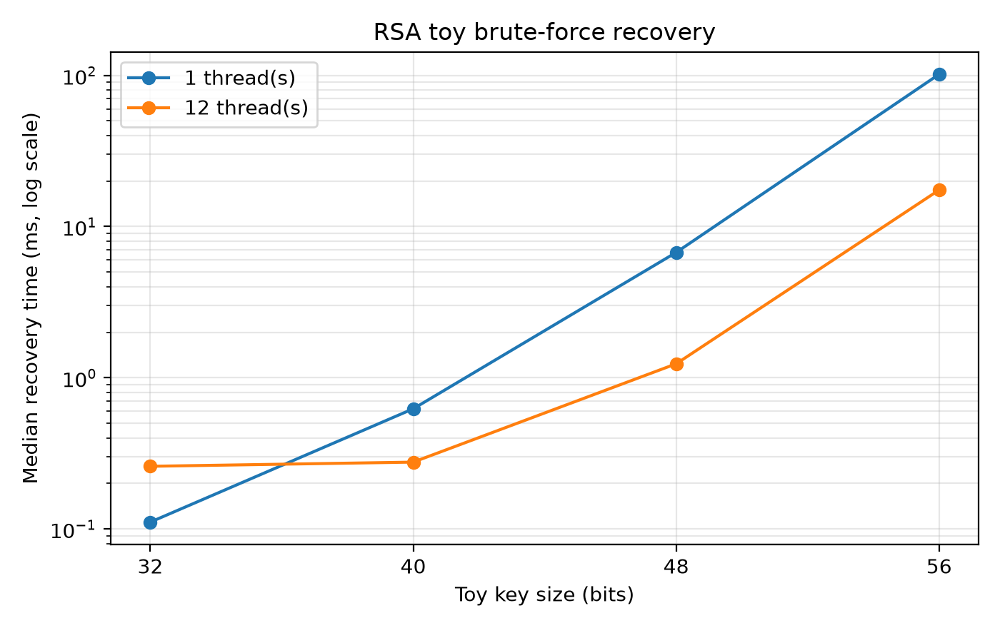
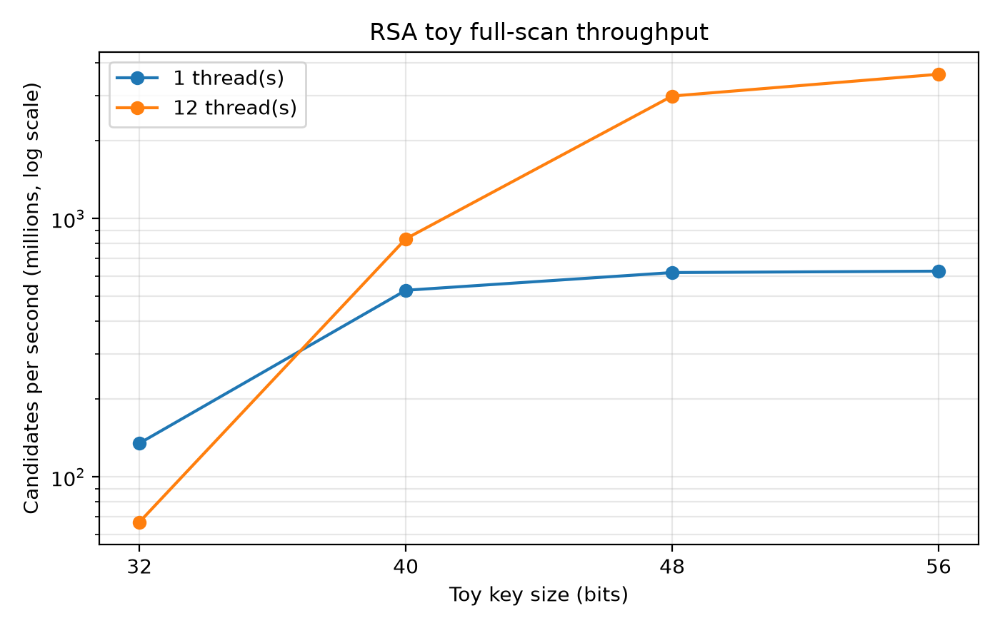
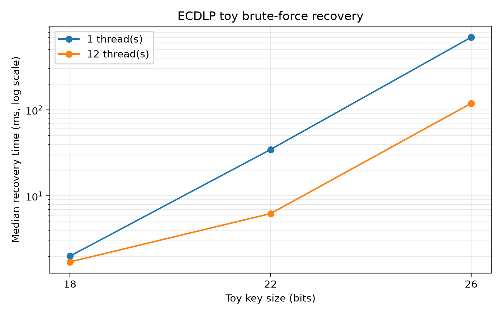
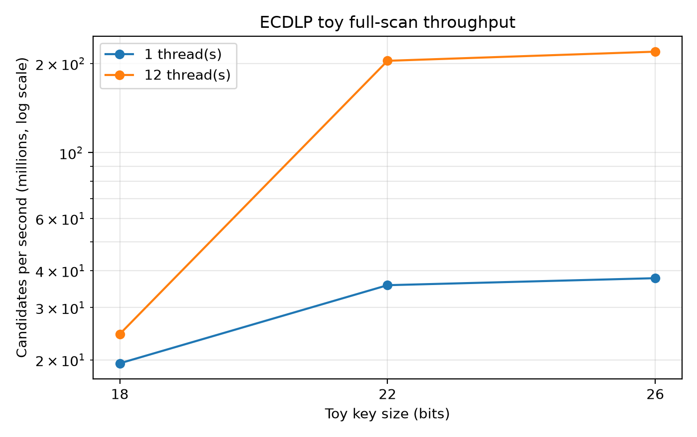
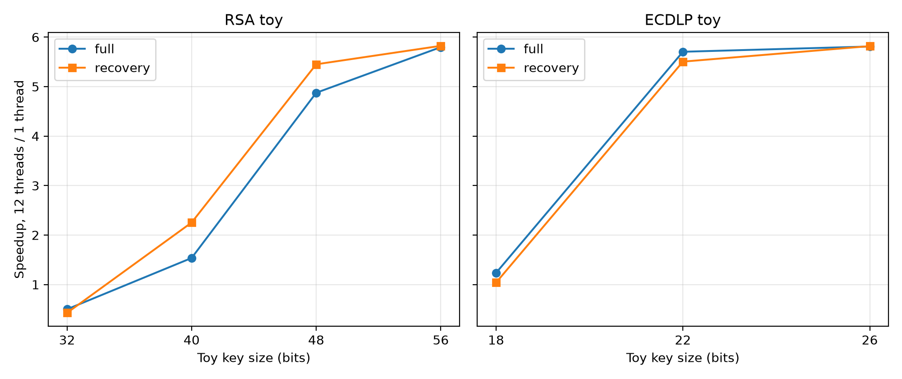
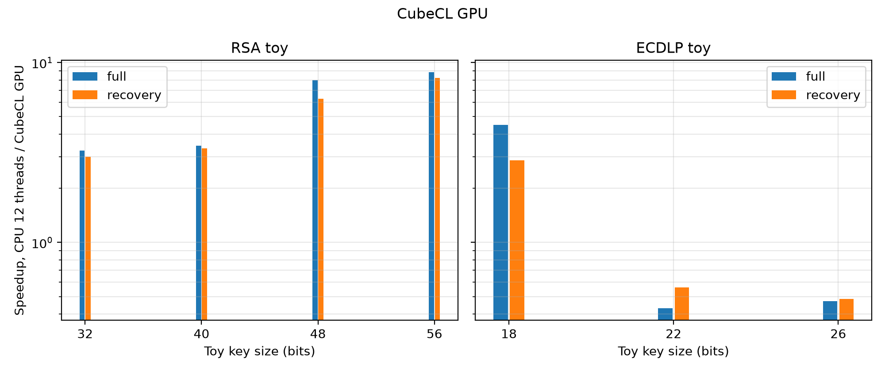
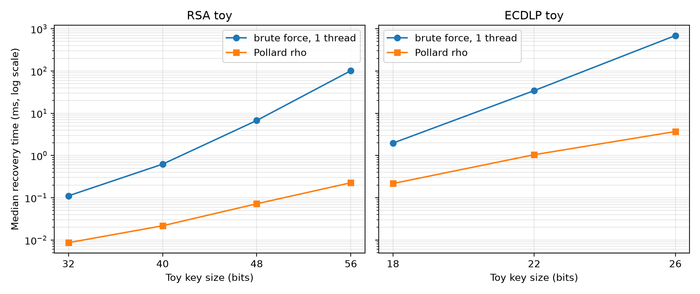

# 4.2 CPU/GPU Key-Recovery Benchmark

## 4.2.1 Problems and Methods

### Toy RSA

For each modulus $n=pq$, the baseline searches for a non-trivial factor by testing $6k-1$ and $6k+1$ candidates up to $\lfloor\sqrt n\rfloor$. This filtered trial division is not the General Number Field Sieve (GNFS) [12]. A candidate is accepted only when $pq=n$ and both factors pass deterministic Miller-Rabin validation. The measured moduli are 32, 40, 48, and 56 bits.

### Toy ECDLP

Given $y^2\equiv x^3+ax+b\pmod p$, a base point $G$ of prime order $q$, and $Q=dG$, the exhaustive baseline enumerates $k=1,2,\ldots,q-1$ until $kG=Q$. Jacobian coordinates are used, and the sequential CPU path advances to the next candidate with point addition. A recovered value is accepted only when $dG=Q$.

The 18-, 22-, and 26-bit curves were generated specifically for this benchmark. Their parameters are stored in `bench/config/curves.json`.

### Selection Boundary

RSA and ECDLP represent two different recovery models: integer factorization and elliptic-curve discrete logarithms. The RSA experiment concerns the modulus and not RSA-PSS padding. ECDSA, Ed25519, and SM2 all depend on ECDLP, but their standard curves, encodings, hashes, and signature equations differ; the toy curves do not reproduce those standardized systems.

ML-DSA is based on module-lattice problems rather than a scalar search space. Meaningful ML-DSA performance work would measure operations such as the number-theoretic transform, sampling, and packing, while cryptanalysis would use lattice-specific cost models. It is therefore excluded from the RSA/ECDLP recovery benchmark. Section 4.1 nevertheless includes correctness cases for every selected signature family.

Two modes are reported: a full scan for candidate throughput and a recovery scan that stops at the target. CPU trials use one and 12 threads; GPU trials use blocks of 256. Each configuration has one warm-up and ten recorded measurements, summarized by median and IQR.

## 4.2.2 CPU Results

### Toy RSA

**Table 4.3. Toy RSA full-space scan**

| Bits | Search space | 1 thread median (ms) | IQR (ms) | 12 threads median (ms) | IQR (ms) | Speedup | 1 thread (million candidates/s) | 12 threads (million candidates/s) |
|---|---|---|---|---|---|---|---|---|
| 32 | 16940 | 0.128 | 0.036 | 0.256 | 0.056 | 0.50 | 134.98 | 66.86 |
| 40 | 248744 | 0.472 | 0.173 | 0.307 | 0.107 | 1.54 | 527.78 | 835.05 |
| 48 | 4145928 | 6.792 | 0.288 | 1.393 | 0.017 | 4.88 | 618.06 | 2980.14 |
| 56 | 71706536 | 114.890 | 1.392 | 19.816 | 0.102 | 5.80 | 625.81 | 3618.70 |

**Table 4.4. Toy RSA recovery time**

| Bits | Approximate search space | 1 thread median (ms) | IQR (ms) | 12 threads median (ms) | IQR (ms) | Speedup |
|---|---|---|---|---|---|---|
| 32 | 16940 | 0.111 | 0.029 | 0.260 | 0.064 | 0.43 |
| 40 | 248744 | 0.624 | 0.136 | 0.277 | 0.033 | 2.25 |
| 48 | 4145928 | 6.745 | 0.452 | 1.237 | 0.126 | 5.45 |
| 56 | 71706536 | 101.680 | 20.051 | 17.457 | 3.431 | 5.82 |

*Figure 4.1. Median toy RSA recovery time with one and 12 CPU threads; the vertical axis uses a logarithmic scale.*

*Figure 4.2. Candidate throughput for the toy RSA full scan; the vertical axis uses a logarithmic scale.*

At the larger sizes, full-scan time grows approximately with the candidate space. From 48 to 56 bits, the space grows by 17.3 times and one-thread time by 16.9 times. One-thread throughput stabilizes near 618-626 million candidates/s at 48-56 bits. The 32-bit measurement is dominated by startup and timer overhead.

At 48-56 bits, 12 threads reach 2.98-3.62 billion candidates/s and provide 4.88-5.80 times full-scan speedup. The laptop has six physical cores and 12 logical threads, and integer division does not scale linearly with simultaneous multithreading. At 32 bits, thread-management overhead exceeds the search time. Recovery IQR is larger because the smaller factor occupies a different position in each search.

### Toy ECDLP

**Table 4.5. Toy ECDLP full-space scan**

| $p$ bits | Search space | 1 thread median (ms) | IQR (ms) | 12 threads median (ms) | IQR (ms) | Speedup | 1 thread (million candidates/s) | 12 threads (million candidates/s) |
|---|---|---|---|---|---|---|---|---|
| 18 | 81736 | 4.201 | 0.386 | 3.402 | 0.373 | 1.24 | 19.46 | 24.43 |
| 22 | 2609700 | 73.075 | 0.632 | 12.810 | 0.136 | 5.71 | 35.72 | 204.23 |
| 26 | 54518392 | 1445.353 | 4.276 | 248.731 | 0.585 | 5.81 | 37.72 | 219.26 |

**Table 4.6. Toy ECDLP recovery time**

| $p$ bits | Search space | 1 thread median (ms) | IQR (ms) | 12 threads median (ms) | IQR (ms) | Speedup |
|---|---|---|---|---|---|---|
| 18 | 81736 | 1.969 | 0.732 | 1.896 | 1.187 | 1.04 |
| 22 | 2609700 | 34.373 | 24.719 | 6.244 | 3.341 | 5.51 |
| 26 | 54518392 | 690.346 | 705.812 | 118.638 | 121.917 | 5.82 |

*Figure 4.3. Median toy ECDLP recovery time with one and 12 CPU threads; the vertical axis uses a logarithmic scale.*

*Figure 4.4. Candidate throughput for the toy ECDLP full scan; the vertical axis uses a logarithmic scale.*

Full-scan time grows with subgroup order. From 18 to 22 bits, the search space grows 31.9 times and one-thread time 17.4 times; from 22 to 26 bits, the space grows 20.9 times and time 19.8 times. The apparent throughput improvement from 19.46 to 37.72 million candidates/s reflects the decreasing proportion of fixed overhead at larger sizes.

At 22-26 bits, 12 threads reach 204.23-219.26 million candidates/s and provide 5.71-5.81 times speedup. The 18-bit job is too short to amortize parallel overhead. Recovery IQR is large because target position is random; medians are therefore more meaningful than individual runs.

*Figure 4.5. Ratio of one-thread time to 12-thread time for toy RSA and ECDLP. Values below one at the smallest sizes show that parallel overhead exceeds useful work.*

## 4.2.3 GPU Results

The CubeCL 0.11.3 implementation [13] uses Rust kernels, the CUDA backend [9], and `cudarc` [10]. Each GPU thread tests one RSA candidate or performs one ECDLP scalar multiplication. The host validates a reported result with the same criteria as the CPU implementation. One warm-up launch excludes JIT compilation from the recorded wall time.

**Table 4.7. CubeCL GPU time and speedup relative to 12 CPU threads**

| Case | Bits | Mode | GPU wall (ms) | 12-thread CPU (ms) | GPU (million candidates/s) | CPU/GPU speedup |
|---|---|---|---|---|---|---|
| RSA | 32 | full | 0.069 | 0.256 | 308.20 | 3.69 |
| RSA | 40 | full | 0.081 | 0.307 | 3152.21 | 3.80 |
| RSA | 48 | full | 0.181 | 1.393 | 23302.33 | 7.70 |
| RSA | 56 | full | 2.171 | 19.816 | 33200.67 | 9.13 |
| RSA | 32 | recovery | 0.087 | 0.260 | - | 3.00 |
| RSA | 40 | recovery | 0.084 | 0.277 | - | 3.30 |
| RSA | 48 | recovery | 0.181 | 1.237 | - | 6.82 |
| RSA | 56 | recovery | 2.288 | 17.457 | - | 7.63 |
| ECDLP | 18 | full | 0.727 | 3.402 | 112.77 | 4.68 |
| ECDLP | 22 | full | 28.000 | 12.810 | 93.33 | 0.46 |
| ECDLP | 26 | full | 530.816 | 248.731 | 102.71 | 0.47 |
| ECDLP | 18 | recovery | 0.595 | 1.896 | - | 3.18 |
| ECDLP | 22 | recovery | 13.602 | 6.244 | - | 0.46 |
| ECDLP | 26 | recovery | 245.928 | 118.638 | - | 0.48 |

*Figure 4.6. Ratio of 12-thread CPU time to CubeCL GPU time for toy RSA and ECDLP; values below one mean that the GPU implementation is slower.*

For toy RSA, GPU speedup rises from 3.69 to 9.13 times in full scans and from 3.00 to 7.63 times in recovery. Full-scan throughput reaches 33.20 billion candidates/s at 56 bits. At 32 bits, launch and result-transfer overhead make up much of the 0.069 ms wall time even after JIT warm-up.

ECDLP behavior differs because the GPU performs a complete scalar multiplication per candidate while the CPU advances with one point addition. The GPU is faster only at 18 bits; at 22 and 26 bits, the 12-thread CPU requires approximately 46-48% of the GPU time. This is an implementation result, not evidence that GPUs are generally unsuitable for ECDLP or that one hardware platform changes the asymptotic attack cost.

CubeCL reports end-to-end wall time rather than kernel-only time. CPU thread creation, GPU launch, and memory transfer are all included, so Table 4.7 compares complete implementations for the specified toy cases.

## 4.2.4 Interpretation and Limits

### Exhaustive Search Is Not the Best Cryptanalytic Baseline

The toy RSA search performs approximately $\sqrt n=2^{b/2}$ candidate tests. GNFS has sub-exponential complexity and is the relevant large-modulus factorization method [8], [12]. The toy ECDLP brute-force path costs $O(q)$, while Pollard's rho has expected cost $O(\sqrt q)$ [8], [11]. The exhaustive measurements therefore do not represent the best known cryptanalytic cost and must not be used to estimate recovery time for standard keys.

### Measurement Limits

- The curves and moduli are deliberately small and non-standard.
- CPU frequency was not pinned and can vary with heat, scheduling, and power policy.
- Recovery time varies with target position; one-thread/12-thread comparisons in that mode show a trend rather than a deterministic ratio.
- Only GPU block size 256 was measured, and the CPU and GPU ECDLP implementations use different candidate-update strategies.
- Pollard's rho was measured only on CPU; GPU rho needs a different parallel-collision design.
- GNFS was not implemented because its overhead is inappropriate for 32-56-bit toy moduli.
- Results are specific to CubeCL 0.11.3, its CUDA backend, driver 615.78.08, and the RTX 4050 Laptop GPU.
- Correctness cases C1-C8 are not performance measurements.

## 4.2.5 Pollard-Rho Comparison

The exhaustive implementation is retained as a hardware baseline. A second CPU experiment measures Brent's rho for toy RSA factorization [14], [15] and Floyd-cycle Pollard rho for ECDLP [11]. Expected work is $O(\sqrt p)$ for finding a toy RSA factor and $O(\sqrt q)$ for ECDLP; for balanced $n=pq$, the former is approximately $O(n^{1/4})$. Each configuration uses ten seeds and reports median steps, time, and success rate.

**Table 4.8. CPU Pollard rho compared with one-thread exhaustive recovery**

| Case | Bits | Rho steps | Rho (ms) | Brute force 1T (ms) | Time speedup | Step reduction | Success rate |
|---|---|---|---|---|---|---|---|
| RSA | 32 | 520 | 0.009 | 0.111 | 12.86 | 30.7 | 1.00 |
| RSA | 40 | 1662 | 0.022 | 0.624 | 28.72 | 148.8 | 1.00 |
| RSA | 48 | 6462 | 0.072 | 6.745 | 93.69 | 612.6 | 1.00 |
| RSA | 56 | 25278 | 0.227 | 101.680 | 448.81 | 2505.2 | 1.00 |
| ECDLP | 18 | 1286 | 0.217 | 1.969 | 9.05 | 27.5 | 1.00 |
| ECDLP | 22 | 7626 | 1.044 | 34.373 | 32.92 | 166.5 | 1.00 |
| ECDLP | 26 | 27332 | 3.696 | 690.346 | 186.78 | 956.5 | 1.00 |

*Figure 4.7. Median one-thread CPU recovery time for exhaustive search and Pollard rho; the vertical axis uses a logarithmic scale.*

Pollard rho reduces the measured step count by 27.5-2505.2 times and time by 9.05-448.81 times. It is also 10.1 times faster than GPU brute-force recovery for the 56-bit RSA case and 66.5 times faster for the 26-bit ECDLP case. Within this toy experiment, attack-algorithm choice dominates additional brute-force hardware.

GPU rho was not measured. A useful parallel design requires multiple walks, distinguished points, and collision detection [16], rather than one independent candidate per thread. At the tested sizes, the CPU walk takes only hundreds to tens of thousands of steps, so GPU synchronization and launch overhead would dominate. Increasing the curves sufficiently would also exceed the current point-counting generator's practical limit.

## 4.2.6 Review Assumptions

- Every modulus, curve, and key is a deterministic toy vector rather than a standardized key.
- CPU and GPU trials ran on the same AC-powered laptop; CPU affinity was not pinned.
- GPU measurements are end-to-end wall times.
- Pollard rho is probabilistic; medians over ten seeds and the recorded success rate are the primary evidence.
- Direct point counting limits the current curve generator to approximately 28 bits.
- Exhaustive search remains only a hardware baseline; Pollard rho is the algorithmic baseline for the measured toy cases.

## 4.2.7 Section Conclusion

For the selected toy parameters, recovery time increases rapidly with search-space size. Twelve CPU threads provide approximately 4.88-5.82 times speedup once the work is large enough to amortize overhead. The CubeCL GPU accelerates the exhaustive RSA baseline and the 18-bit ECDLP case but is slower than the incremental CPU ECDLP implementation at 22 and 26 bits. CPU Pollard rho then reduces time by 9.05-448.81 times relative to one-thread exhaustive recovery.

These results demonstrate scaling, overhead, and the importance of algorithm selection. They do not show that RSA-2048, RSA-4096, P-256, Ed25519, or SM2 can be recovered on the tested hardware, and they do not replace GNFS analysis, standard-parameter Pollard-rho estimates, or implementation-specific nonce and side-channel analysis.
