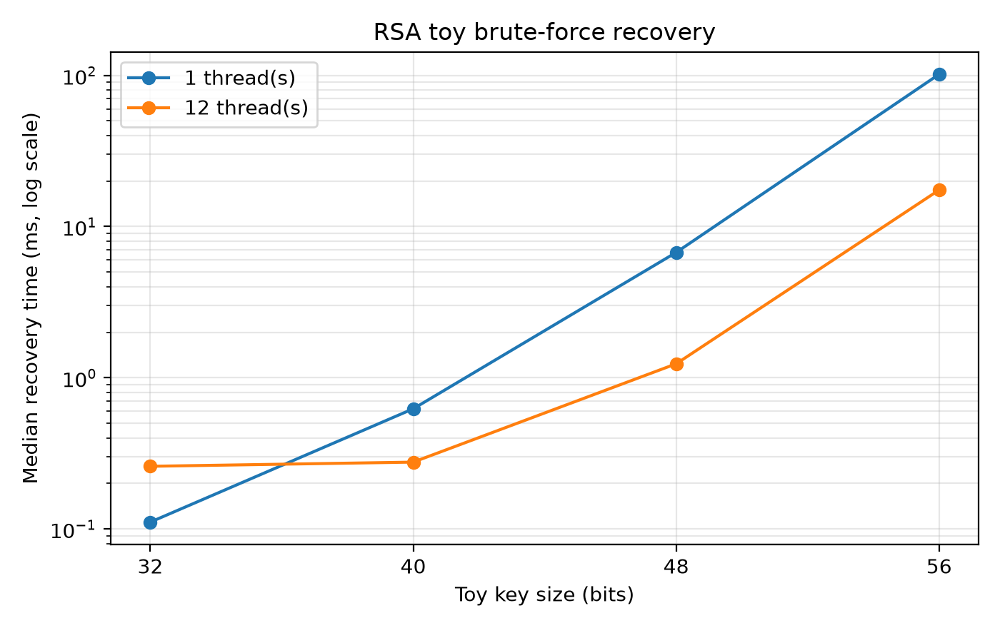
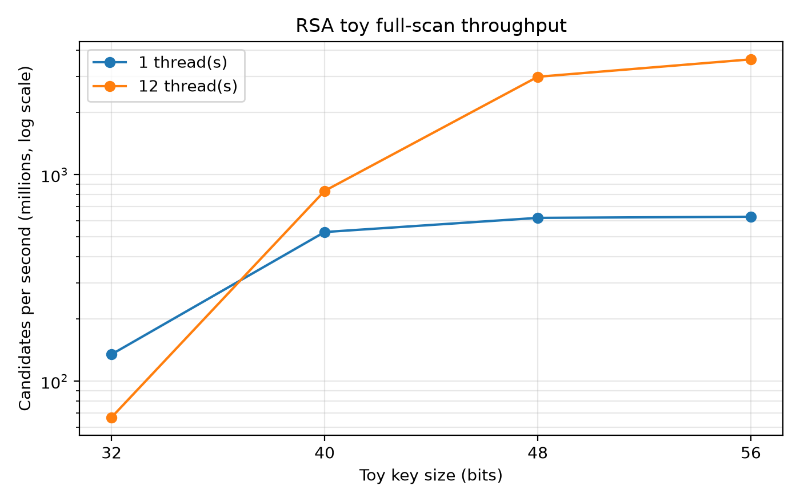
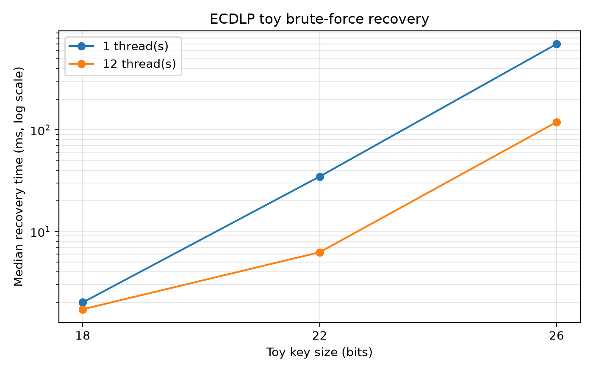
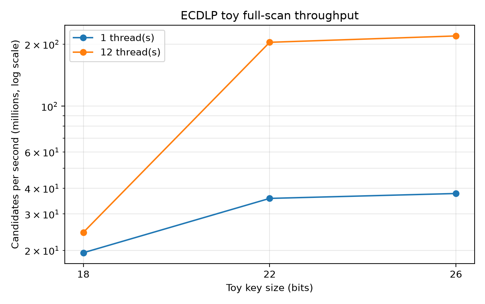
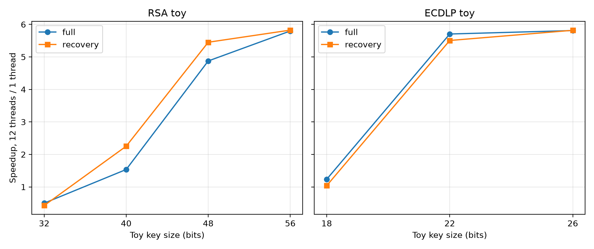
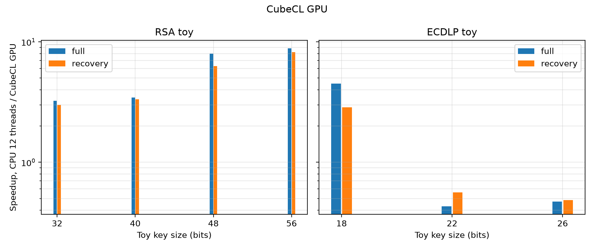
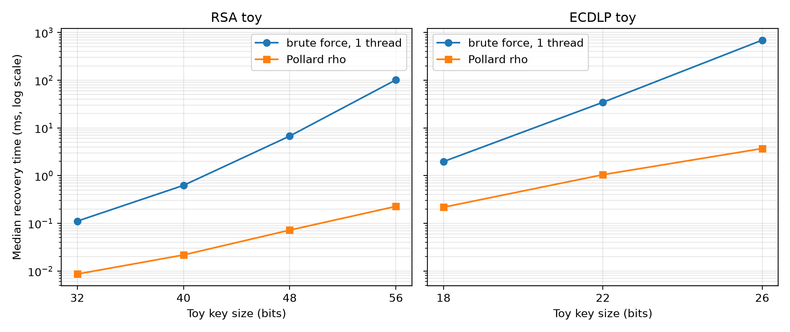

# Digital Signature Algorithms and Their Resistance to Attacks in Banking

> Consolidated review draft<br>
> University: [To be completed]<br>
> Faculty/Department: [To be completed]<br>
> Course: [To be completed]<br>
> Lecturer: [To be completed]<br>
> Group: [To be completed]<br>
> Date: [To be completed]

## Team members

| Member | Assigned contribution |
|---|---|
| Hoàng Thu An | Ed25519 |
| Nguyễn Tiến Đạt | SM2 |
| Vũ Minh Hoàng | RSA-PSS and ML-DSA |
| Nguyễn Hoàng Minh | ECDSA; coordination of Introduction, Conclusion, and References |
| Nguyễn Văn Đức | Banking workflow |
| Nguyễn Quang Vũ Hoàng | Testing and performance implementation |
| Nguyễn Hoàng Anh | Introduction, testing analysis, Conclusion, References, and report integration |

## Table of contents

1. [Introduction](#1-introduction)
2. [Cryptographic Algorithms](#2-cryptographic-algorithms)
   - [2.1 Ed25519](#21-ed25519)
   - [2.2 SM2](#22-sm2)
   - [2.3 RSA-2048 and RSA-4096 (RSA-PSS)](#23-rsa-2048-and-rsa-4096-rsa-pss)
   - [2.4 ECDSA](#24-ecdsa)
   - [2.5 Post-Quantum Cryptography — ML-DSA](#25-post-quantum-cryptography--ml-dsa)
3. [Mechanism of Operation — Banking Workflow](#3-mechanism-of-operation--banking-workflow)
4. [Testing and Performance Analysis](#4-testing-and-performance-analysis)
   - [4.1 Test Cases and Experimental Setup](#41-test-cases-and-experimental-setup)
   - [4.2 CPU/GPU Key-Recovery Benchmark](#42-cpugpu-key-recovery-benchmark)
   - [4.3 Quantum Computer — Theoretical Analysis](#43-quantum-computer--theoretical-analysis)
5. [Conclusion and Future Work](#5-conclusion-and-future-work)
6. [References](#6-references)

---

# 1 Introduction

Digital banking depends on messages that cause consequential and often irreversible actions: transferring funds, approving payment batches, updating beneficiary details, issuing certificates, and recording settlement decisions. These messages must remain attributable to an authorized signer and must not be altered without detection. A digital signature addresses this requirement by binding a private signing key to a specific message representation. When the surrounding identity, certificate, key-management, and audit processes are trustworthy, a verified signature supports data integrity, signatory authentication, and evidence that can be used in non-repudiation procedures [1].

A signature algorithm is nevertheless only one component of transaction security. It does not encrypt the transaction, authenticate the human requester, decide whether the requester is authorized, prevent replay of an authentic message, apply fraud or sanctions controls, or protect a private key that is exposed in application memory. A banking design must therefore combine signatures with canonical message construction, certificate and key lifecycle management, protected cryptographic modules, authenticated transport, authorization policy, replay detection, business validation, and auditable acceptance or rejection paths.

## 1.1 Motivation

The security of a digital signature depends on more than the nominal algorithm name or key length. Each scheme relies on a mathematical problem and a set of implementation assumptions. RSA-PSS depends on the difficulty of inverting RSA without the private key and is closely related to integer factorization; ECDSA, Ed25519, and SM2 rely on elliptic-curve discrete logarithms; ML-DSA relies on structured module-lattice problems [1], [2]. These foundations lead to different key and signature sizes, attack models, implementation requirements, and migration risks.

Several failure modes can bypass the intended mathematical security without solving the underlying hard problem. Weak key generation may produce predictable private keys. In ECDSA and SM2, reuse, bias, or leakage of the per-message nonce can reveal the long-term private key. Incorrect point validation, non-canonical encodings, side-channel leakage, and fault injection can compromise elliptic-curve implementations. RSA deployments can fail through weak prime generation, incorrect padding configuration, or faults in optimized private-key operations. Post-quantum signatures avoid the specific factoring and discrete-logarithm threat posed by Shor's algorithm, but they still depend on parameter selection, implementation quality, key protection, and evolving cryptanalysis.

Key management is therefore inseparable from algorithm analysis. NIST SP 800-57 treats generation, distribution, storage, access, cryptoperiod, backup, revocation, compromise recovery, and destruction as parts of the key lifecycle [3]. Cryptographic modules add controls for roles, authentication, sensitive parameters, self-tests, physical protection, and attack mitigation [4]. In a banking environment, these controls matter because a mathematically valid signature created by a stolen or misused key can still authorize an invalid financial instruction.

The signed data must also have an invariant interpretation. Hashing and signing operate on bytes, while banking applications exchange structured fields. Different field ordering, number formatting, character encoding, or omission of transaction context can cause verification failures or allow one byte sequence to be interpreted in unintended ways. Canonicalization schemes address this problem by producing a deterministic representation for hashing and signing [5]. The signature should bind the transaction identifier, accounts, amount, currency, timestamp, replay-prevention value, purpose, and relevant approval context. Even then, a valid signature must be followed by certificate validation, replay checks, authorization, fraud screening, and business-rule enforcement.

The report also considers two changes in computing capability. First, conventional CPU and GPU parallelism can accelerate exhaustive search on deliberately reduced key spaces. Such experiments are useful for studying scaling and implementation effects, but they do not reproduce the best cryptanalytic algorithms against standard keys. Trial division is not the General Number Field Sieve; exhaustive scalar search is not Pollard's rho; nonce exploitation is not an ECDLP search; and lattice reduction is not ordinary brute force. Measurements on toy parameters must therefore be interpreted within their experimental boundary.

Second, a sufficiently large fault-tolerant quantum computer running Shor's algorithm would change the security assumptions of both RSA and elliptic-curve signatures by solving integer factorization and discrete logarithms in polynomial time [6]. This is a theoretical future threat, not evidence that present quantum computers can recover standard banking keys. NIST has standardized ML-DSA as a module-lattice-based post-quantum signature scheme believed to resist large-scale quantum adversaries under current cryptanalytic knowledge [2]. Its larger keys and signatures, different implementation risks, and relatively new deployment ecosystem make migration a system-engineering and crypto-agility problem rather than a simple algorithm substitution.

These considerations motivate a comparison that separates mathematical security, implementation risk, system integration, measured toy-key behavior, and future quantum exposure. Signing or verification speed alone cannot establish that one scheme is safer or more suitable for banking.

## 1.2 Purpose of the Project

The project studies five digital-signature families: Ed25519, SM2, RSA-PSS with RSA-2048 and RSA-4096, ECDSA with NIST P-256 and SHA-256, and the post-quantum ML-DSA parameter sets standardized in FIPS 204. For each family, the report identifies the selected configuration, explains key generation and signature generation/verification, states the underlying security assumptions, distinguishes mathematical attacks from implementation failures, and evaluates deployment considerations in a banking environment.

The project then connects the algorithms to a transaction workflow. The workflow identifies the actors, trust boundaries, canonical data to be signed, authorization gates, protected-key operations, certificate and signature validation, replay controls, business and fraud checks, audit evidence, and separate acceptance and rejection paths. The algorithms in Section 2 are evaluated as alternative signature suites; the workflow does not assume that all of them are combined in one transaction pipeline. TLS remains necessary for transport protection, while the application-layer signature preserves integrity and attribution across processing and storage boundaries [7].

The experimental component has two purposes. Correctness tests confirm that the selected library configurations can generate and verify signatures and record representation sizes for the tested outputs. Separate CPU/GPU experiments measure key-recovery behavior only on generated toy RSA moduli and small elliptic curves. They compare exhaustive search, parallel execution, and Pollard's rho under a documented environment. A dedicated ECDSA test demonstrates algebraic private-key recovery after nonce reuse. These experiments do not attack RSA-2048, RSA-4096, P-256, Ed25519, SM2, ML-DSA, real bank data, or any deployed banking service.

The quantum component is theoretical. It examines why Shor's algorithm threatens factoring- and discrete-logarithm-based signatures, contrasts that threat with the module-lattice foundation of ML-DSA, and identifies implications for inventory, algorithm agility, hybrid transition, storage, transport, certificates, HSMs, and long-term verification. It does not claim access to a cryptographically relevant quantum computer and does not report a quantum benchmark.

The project is organized around the following research questions:

1. Security foundations: What mathematical problems and parameter choices support the security of Ed25519, SM2, RSA-PSS, ECDSA P-256, and ML-DSA, and which classical or quantum attacks are relevant to each?
2. Implementation and key-management risk: How can nonce failure, weak key generation, invalid inputs, side channels, faults, or poor lifecycle controls compromise a deployment without directly solving its underlying hard problem?
3. Banking integration: What data and control points must a banking workflow bind to a digital signature, and which complementary mechanisms remain necessary for transport security, identity, authorization, replay prevention, fraud control, and auditability?
4. Experimental interpretation: What do CPU/GPU measurements on toy RSA and ECDLP parameters reveal about search scaling and algorithm choice, and which conclusions about standard keys are not supported by those measurements?
5. Migration and crypto-agility: How does the theoretical quantum threat change the long-term position of RSA and elliptic-curve signatures, and what operational trade-offs arise when preparing for ML-DSA or hybrid deployment?

The scope is limited to a comparative technical analysis, a reference banking workflow, reproducible correctness tests, toy-parameter key-recovery measurements, and theoretical quantum analysis. It does not evaluate a production bank, certify a cryptographic product, conduct penetration testing, process real financial data, or establish that any standard-size key can be recovered using the reported hardware. Conclusions in Section 5 must remain proportional to this scope and to the evidence presented in Sections 2-4.

---

# 2 Cryptographic Algorithms

---

# 2.1 Ed25519

## 2.1.1 Mathematical Theory

### Scope and standards

Ed25519 is the instance of EdDSA (Edwards-curve Digital Signature Algorithm) that uses the curve edwards25519 and the hash function SHA-512. EdDSA itself is a variant of Schnorr's signature system on twisted Edwards curves. RFC 8032 describes five instances, shown in Table 2.1 [8].

**Table 2.1. EdDSA instances in RFC 8032**

| Instance | Curve | Hash | Prehash of message? | Context string |
|---|---|---|---|---|
| Ed25519 (this report) | edwards25519 | SHA-512 | No (PureEdDSA) | Not allowed (must be empty) |
| Ed25519ctx | edwards25519 | SHA-512 | No | Yes (should be non-empty) |
| Ed25519ph | edwards25519 | SHA-512 | Yes, SHA-512 | Yes |
| Ed448 | edwards448 | SHAKE256 | No | Yes |
| Ed448ph | edwards448 | SHAKE256 | Yes, SHAKE256 | Yes |

In this report we only analyse plain Ed25519 (PureEdDSA, no context, no prehashing).
### Parameters

**Table 2.2. Parameters of Ed25519**

| Symbol | Meaning | Value |
|---|---|---|
| $p$ | Prime of the field $\mathbb{F}_p$ | $2^{255}-19$ |
| $b$ | Bit length of keys (signature has $2b$ bits) | 256 |
| $H$ | Hash function | SHA-512 |
| $c$ | Base-2 logarithm of the cofactor | 3 (cofactor 8) |
| $n$ | Position of the fixed top bit of the secret scalar | 254 |
| $a$ | Curve coefficient | $-1$ |
| $d$ | Curve coefficient (non-square in $\mathbb{F}_p$) | $-121665/121666 \bmod p$ |
| $B$ | Base point | the point $(x, 4/5)$ with $x$ "positive" |
| $L$ | Prime order of the subgroup generated by $B$ | $2^{252}+27742317777372353535851937790883648493$ |

The curve is the twisted Edwards curve

$$-x^2 + y^2 = 1 + d\,x^2y^2 \pmod p \tag{2.1}$$

and two points are added with the law

$$(x_1,y_1)+(x_2,y_2)=\left(\frac{x_1y_2+x_2y_1}{1+d\,x_1x_2y_1y_2},\ \frac{y_1y_2+x_1x_2}{1-d\,x_1x_2y_1y_2}\right) \tag{2.2}$$

### Encoding of points and scalars

All values are represented as octet strings, and integers use the little-endian convention. In other words, a 32-octet string $h[0]$, ..., $h[31]$ stands for the integer $h[0] + 2^8 · h[1] + ... + 2^{248} · h[31]$.

To encode a curve point (x, y), where 0 ≤ x, y < p, first write the y-coordinate as a 32-octet little-endian string. The most significant bit of its last octet is always zero, so it is free to carry extra information: set that bit to the least significant bit of x. The result is the encoding of the point.

### Key generation

The private key is a 32-byte random seed $sk$ . The public key is generated by the following steps.

1. Compute $h = \mathit{SHA\text{-}512}(\mathit{sk})$ (64 bytes). Only the first 32 bytes are used further.
2. Prune $h$: clear the lowest 3 bits of the first byte, clear the highest bit of the last byte, and set the second-highest bit of the last byte.
3. Interpret the pruned buffer as a little-endian integer $s$ (the secret scalar) and compute the point $[s]B$.
4. Encode the point $[s]B$ as a 32-byte public key: write the $y$-coordinate in little-endian form and set the most significant bit of the last byte to the least significant bit of the $x$-coordinate.

### Signing

The inputs are a 32-byte private key and a message $M$ of any length.

1. Hash the private key with SHA-512 to obtain a 64-byte digest $h$. From the first half of $h$ derive the secret scalar $s$ and the public key $A$ (as in key generation). Keep the second half of $h$ as the prefix.
2. Compute $r = \mathrm{SHA\text{-}512}(\mathrm{dom2}(F,C) \Vert \mathrm{prefix} \Vert \mathrm{PH}(M))$ and interpret the result as a little-endian integer (then reduce modulo $L$).
3. Compute the point $R = [r]B$ and encode it as a 32-byte string.
4. Compute $k = \mathrm{SHA\text{-}512}(\mathrm{dom2}(F,C) \Vert R \Vert A \Vert \mathrm{PH}(M))$ and interpret it as a little-endian integer (then reduce modulo $L$).
5. Compute $S = (r + k \cdot s) \bmod L$.
6. The signature is the 64-byte string formed by concatenating the encoding of $R$ and the little-endian encoding of $S$.

### Verification

To verify a signature on message M with public key A:

1. Split the 64-byte signature into two 32-byte halves. Decode the first half as point R and the second half as integer S (must satisfy $0 \leq S < L$). Decode the public key $A$ as point $A'$. If any decoding fails (or $S$ is out of range), the signature is invalid.
2. Compute $k = \mathrm{SHA\text{-}512}(\mathrm{dom2}(F,C) \Vert R \Vert A \Vert \mathrm{PH}(M))$ and interpret it as a little-endian integer.
3. Check whether the equation $[8][S]B = [8]R + [8][k]A'$ holds. It is also acceptable (and often used) to check the simpler equation $[S]B = R + [k]A'$.

### Security assumptions and attack resistance

#### Security foundation

The security of Ed25519 rests on the hardness of the elliptic-curve discrete-logarithm problem (ECDLP) in the prime-order subgroup of order $L$ generated by the base point $B$ on the twisted Edwards curve edwards25519. This curve is birationally equivalent to Curve25519; any efficient algorithm that solves ECDLP on one curve immediately yields an algorithm for the other. The design target is a classical security level of approximately 128 bits, comparable to AES-128 or NIST P-256 [8], [9].

Ed25519 uses SHA-512 both in secret expansion and in the Schnorr-style challenge computation. Its security analysis therefore depends on the hash-function assumptions of the EdDSA construction in addition to ECDLP hardness; SHA-512 is a building block and is not itself a signature algorithm.

A further design choice is the deterministic derivation of the nonce

$$
r = H(\text{prefix}\Vert M).
$$

No fresh randomness is required for each signature. This eliminates the classic failure mode of ECDSA in which reuse (or bias) of the ephemeral scalar reveals the long-term secret key, as occurred in the Sony PlayStation 3 code-signing incident.

#### Classical attacks
The best generic attack against ECDLP is Pollard’s rho algorithm (and its parallelised variants). On a group of prime order $L\approx 2^{252}$ its expected cost is

$$
\sqrt{\frac{\pi L}{2}}\approx 2^{126}
$$

group operations. This generic cost is outside the feasible scope of the hardware and experiments considered in this report.

Batch verification, while dramatically faster, does not weaken the underlying ECDLP assumption; each individual signature is still verified against the same hard problem.

#### Implementation-level threats

Even when the mathematical assumption holds, concrete security can be destroyed by implementation mistakes. The original Ed25519 design and RFC 8032 address the most common of these threats explicitly [8], [9]:

- Side-channel resistance. Constant-time implementations avoid secret-dependent branches and memory access where possible, reducing exposure to timing, cache, and branch-prediction attacks. This design discipline does not make an implementation immune to every side channel, fault, compiler effect, or platform-specific leakage.

- Nonce generation. Because the nonce $r$ is derived deterministically from the secret prefix and the message, Ed25519 avoids dependence on a fresh random value for every signature. A high-quality 32-byte seed is still required at key generation, and leakage or misuse of the seed remains fatal.

- Signature scalar canonicality. A verifier must reject an encoded scalar $S$ outside $0\le S<L$. Without this check, adding a multiple of $L$ can create a different encoding that represents the same scalar and introduce trivial signature malleability.

- Small-order and invalid-point handling. Public keys and the point $R$ must be decoded and validated according to the selected verification equation and interoperability profile. Inconsistent treatment of non-canonical encodings or small-order points can create cross-implementation acceptance differences and, in some settings, forgery risks.

- Key management.  The 32-byte private seed completely determines the secret scalar.

#### Limitations

Ed25519 does not protect against a sufficiently capable fault-tolerant quantum computer running Shor’s algorithm. Under the classical attack model used in this report, its standard parameters remain outside the feasible scope of the reported experiments. Long-lived systems should retain a migration path, and present security still depends on correct, side-channel-aware implementation and key management.

## 2.1.2 Application in Banking System

Ed25519 is attractive for banking systems mainly because of its speed, small key and signature sizes, and resistance to common implementation mistakes.

Advantages in a banking context
- Public keys are only 32 bytes and signatures are 64 bytes. This is much smaller than RSA-2048 or RSA-4096, which helps when many signatures need to be stored or transmitted.
- Signing and verification are very fast on modern CPUs. This is useful in high-volume systems such as payment gateways or core banking services.
- The deterministic nonce removes one of the most dangerous failure modes of ECDSA (nonce reuse or weak randomness). In practice this makes Ed25519 safer to implement correctly.
- The design includes protections against side-channel attacks, which is helpful when code runs on shared or monitored servers.
- Since 2023, EdDSA (including Ed25519) has been approved in FIPS 186-5, so it is no longer an “unofficial” algorithm [1]. Some studies also recommend Curve25519/Ed25519 for TLS in e-commerce and online banking environments because of its performance [10].

Limitations and practical concerns
- In practice, traditional banking systems still rely more heavily on RSA and NIST ECDSA. Older HSMs, internal policies, or legacy infrastructure may not support Ed25519 out of the box.
- Although modern HSMs (such as certain YubiHSM and Securosys models) already support Ed25519, banks typically require certified modules and formal approval from security or compliance teams [11], [12].
- Like all elliptic-curve schemes, Ed25519 is vulnerable to large-scale quantum computers. For data that must remain secure for decades, a migration path to post-quantum signatures should be considered.
- The private key is just a 32-byte seed. In a banking environment it should be generated and stored inside a proper HSM; software-only key storage is generally not acceptable.

Overall suitability

Ed25519 is a good choice for new systems or for components that need high performance and small signatures. It is less suitable as a simple drop-in replacement in legacy banking infrastructure that is already built around RSA or NIST ECDSA. In those cases it can still be introduced gradually where the benefits clearly outweigh the integration cost.

Note on the toy-key benchmarks in Section 4.

The experiments in Section 4 only use very small (toy) keys so that the search can finish in a reasonable time. They are useful for comparing different search methods, but they do not mean that a real 256-bit Ed25519 key can be broken. The security of standard Ed25519 still depends on the difficulty of the elliptic-curve discrete logarithm problem at the 128-bit level.

---

# 2.2 SM2

This section examines the SM2 digital signature algorithm defined in the GB/T 32918 series. SM2 is an elliptic-curve public-key system that also includes encryption and key-exchange mechanisms, but the scope here is limited to digital signatures. The selected signature configuration uses the standard SM2 curve, the SM3 hash function, and an explicitly configured signer identity [13]-[16].

## 2.2.1 Mathematical Theory

### Domain parameters and key generation

SM2 operates on a short Weierstrass elliptic curve over a prime field $\mathbb{F}_p$:

$$
y^2 \equiv x^3 + ax + b \pmod p. \tag{2.2.1}
$$

The curve must be non-singular:

$$
4a^3 + 27b^2 \not\equiv 0 \pmod p. \tag{2.2.2}
$$

The domain parameters are the field prime $p$, curve coefficients $a$ and $b$, base point $G=(x_G,y_G)$, prime order $n$ of $G$, and cofactor $h$ [14]. This report uses the standardized 256-bit SM2 curve commonly identified as `sm2p256v1`. Its intended generic classical security level is approximately 128 bits because the best generic attacks on a prime-order elliptic-curve subgroup require work proportional to $\sqrt{n}$.

The signer chooses a private key

$$
d_A \in [1,n-2]
$$

using an approved cryptographic random-number generator and computes the public key

$$
P_A=[d_A]G. \tag{2.2.3}
$$

The private key must remain secret. The public key may be distributed through a certificate or another authenticated mechanism, but the verifier must also know the curve, hash, signer identity, and signature encoding expected by the protocol.

### Signer identity and message digest

A distinguishing feature of SM2 is that the signer identity and public-key context are hashed into an auxiliary value $Z_A$ before the message is signed:

$$
Z_A=\operatorname{SM3}(ENTL_A \parallel ID_A \parallel a \parallel b \parallel x_G \parallel y_G \parallel x_A \parallel y_A). \tag{2.2.4}
$$

Here, $ID_A$ is the signer identifier, $ENTL_A$ is its bit length encoded according to the signature profile, and $(x_A,y_A)$ are the coordinates of $P_A$. The message representative is

$$
e=\operatorname{SM3}(Z_A \parallel M). \tag{2.2.5}
$$

SM3 produces a 256-bit digest [15]. Including $Z_A$ binds the calculation to the configured identity and public key, but it does not authenticate the human or organization by itself. The signer and verifier must obtain the same identity value from a trusted protocol context. A commonly shown default identity is the 16-byte ASCII string `1234567812345678`, for which $ENTL_A=128$, but a banking system must use the identity defined by its own certificate, protocol, or application profile. Silent fallback to a default value can cause interoperability or identity-binding errors.

### Signature generation

To sign message $M$, the signer first computes $e$ using Eq. (2.2.5), then performs the following steps [13]:

1. Generate a fresh, secret, uniformly distributed nonce $k\in[1,n-1]$.
2. Compute the curve point $(x_1,y_1)=[k]G$.
3. Compute

   $$
   r=(e+x_1)\bmod n. \tag{2.2.6}
   $$

   If $r=0$ or $r+k=n$, generate a new $k$ and restart.
4. Compute

   $$
   s=((1+d_A)^{-1}(k-rd_A))\bmod n. \tag{2.2.7}
   $$

   If $s=0$, generate a new $k$ and restart.
5. Output the signature pair $(r,s)$ in the encoding required by the surrounding protocol.

The modular inverse exists because the key-generation range excludes $d_A=n-1$. The nonce is a one-time secret. Reusing the same $k$, generating it with inadequate entropy, or leaking information about it through timing, power, cache, or fault behavior can expose the long-term private key without solving the elliptic-curve discrete-logarithm problem.

### Signature verification

Given $M$, signer identity $ID_A$, public key $P_A$, and signature $(r,s)$, the verifier [13]:

1. Validates the public key and checks $r,s\in[1,n-1]$.
2. Recomputes $Z_A$ and $e=\operatorname{SM3}(Z_A\parallel M)$ using the exact configured identity and domain parameters.
3. Computes

   $$
   t=(r+s)\bmod n. \tag{2.2.8}
   $$

   If $t=0$, reject.
4. Computes

   $$
   (x_1',y_1')=[s]G+[t]P_A. \tag{2.2.9}
   $$

5. Computes

   $$
   R=(e+x_1')\bmod n \tag{2.2.10}
   $$

   and accepts if and only if $R=r$.

Verification must reject malformed encodings, out-of-range scalars, the point at infinity, points outside the selected curve, and public keys that do not satisfy the required subgroup checks. A mathematically valid signature is meaningful only when the public key, identity, certificate status, and transaction context have also been validated.

### Security assumptions and attacks

The public-key relation $P_A=[d_A]G$ is easy to compute in the forward direction. Recovering $d_A$ from $P_A$ is the elliptic-curve discrete-logarithm problem. Exhaustive search over a standard 256-bit scalar space is infeasible, and Pollard's rho reduces generic attack cost to approximately $O(\sqrt{n})$, corresponding to an intended classical security level of about 128 bits for the selected subgroup.

The ECDLP assumption does not protect a faulty implementation. The main practical risks are:

- Nonce failure: reuse, bias, partial leakage, or predictability of $k$ can expose $d_A$ algebraically or through statistical/lattice methods.
- Private-key exposure: keys stored in application memory can be copied or misused even when the curve remains mathematically secure.
- Invalid public keys: missing curve or subgroup validation can create invalid-point and small-subgroup attack paths.
- Side channels and faults: scalar multiplication and modular arithmetic require side-channel-resistant implementations and appropriate fault checks.
- Configuration mismatch: different signer IDs, SM3 inputs, curve identifiers, or signature encodings cause rejection or unintended identity semantics.

SM2 is not post-quantum secure. A sufficiently capable fault-tolerant quantum computer running Shor's algorithm could solve the underlying ECDLP in polynomial time. This is a theoretical migration risk, not evidence that current quantum computers or the Section 4 toy-key experiments can recover a standard SM2 private key.

## 2.2.2 Application in Banking System

### Role in a banking signature workflow

SM2 can provide transaction integrity and signer-key attribution in banking systems that require the SM2/SM3 ecosystem. The signature should be applied to a canonical representation that binds the transaction identifier, source and destination accounts, amount, currency, timestamp, replay-prevention value, purpose, and relevant approval context. The signer identity used in $Z_A$ must come from the banking protocol or certificate profile and must remain identical at verification.

SM2 does not replace transport encryption, requester authentication, authorization, certificate validation, replay prevention, fraud screening, sanctions controls, or audit logging. A valid signature proves only that the verification equation succeeds for the supplied message representation, identity, and public key. Section 3 therefore treats SM2 as one possible signature suite inside a larger acceptance and rejection workflow.

### Key management and implementation controls

For a banking deployment, private SM2 keys should be generated and retained in a protected cryptographic module when the platform supports the required curve and SM3 operations. Access to the signing operation should be authenticated and authorized, with role separation or dual control for high-value keys. The lifecycle must include activation, rotation, certificate renewal, revocation, compromise response, archival policy, and destruction.

The signing implementation must use a cryptographically secure source for each nonce and must prevent nonce or scalar leakage. Signer and verifier configurations should pin:

- the SM2 curve and domain parameters;
- SM3 as the digest function;
- the exact source and encoding of $ID_A$ and $ENTL_A$;
- the public-key and certificate profile;
- the signature encoding and canonical message format;
- validation, rejection, and audit behavior.

The banking service should not treat a library's generic “SM2” label as a complete protocol profile. Interoperability tests must include different signer IDs, modified messages, malformed points, out-of-range scalars, altered encodings, revoked certificates, and replayed transactions.

### Evidence and deployment position

Correctness test C5 in Section 4.1 generated and verified an SM2/SM3 signature through the tested OpenSSL CLI configuration. The observed DER signature was 72 bytes. This is one encoded output, not a universal fixed length: DER encodes the two signature integers and their lengths, so the total can vary.

SM2 provides a compact elliptic-curve signature with explicit signer-identity binding and an intended classical security level comparable to other 256-bit elliptic-curve schemes in this report. Its deployment is most appropriate where regulatory, protocol, partner, or infrastructure requirements already support SM2 and SM3. Its limitations are the fragility of nonce handling, the need for exact identity and encoding agreement, dependence on suitable certificate/HSM support, and exposure to a future cryptographically relevant quantum computer.

The report's CPU/GPU ECDLP experiments use separate 18-, 22-, and 26-bit toy curves. They illustrate search scaling and implementation effects only. They do not benchmark SM2 signing or verification and do not support an estimate for recovering a standard SM2 key.

---

# 2.3 RSA-2048 and RSA-4096 (RSA-PSS)

## 2.3.1 Mathematical Theory

### Scope and standards

In public-key cryptography, the RSA cryptosystem introduced by Rivest, Shamir, and Adleman [17] can be instantiated for either encryption or digital signatures, yet their algebraic workflows, padding constructions, and security reductions differ fundamentally:

- RSA Encryption: The sender encrypts a plaintext message $m$ under the recipient's public key $(n, e)$ via $c \equiv m^e \pmod n$. Only the holder of the private exponent $d$ recovers $m \equiv c^d \pmod n$.
- RSA Digital Signature: The signer computes a signature $s$ over an encoded message digest using the private key $(n, d)$ via $s \equiv m^d \pmod n$, and any verifier holding $(n, e)$ checks whether $s^e \equiv m \pmod n$.

Unpadded ("textbook") RSA signatures are algebraically malleable because modular exponentiation is multiplicatively homomorphic:

$$\text{If } s_1 \equiv m_1^d \pmod n \quad \text{and} \quad s_2 \equiv m_2^d \pmod n, \quad \text{then } (s_1 \cdot s_2)^e \equiv (m_1 \cdot m_2) \pmod n \tag{2.3.1}$$

An adversary observing two valid signatures can forge a valid signature $s_3 = (s_1 \cdot s_2) \bmod n$ on $m_3 = (m_1 \cdot m_2) \bmod n$ without knowing $d$. Moreover, textbook RSA admits trivial existential forgery: choosing any $s \in \mathbb{Z}_n^*$ and computing $m \equiv s^e \pmod n$ yields a valid message-signature pair $(m, s)$.

To eliminate algebraic malleability and provide a tight security reduction to the RSA problem in the Random Oracle Model (ROM) [19], modern standards mandate RSA-PSS (Probabilistic Signature Scheme), defined in PKCS #1 v2.2 (RFC 8017) [18] and approved in NIST FIPS 186-5 [1]. In this report, we analyse RSA-PSS at two standard modulus lengths: RSA-2048 and RSA-4096. Table 2.3.1 summarizes the baseline parameters assumed in our analysis and tested in Section 4.1.

**Table 2.3.1. Assumed RSA-PSS parameters and configurations**

| Symbol / Parameter | Meaning | Assumed Configuration |
|---|---|---|
| $k$ | Modulus bit length $\lceil \log_2 n \rceil$ | 2048 bits (256 B) or 4096 bits (512 B) |
| $p, q$ | Secret prime factors of $n$ | Distinct primes of $k/2$ bits each ($1024$ or $2048$ bits) |
| $e$ | Public verification exponent | $65537 = 2^{16} + 1$ (Fermat prime $F_4$) |
| $H$ | Underlying hash function | SHA-256 ($hLen = 32$ bytes) |
| $\text{MGF}$ | Mask Generation Function | $\text{MGF1-SHA256}$ [18] |
| $sLen$ | Random salt length | $sLen = hLen = 32$ B (FIPS 186-5 standard) or $sLen_{\max} = emLen - hLen - 2$ (Section 4.1 test cases C1, C2) |

### Key generation and CRT representation

Let $k \in \{2048, 4096\}$ denote the target modulus bit length:

1. Prime generation: Generate two distinct random primes $p$ and $q$ of $k/2$ bits each such that $|p - q| > 2^{k/2 - 100}$, preventing Fermat factorization when $p$ and $q$ are too close [1].
2. Modulus computation: Compute the composite modulus
   $$n = p \cdot q \tag{2.3.2}$$
3. Totient / Carmichael function: Compute Euler's totient $\phi(n) = (p - 1)(q - 1)$ or Carmichael's function
   $$\lambda(n) = \operatorname{lcm}(p - 1, q - 1) = \frac{(p - 1)(q - 1)}{\gcd(p - 1, q - 1)} \tag{2.3.3}$$
4. Public exponent: Select $e = 65537$ satisfying $\gcd(e, \lambda(n)) = 1$. Its binary representation ($10000000000000001_2$) has Hamming weight 2, allowing modular exponentiation $s^e \bmod n$ in 16 squarings and 1 multiplication while avoiding low-exponent weaknesses.
5. Private exponent: Compute the modular inverse of $e$ modulo $\lambda(n)$ via the Extended Euclidean Algorithm:
   $$d \equiv e^{-1} \pmod{\lambda(n)} \iff e \cdot d \equiv 1 \pmod{\lambda(n)} \tag{2.3.4}$$
6. Chinese Remainder Theorem (CRT) representation: Hardware Security Modules (HSMs) store the private key as the 5-tuple $(p, q, d_p, d_q, q_{\text{inv}})$ where
   $$d_p = d \bmod (p - 1), \quad d_q = d \bmod (q - 1), \quad q_{\text{inv}} = q^{-1} \bmod p \tag{2.3.5}$$
   Computing modular exponentiation modulo $p$ and $q$ of size $k/2$ bits reduces cubic exponentiation cost $O(k^3)$ by roughly a factor of $4$.

### RSA-PSS signing and verification workflow

RSA-PSS binds a message $M$ to a fresh per-signature random salt via `EMSA-PSS-ENCODE` before applying the private RSA operation [18].

```text
Message M ──► mHash = H(M) ──┐
                             ├──► M' = (0x00)_8 || mHash || salt ──► H = Hash(M')
Random salt (sLen bytes) ────┴───────────────────────────────────────────┐
                                                                         ▼
DB = PS || 0x01 || salt ─────────► maskedDB = DB ⊕ MGF1(H) ──► EM = maskedDB || H || 0xbc
                                                                         │
                                                                         ▼
                                                       s = EM^d mod n (via CRT)
```

#### 1. Signature generation (`EMSA-PSS-ENCODE` + `RSASP1`)

Given message $M$, hash function $H$ with output length $hLen = 32$ bytes, salt length $sLen$, and encoded message length $emLen = \lceil (k - 1)/8 \rceil$:

1. Compute the message digest $mHash = H(M)$.
2. Sample a fresh random salt $salt \stackrel{\$}{\leftarrow} \{0, 1\}^{8 \cdot sLen}$.
3. Form $M' = (\text{0x00})_8 \parallel mHash \parallel salt$ and compute the intermediate hash $H_{\text{pss}} = H(M')$.
4. Construct the data block $DB = PS \parallel \text{0x01} \parallel salt$, where $PS$ consists of $emLen - sLen - hLen - 2$ zero bytes. (In Section 4.1 test cases C1 and C2, `padding.PSS.MAX_LENGTH` sets $sLen = emLen - hLen - 2$, so $PS$ is empty.)
5. Compute the mask $dbMask = \operatorname{MGF1}(H_{\text{pss}}, emLen - hLen - 1)$ and mask the data block:
   $$maskedDB = DB \oplus dbMask \tag{2.3.6}$$
6. Zero the leftmost $8 \cdot emLen - (k - 1)$ bits of $maskedDB$ so that the integer value of the encoded message $EM = maskedDB \parallel H_{\text{pss}} \parallel \text{0xbc}$ satisfies $EM < n$.
7. Compute the signature $s = EM^d \bmod n$ using Garner's CRT recombination:
   $$s_p = EM^{d_p} \bmod p, \quad s_q = EM^{d_q} \bmod q, \quad h = (s_p - s_q) \cdot q_{\text{inv}} \bmod p, \quad s = s_q + h \cdot q \tag{2.3.7}$$
   The resulting signature $s$ is $256$ bytes for RSA-2048 and $512$ bytes for RSA-4096 (verified in test cases C1 and C2 of Section 4.1).

#### 2. Signature verification (`RSAVP1` + `EMSA-PSS-VERIFY`)

Given message $M$, signature $s$, and public key $(n, e)$:

1. Check that $|s| = k/8$ bytes and $0 \le s < n$; otherwise reject.
2. Compute the encoded message representative:
   $$EM = s^e \bmod n \tag{2.3.8}$$
3. Check that the trailing byte of $EM$ equals $\text{0xbc}$, then parse $EM = maskedDB \parallel H_{\text{pss}} \parallel \text{0xbc}$.
4. Verify that the top $8 \cdot emLen - (k - 1)$ bits of $maskedDB$ are zero.
5. Recover $DB = maskedDB \oplus \operatorname{MGF1}(H_{\text{pss}}, emLen - hLen - 1)$ and clear its top $8 \cdot emLen - (k - 1)$ bits.
6. Verify that $DB$ starts with $emLen - sLen - hLen - 2$ zero bytes followed by $\text{0x01}$, and extract the trailing $sLen$ bytes as $salt$.
7. Recompute $H' = H((\text{0x00})_8 \parallel H(M) \parallel salt)$ and accept the signature if and only if $H' = H_{\text{pss}}$.

### Security assumptions and attack vectors

#### 1. Integer Factorization Problem (IFP) and key-size scaling

The security of RSA-PSS reduces in the Random Oracle Model to the RSA problem (inverting $x \mapsto x^e \bmod n$), which in turn relies on the hardness of the Integer Factorization Problem (IFP): given a composite modulus $n = p \cdot q$, recover its prime factors $p$ and $q$ [17], [19]. Once $p$ and $q$ are known, an attacker immediately computes $\lambda(n) = \operatorname{lcm}(p-1, q-1)$ and recovers $d \equiv e^{-1} \pmod{\lambda(n)}$.

Per NIST SP 800-57 Part 1 Rev. 5 [3]:

- RSA-2048 ($k = 2048$): Offers approximately 112 bits of classical security and is approved through 2030.
- RSA-4096 ($k = 4096$): Offers approximately 128–140 bits of classical security, providing a wider classical safety margin beyond 2030 at the cost of substantially slower signing.

#### 2. General Number Field Sieve (GNFS) vs. trial division and Pollard's rho

A critical distinction must be drawn between three algorithmic regimes for factoring $n = p \cdot q$:

1. Trial division (exhaustive divisor search): Tests candidate divisors $d \le \lfloor\sqrt{n}\rfloor$ (e.g., filtering by $6k \pm 1$ as in Section 4.2.1). Its complexity is exponential in the bit length $k$:
   $$T_{\text{trial}}(k) = O(\sqrt{n}) = O(2^{k/2}) \tag{2.3.9}$$
2. Pollard's rho / Brent cycle finding: Uses a pseudorandom iteration $x_{i+1} = (x_i^2 + c) \bmod n$ and $\gcd(|x_i - x_j|, n)$ to find a factor $p$ in expected time $O(p^{1/2}) = O(n^{1/4})$ [27]:
   $$T_{\rho}(k) = O(n^{1/4}) = O(2^{k/4}) \tag{2.3.10}$$
3. General Number Field Sieve (GNFS): The asymptotically fastest known classical algorithm for factoring large balanced RSA moduli ($k \ge 400$ bits) [20]. GNFS operates in sub-exponential heuristic time:
   $$L_n\left[\frac{1}{3}, \left(\frac{64}{9}\right)^{1/3}\right] = \exp\left(\left(\left(\frac{64}{9}\right)^{1/3} + o(1)\right)(\ln n)^{1/3}(\ln \ln n)^{2/3}\right) \tag{2.3.11}$$
   where $(64/9)^{1/3} \approx 1.923$.

GNFS does not search the key space. Instead, it proceeds in four stages: (i) selecting irreducible polynomials $f_1(x), f_2(x) \in \mathbb{Z}[x]$ sharing a root $m \pmod n$; (ii) distributed relation sieving over pairs $(a, b)$ to find smooth values over rational and algebraic factor bases; (iii) sparse linear algebra over $\mathbb{F}_2$ (via Block Lanczos or Block Wiedemann) to find a null-space dependency; and (iv) algebraic square-root extraction to construct $x^2 \equiv y^2 \pmod n$, yielding a non-trivial factor via $\gcd(x - y, n)$.

Historically, GNFS factored RSA-768 in 2009 (~1,500 core-years) [21] and RSA-829 in 2020 (~2,700 core-years) [22]. Factoring RSA-2048 via GNFS requires roughly $2^{112}$ operations, remaining infeasible for classical computers.

#### 3. Padding, key-generation, and implementation vulnerabilities

- Strict encoding verification: RSA signature security depends on applying the complete verification procedure for the selected encoding. RFC 8017 requires verifiers to reconstruct the expected encoded message and compare the complete result; accepting partial, malformed, or ambiguously parsed encodings is non-conforming [18]. RSA-PSS additionally randomizes the encoding with a salt and masks the data block with $\text{MGF1}$.
- Bellcore CRT fault injection: If a hardware glitch (voltage spike or electromagnetic fault) corrupts only one branch of the CRT exponentiation in Eq. (2.3.7)—say $\tilde{s}_p \ne s_p$ while $s_q$ is intact—the faulty signature $\tilde{s}$ satisfies $\tilde{s}^e \equiv EM \pmod q$ but $\tilde{s}^e \not\equiv EM \pmod p$ [23]. A single GCD reveals the secret prime factor from one faulty signature:
  $$q = \gcd(\tilde{s}^e - EM \bmod n,\, n) \tag{2.3.12}$$
  Consequently, banking HSMs must verify $\tilde{s}^e \bmod n = EM$ internally before outputting any signature.
- Low-entropy prime generation: When embedded devices generate RSA keys with insufficient entropy after boot, different moduli $n_1 = p q_1$ and $n_2 = p q_2$ may share a prime factor $p$, allowing instant recovery via $p = \gcd(n_1, n_2)$ in polynomial time [24].
- Timing side channels: Non-constant-time modular exponentiation leaks bits of $d_p, d_q$. Countermeasures include multiplicative RSA blinding ($EM' = EM \cdot r^e \bmod n$, followed by $s = (EM')^d \cdot r^{-1} \bmod n$) and constant-time Montgomery ladders.

#### 4. Quantum threat (Shor's algorithm)

On a fault-tolerant quantum computer, Shor's algorithm [6] reduces integer factorization to order-finding in $\mathbb{Z}_n^*$ using the Quantum Fourier Transform (QFT), running in polynomial time $\tilde{O}(k^3)$. Under the architecture and error-correction assumptions in their resource estimate, Gidney and Ekerå [25] describe an eight-hour RSA-2048 factorization using approximately 20 million noisy qubits. Cross-algorithm resource comparisons and present-capability limits belong in Section 4.3.

## 2.3.2 Application in Banking System

### Comparison of RSA-2048 and RSA-4096

Table 2.3.2 compares RSA-2048 and RSA-4096 across cryptographic security, key/signature footprints, and operational trade-offs in banking environments. (As emphasized in the project guidelines, security levels reflect cryptanalytic GNFS complexity rather than single-machine timing measurements.)

**Table 2.3.2. Comparison of RSA-2048 and RSA-4096 for banking deployment**

| Criterion | RSA-2048 (RSA-PSS) | RSA-4096 (RSA-PSS) | Banking Deployment Implications |
|---|---|---|---|
| Modulus size ($k$) | 2048 bits | 4096 bits | Doubling $k$ increases signing cost by roughly $2^3 = 8\times$ |
| Classical security (NIST SP 800-57) | $\approx 112$ bits | $\approx 128\text{–}140$ bits | RSA-2048 acceptable until ~2030; RSA-4096 for longer-lived roots |
| Quantum security (Shor) | Broken ($\tilde{O}(k^3)$) | Broken ($\tilde{O}(k^3)$) | Doubling key size does not protect against a CRQC |
| Public key size (DER SubjectPublicKeyInfo) | $\approx 294$ B | $\approx 550$ B | Larger certificate chains in TLS and ISO 20022 envelopes |
| Private key size (CRT 5-tuple) | $\approx 1190$ B | $\approx 2350$ B | Consumes more tamper-protected NVRAM slots inside HSMs |
| Signature size ($s$) | 256 B (Test C1) | 512 B (Test C2) | $4\times\text{–}8\times$ larger than 64 B Ed25519/ECDSA signatures |
| Signing cost scaling | Baseline ($1\times$, $O(k^3)$) | $\approx 6\times\text{–}8\times$ slower | High-throughput signing endpoints suffer TPS reduction with RSA-4096 |
| Verification cost ($e = 65537$) | Fast ($1\times$, $O(k^2)$) | $\approx 3.5\times\text{–}4\times$ slower than 2048 | Both verify quickly because $e = 65537$ requires only 17 multiplications |
| Typical banking role | Interbank XML signing, TLS leaf certs, EMV cards | Offline Root CAs, Intermediate CAs, long-term audit archives | Tiered deployment separates high-frequency signing from long-term trust anchors |

### Role and integration in banking workflows

In banking systems—where RSA-PSS serves as a primary classical baseline alongside ECDSA, Ed25519, and SM2—its deployment is governed by asymmetric performance characteristics (very fast verification with $e = 65537$, slower private-key signing) and wide legacy support:

1. Hierarchical PKI and Certificate Authorities: Banking PKIs (including SWIFT PKI, national clearing houses, and payment card root hierarchies) commonly use RSA-4096 for offline Root and Issuing CAs, where signatures are generated infrequently (signing intermediate certificates or Certificate Revocation Lists) and verification speed on client terminals is prioritized.
2. Interbank messaging and corporate treasury (ISO 20022 / EBICS): Financial messaging standards such as ISO 20022 XML Digital Signatures (`rsa-sha256` / `sha256-rsa-MGF1`) and EBICS (Electronic Banking Internet Communication Standard, authentication version A006) mandate RSA-PSS with SHA-256 to sign payment batches and treasury instructions [27].
3. EMV chip card authentication (SDA / DDA / CDA): In contact and contactless payment cards, POS terminals must verify the Issuer and IC Card certificates within strict millisecond windows (~100–300 ms). Because RSA verification with $e = 65537$ requires only 16 modular squarings and 1 multiplication, low-power POS terminals can verify RSA-2048 certificates rapidly.
4. Operational controls and HSM requirements:
   - Strict PSS parameter enforcement: Verifiers must reject legacy PKCS #1 v1.5 signatures on endpoints configured for RSA-PSS and explicitly pin the hash algorithm (SHA-256/384/512), MGF1 hash, and acceptable salt length ($sLen = hLen$) [18], [26].
   - HSM key protection and fault checking: Private signing keys must be generated and retained inside FIPS 140-3 Level 3 HSMs, with mandatory post-CRT verification ($s^e \bmod n = EM$) enabled to prevent Bellcore fault attacks [23].

### Methodological note for Section 4 benchmarks

In Section 4.1 (test cases C1 and C2), RSA-PSS correctness is validated at full 2048-bit (256 B) and 4096-bit (512 B) key sizes using Python `cryptography 50.0.2`. In Section 4.2 (test cases K1, K3, G1), CPU and GPU key-recovery experiments operate strictly on 32, 40, 48, and 56-bit toy RSA moduli:

- The CPU/GPU brute-force benchmark tests candidate divisors $6k \pm 1 \le \lfloor\sqrt{n}\rfloor$ with complexity $O(2^{k/2})$, while the CPU Pollard-Brent rho benchmark recovers a factor in $O(2^{k/4})$ steps (reducing steps by $27.5\times\text{–}2505\times$ on 32–56 bit moduli).
- Neither trial division nor Pollard's rho models GNFS ($L_n[1/3, 1.923]$), which is the relevant classical attack for RSA-2048 and RSA-4096. Conversely, GNFS has large polynomial-selection and linear-algebra overhead that makes it unsuitable for 32–56 bit toy moduli (directly answering Review Question 5 in Section 4.2.6).
- Therefore, toy RSA recovery times measured on CPU/GPU in Section 4.2 illustrate parallel search throughput and algorithmic scaling ($O(2^{k/2})$ vs. $O(2^{k/4})$), and must never be extrapolated to estimate the time required to break RSA-2048 or RSA-4096.

---

# 2.4 ECDSA

This section analyzes the Elliptic Curve Digital Signature Algorithm (ECDSA) using NIST P-256 (also named `secp256r1`) with SHA-256 as the report's fixed configuration. This choice is consistent with NIST FIPS 186-5 and SP 800-186, provides approximately 128 bits of classical security, and matches the ECDSA correctness and nonce-reuse test cases in Section 4.1 [1], [28].

## 2.4.1 Mathematical Theory

### Scope, standards, and fixed configuration

ECDSA is the elliptic-curve analogue of the Digital Signature Algorithm. Its security is based on the difficulty of recovering a secret scalar from a public elliptic-curve point. ECDSA provides message integrity, signer authentication, and evidence supporting non-repudiation when the private key, certificate identity, signing process, and audit controls are managed correctly. It does not encrypt the message and does not by itself provide user authentication, authorization, replay protection, or transport confidentiality.

NIST FIPS 186-5 specifies ECDSA key generation, per-message secret generation, signing, and verification. NIST SP 800-186 specifies the recommended elliptic-curve domain parameters. For interoperability, RFC 5480 identifies the combination of P-256 and SHA-256 with a target security strength of approximately 128 bits [1], [28], [29]. Table 2.4.1 fixes the configuration used throughout this report.

**Table 2.4.1. ECDSA configuration used in this report**

| Item | Selected value | Rationale |
|---|---|---|
| Signature algorithm | ECDSA | Approved in NIST FIPS 186-5 |
| Elliptic curve | NIST P-256 (`secp256r1`) | NIST-recommended 256-bit prime-field curve; approximately 128-bit classical security |
| Curve model | Short Weierstrass curve over $\mathbb{F}_p$ | Matches the P-256 definition in SP 800-186 |
| Hash function | SHA-256 | Security strength and output size are aligned with P-256 |
| Per-message secret | Random generation approved by FIPS 186-5, or deterministic generation following FIPS 186-5/RFC 6979 | Prevents key recovery caused by weak, biased, or repeated nonces |
| Signature representation | Mathematical pair $(r,s)$; DER-encoded ASN.1 in the Section 4.1 test | DER size varies with integer encoding; Test C3 observed 72 bytes |

### P-256 domain parameters

P-256 is a short-Weierstrass curve over the prime field $\mathbb{F}_p$:

$$
E: y^2 \equiv x^3 + ax + b \pmod p. \tag{2.4.1}
$$

Its domain parameters are $D=(p,a,b,G,n,h)$, where $G=(G_x,G_y)$ is a base point of prime order $n$ and the cofactor is $h=1$. The values in Table 2.4.2 are taken from NIST SP 800-186 [28].

**Table 2.4.2. NIST P-256 domain parameters**

| Symbol | Meaning | Value |
|---|---|---|
| $p$ | Prime defining $\mathbb{F}_p$ | `FFFFFFFF00000001000000000000000000000000FFFFFFFFFFFFFFFFFFFFFFFF` |
| $a$ | Curve coefficient | `FFFFFFFF00000001000000000000000000000000FFFFFFFFFFFFFFFFFFFFFFFC` ($p-3$) |
| $b$ | Curve coefficient | `5AC635D8AA3A93E7B3EBBD55769886BC651D06B0CC53B0F63BCE3C3E27D2604B` |
| $G_x$ | Base-point x-coordinate | `6B17D1F2E12C4247F8BCE6E563A440F277037D812DEB33A0F4A13945D898C296` |
| $G_y$ | Base-point y-coordinate | `4FE342E2FE1A7F9B8EE7EB4A7C0F9E162BCE33576B315ECECBB6406837BF51F5` |
| $n$ | Prime order of $G$ | `FFFFFFFF00000000FFFFFFFFFFFFFFFFBCE6FAADA7179E84F3B9CAC2FC632551` |
| $h$ | Cofactor | $1$ |

The base point generates a prime-order subgroup:

$$
[n]G=\mathcal{O}, \tag{2.4.2}
$$

where $\mathcal{O}$ is the point at infinity. Because $n$ is close to $2^{256}$, generic attacks against the corresponding discrete-logarithm problem require work on the order of $2^{128}$ group operations rather than $2^{256}$ when Pollard's rho is used.

### Key generation

For the fixed domain parameters $D$, the signer generates a private scalar

$$
d \stackrel{\$}{\leftarrow} \{1,2,\ldots,n-1\} \tag{2.4.3}
$$

using an approved cryptographically secure random bit generator. The public key is the curve point

$$
Q=[d]G. \tag{2.4.4}
$$

Computing $Q$ from $d$ is efficient through elliptic-curve scalar multiplication. Recovering $d$ from the public values $(G,Q)$ is the elliptic-curve discrete-logarithm problem (ECDLP). The private scalar must remain confidential and integrity-protected throughout its cryptoperiod. The public point must remain associated with the P-256 domain parameters and should be validated before it is used to verify signatures [1], [28].

### Signature generation

Let $M$ be the message and let

$$
H=\operatorname{SHA\text{-}256}(M). \tag{2.4.5}
$$

FIPS 186-5 converts the leftmost $\min(\operatorname{len}(n),\operatorname{len}(H))$ bits of $H$ to an integer $e$. Because both the P-256 subgroup order and SHA-256 output are approximately 256 bits, this configuration uses the complete SHA-256 output as the input integer.

To sign $M$ with private key $d$:

1. Generate a secret per-message value $k$ satisfying $1\leq k\leq n-1$. It may be produced by an approved random process or deterministically from the private key and message as specified by FIPS 186-5 and RFC 6979 [1], [30].
2. Compute the curve point
   $$
   R=[k]G=(x_R,y_R). \tag{2.4.6}
   $$
3. Compute
   $$
   r=x_R\bmod n. \tag{2.4.7}
   $$
   If $r=0$, a randomly generated $k$ must be replaced. For deterministic ECDSA, FIPS 186-5 specifies failure because regenerating the same deterministic value would reproduce the same result.
4. Compute
   $$
   s=k^{-1}(e+r d)\bmod n. \tag{2.4.8}
   $$
   If $s=0$, handle the failure in the same way as for $r=0$.
5. Output the signature $(r,s)$ and securely destroy $k$ and $k^{-1}$.

The secrecy and integrity of $k$ are as important as those of the long-term private key. Knowledge of a single nonce and its signature immediately reveals $d$:

$$
d=(s k-e)r^{-1}\bmod n. \tag{2.4.9}
$$

The mathematical signature consists of two integers. Some protocols serialize them as a fixed-width 64-byte string, while X.509- and ASN.1-based implementations commonly use a DER `SEQUENCE` containing two signed `INTEGER` values. DER length is therefore variable; the P-256/SHA-256 smoke test in Section 4.1 observed one 72-byte encoding and must not be interpreted as a universal ECDSA signature length.

### Signature verification

The verifier receives $(M,r,s)$, the purported public key $Q$, and the P-256 domain parameters. Before performing the verification equation, the implementation must ensure that $Q$ is a valid non-identity point on the selected curve and that the key is associated with the intended domain parameters [1], [28]. It then performs the following steps:

1. Reject unless $r$ and $s$ are integers in $[1,n-1]$.
2. Compute $H=\operatorname{SHA\text{-}256}(M)$ and derive the integer $e$ in the same way as the signer.
3. Compute
   $$
   w=s^{-1}\bmod n,\qquad u_1=e w\bmod n,\qquad u_2=r w\bmod n. \tag{2.4.10}
   $$
4. Compute
   $$
   X=[u_1]G+[u_2]Q. \tag{2.4.11}
   $$
   Reject if $X=\mathcal{O}$.
5. Accept if and only if
   $$
   r=x_X\bmod n. \tag{2.4.12}
   $$

Correctness follows by substituting $Q=[d]G$ and $s=k^{-1}(e+rd)$:

$$
\begin{aligned}
[u_1]G+[u_2]Q
&=[e s^{-1}]G+[r s^{-1}][d]G\\
&=[(e+rd)s^{-1}]G\\
&=[k]G=R.
\end{aligned} \tag{2.4.13}
$$

The verifier therefore reconstructs a point whose x-coordinate produces the original value $r$, provided that the signature, message, public key, and domain parameters are consistent.

### Security foundation and classical attacks

The central mathematical assumption is the hardness of ECDLP: given $G$ and $Q=[d]G$, recover $d$. Exhaustively testing every possible scalar has complexity $O(n)$. Pollard's rho uses pseudorandom walks and collision detection to reduce the expected generic attack cost to approximately

$$
\sqrt{\frac{\pi n}{2}}=O(\sqrt n). \tag{2.4.14}
$$

For the P-256 subgroup, $n\approx2^{256}$, so the generic classical cost is on the order of $2^{128}$ curve operations. This is the basis for describing P-256 as providing approximately 128 bits of classical security [1], [28], [31]. Pollard's rho is not brute force: it searches for a useful collision in a pseudorandom walk and uses that collision to solve the discrete logarithm. Conversely, the sequential scalar search in Section 4.2 is a deliberately simple toy baseline with $O(n)$ work.

This estimate assumes correct domain parameters, a valid public key, constant-time and fault-resistant arithmetic, and uncompromised key storage. It does not imply that every P-256 implementation provides 128-bit operational security. Side-channel leakage, faulty point arithmetic, weak private-key generation, invalid-point handling, or exposed HSM credentials can bypass the ECDLP assumption without solving the mathematical problem.

### Nonce reuse, nonce bias, and partial leakage

Nonce failure is the most direct ECDSA-specific implementation risk. Suppose the same private key $d$ signs two different message hashes $e_1$ and $e_2$ using the same nonce $k$. The point $[k]G$ is identical, so both signatures share the same $r$:

$$
s_1=k^{-1}(e_1+r d)\bmod n,\qquad
s_2=k^{-1}(e_2+r d)\bmod n. \tag{2.4.15}
$$

Subtracting the equations gives

$$
k=(e_1-e_2)(s_1-s_2)^{-1}\bmod n, \tag{2.4.16}
$$

after which the long-term private key is recovered as

$$
d=(s_1 k-e_1)r^{-1}\bmod n. \tag{2.4.17}
$$

This is an algebraic key-recovery attack. It requires neither brute force nor Pollard's rho and is exactly the failure illustrated by test I1 in Section 4.1. Biased nonces, partially predictable nonces, or side-channel leakage of nonce bits can also expose the private key across multiple signatures through hidden-number-problem and lattice techniques [32].

The primary mitigations are:

- use the approved random-generation procedures in FIPS 186-5 with a correctly seeded cryptographic random bit generator, or use deterministic ECDSA as defined by FIPS 186-5 and RFC 6979;
- generate and use $k$ inside a protected signing boundary, and destroy $k$ and $k^{-1}$ after signing;
- implement scalar multiplication and modular inversion in constant time, with protections against timing, cache, power, electromagnetic, and fault attacks;
- validate P-256 public keys and domain-parameter associations before verification;
- protect the long-term key in a controlled cryptographic module, enforce authorization and audit policies around signing, and rotate or revoke a key after suspected compromise.

Deterministic nonce generation removes dependence on fresh randomness during each signature, but it does not eliminate all implementation risks. The private key still requires strong randomness at key-generation time, and deterministic implementations remain exposed to side-channel and fault attacks if sensitive computations are not protected [1], [30].

### Quantum threat and benchmark boundary

ECDSA is not post-quantum secure. A sufficiently large fault-tolerant quantum computer running Shor's algorithm could solve elliptic-curve discrete logarithms in polynomial time. This is a theoretical migration risk rather than evidence that current quantum computers can recover P-256 private keys; the report treats the issue in Section 4.3.

The Section 4.2 ECDLP benchmark uses small, generated curves with 18-, 22-, and 26-bit field sizes. Those measurements demonstrate search scaling, CPU/GPU implementation effects, and the difference between exhaustive search and Pollard's rho. They do not measure the security of P-256, and their running times must not be extrapolated to claim that a standard 256-bit ECDSA key can be recovered on the tested hardware.

The implementation artifacts align with this section as follows:

- Test C3 calls the `cryptography` library with `SECP256R1` and SHA-256, verifies the generated signature, and records the length of that one DER encoding. It is a correctness test, not a signing-performance or security-strength benchmark.
- Test I1 implements the P-256 equations in (2.4.15)-(2.4.17), confirms that both signatures verify through the independent library API, and checks that the recovered scalar produces the original public point. Its seeded pseudorandom generator is used only to make the demonstration reproducible and is not presented as an approved production key or nonce generator.
- Tests K2 and K3 recover scalars on generated toy curves by exhaustive search and Pollard's rho, respectively. Their results illustrate algorithmic scaling and implementation behavior, not key recovery against P-256.

## 2.4.2 Application in Banking System

### Role in a banking signature architecture

ECDSA P-256 is suitable as a classical signature option in banking systems that require compact certificates and signatures, standardized X.509 integration, and approximately 128 bits of classical security. Potential uses include signing canonical transaction envelopes, service-to-service messages, approval records, settlement instructions, audit evidence, and software or device-management artifacts. The algorithm should be treated as one selectable signature suite in the Section 3 workflow rather than combined with every other signature algorithm in a single mandatory pipeline.

The object signed by ECDSA must be an unambiguous byte sequence. For a banking transaction, canonicalization should bind at least the transaction identifier, source and destination accounts, amount, currency, timestamp, replay-prevention value, and business purpose. Signing only a partial or ambiguously encoded structure can permit a valid signature to be interpreted under unintended transaction data. The signature provides evidence that the protected key approved those bytes; it does not prove that the transaction complied with account limits, sanctions screening, fraud controls, or dual-authorization policy.

A deployable ECDSA transaction flow therefore requires controls outside the mathematical signature:

1. Authorization before signing: Authenticate the requester and apply role, amount, and approval-quorum policies before the signing service invokes the private key.
2. Canonical message construction: Convert the complete transaction envelope into one deterministic representation and record the exact algorithm identifier (`ECDSA-P256-SHA256`).
3. Protected signature generation: Generate and retain the private key in a controlled cryptographic module. Permit signing only through an authenticated service interface and log each authorized operation.
4. Protected transport: Send the signed envelope through TLS or another authenticated confidential channel. ECDSA does not encrypt transaction data.
5. Verification and trust validation: Validate the certificate path and revocation status, confirm that the public key is a valid P-256 point, enforce the expected hash and signature encoding, and verify the signature.
6. Replay and business checks: Reject duplicate transaction identifiers or nonces, enforce timestamp windows, and execute account, fraud, compliance, and settlement checks independently of signature verification.
7. Audit and response: Preserve the canonical payload, signature, algorithm identifiers, certificate evidence, verification result, and decision trail. Revoke and replace the key when compromise is suspected.

### Key management and HSM requirements

The operational security of ECDSA depends heavily on key and nonce handling. NIST SP 800-57 treats key generation, storage, use, cryptoperiod, backup, compromise recovery, revocation, and destruction as parts of one key-management lifecycle [3]. For a banking deployment, the ECDSA private key should therefore be non-exportable where practical, separated by environment and purpose, and accessible only to authenticated roles and approved signing services.

A hardware security module (HSM) or equivalent controlled cryptographic module can enforce private-key isolation, role-based access, audit logging, self-tests, and protections for sensitive security parameters. FIPS 140-3 defines security requirements for cryptographic modules across interfaces, roles and authentication, sensitive parameter management, physical security, self-tests, lifecycle assurance, and attack mitigation [4]. Certification alone does not make an overall banking workflow secure: the deployed module, firmware, operating mode, algorithm implementation, surrounding authorization service, and key-management procedures must all be included in the assessment.

An ECDSA signing service should enforce the following configuration controls:

- pin P-256 and SHA-256 rather than accepting arbitrary caller-selected curves or hashes;
- use an approved random nonce generator or a reviewed deterministic-ECDSA implementation conforming to FIPS 186-5/RFC 6979;
- prohibit reuse of a private key for unrelated cryptographic purposes;
- keep nonce generation, modular inversion, and scalar multiplication inside the protected implementation boundary;
- use constant-time, fault-aware cryptographic libraries and current validated implementations where policy requires them;
- check return codes and reject malformed, out-of-range, or non-canonical signature encodings;
- maintain key identifiers, certificate bindings, activation and expiration dates, revocation status, and an auditable record of administrative changes.

Deterministic ECDSA reduces the risk that a failed random source will repeat or bias $k$, but it must not be described as a substitute for HSM controls or side-channel resistance. A deterministic signer repeats the same sensitive computation for the same key and message, so timing, power, electromagnetic, cache, and fault protections remain necessary [1], [30].

### Input validation and interoperability

Banking integrations often fail at the encoding and policy boundaries rather than in the ECDSA equation itself. The verifier should enforce all of the following before accepting a transaction:

- the certificate and algorithm identifier select P-256 rather than a caller-supplied or unknown curve;
- the public key is a valid non-identity point on P-256 and is associated with the validated certificate;
- both signature integers satisfy $1\le r,s\le n-1$;
- SHA-256 is applied to the same canonical bytes used by the signer;
- the signature encoding follows the protocol's required format, such as strict DER or a fixed-width raw $r\parallel s$ representation;
- trailing data, non-minimal integer encodings, unknown algorithm parameters, and format conversions are rejected rather than silently normalized;
- certificate validity, revocation, key usage, policy, signer identity, and authorization are checked separately from the ECDSA result.

RFC 5480 defines the ECC public-key information format used in X.509 and identifies `secp256r1` for P-256 interoperability [29]. A system must nevertheless specify the complete signature profile. Curve name alone is insufficient because the hash, message canonicalization, signature encoding, certificate policy, and nonce-generation behavior also affect compatibility and security.

### Comparison with Ed25519 and SM2

ECDSA P-256, Ed25519, and SM2 are all elliptic-curve signature schemes with roughly 256-bit public-key groups and approximately 128-bit classical security targets, but they are not interchangeable. Their domain parameters, signature equations, hash processing, nonce rules, public-key encodings, and deployment standards differ.

**Table 2.4.3. Deployment-oriented comparison of ECDSA P-256, Ed25519, and SM2**

| Criterion | ECDSA P-256 | Ed25519 | SM2 |
|---|---|---|---|
| Main curve/profile in this report | NIST P-256 / `secp256r1` | `edwards25519` | `sm2p256v1` |
| Hash configuration | SHA-256 | SHA-512 as an internal component of Ed25519 | SM3 in the selected SM2 profile |
| Per-message secret | Fresh random $k$ or deterministic ECDSA | Derived deterministically from the private-key expansion and message | Fresh secret nonce in the selected profile |
| Signature encoding | Pair $(r,s)$; commonly variable-length DER or protocol-defined 64-byte raw form | Fixed 64-byte encoding | Pair $(r,s)$; encoding depends on the protocol |
| Identity binding inside the signature input | No built-in signer-ID value; identity normally comes from certificate/protocol context | No built-in signer-ID value; context depends on the Ed25519 variant/protocol | Includes signer identity and public-key context through $Z_A$ in the standard signature construction |
| Primary implementation concern | Catastrophic key exposure from repeated, biased, or leaked nonce; strict curve and point validation | Correct variant selection, key/point decoding, side-channel-safe implementation | Consistent curve, SM3, signer ID, encoding, and secure nonce generation |
| Integration consideration | Strong X.509 and existing ECC interoperability through standardized P-256 identifiers | Fixed small keys/signatures and deterministic signing; compatibility must be confirmed in the target PKI/HSM stack | Appropriate where the applicable protocol, regulation, or ecosystem requires the SM2/SM3 profile |

RFC 8032 specifies that Ed25519 does not require a unique random number for each signature and uses 32-byte public keys and 64-byte signatures [8]. SM2 uses a distinct 256-bit curve and, in its commonly standardized configuration, SM3 plus signer-identity context; the signer and verifier must agree on all parameters [16], [13]. These differences have direct operational consequences. A bank cannot replace one scheme with another by changing only an algorithm label while leaving key formats, certificates, signing APIs, and verification rules unchanged.

ECDSA P-256 is a reasonable classical choice when interoperability with existing P-256 certificate and cryptographic-module ecosystems is the dominant requirement. Ed25519 can reduce signature and implementation complexity in systems whose policies and hardware support it. SM2 may be required for specific standards or regional interoperability. The final choice should be based on policy, HSM and certificate support, protocol compatibility, threat model, and migration requirements rather than signature speed alone.

### Advantages, limitations, and deployment position

The principal advantages of ECDSA P-256 are compact keys and signatures relative to RSA, mature standardization, an approximately 128-bit classical security target, and established use in certificate-based protocols. Its main limitations are the fragility of nonce handling, the need for careful point and encoding validation, exposure to side-channel and fault attacks, and vulnerability to a future cryptographically relevant quantum computer.

For the report's banking workflow, ECDSA P-256 should be presented as a currently deployable classical signature profile, not as a complete security architecture and not as a long-term post-quantum solution. Banks adopting it should preserve algorithm identifiers and variable-length fields, separate signature policy from application logic, maintain an inventory of keys and dependent systems, and design for replacement or hybrid migration as post-quantum standards and compatible banking infrastructure mature.

---

# 2.5 Post-Quantum Cryptography — ML-DSA

## 2.5.1 Mathematical Theory

### Scope and NIST FIPS 204 standardization

Because Shor's algorithm [6] solves both integer factorization (RSA) and discrete logarithms over elliptic curves (ECDSA, Ed25519, SM2) in polynomial quantum time, all four classical signature schemes analysed in Sections 2.1–2.4 would become vulnerable if cryptographically relevant fault-tolerant quantum computers are built. In August 2024, NIST published FIPS 204: Module-Lattice-Based Digital Signature Standard (ML-DSA) [2], derived from CRYSTALS-Dilithium [34], as the primary standard for general-purpose post-quantum digital signatures, alongside FIPS 205 (SLH-DSA) [33] as a stateless hash-based backup.

FIPS 204 specifies three parameter sets—ML-DSA-44, ML-DSA-65, and ML-DSA-87—targeting NIST Security Categories 2, 3, and 5 respectively. This report analyses all three parameter sets (with correctness verified in Section 4.1 test cases C6, C7, and C8) and focuses on ML-DSA-65 as the primary baseline for banking systems.

### Module-lattice foundation and hardness assumptions

ML-DSA operates over the power-of-two cyclotomic polynomial ring

$$R_q = \mathbb{Z}_q[X] / (X^{256} + 1), \quad \text{where } n = 256 \text{ and } q = 8380417 = 2^{23} - 2^{13} + 1 \tag{2.5.1}$$

Because $q \equiv 1 \pmod{512}$, the field $\mathbb{Z}_q$ contains a primitive $512$-th root of unity, allowing polynomial multiplication in $R_q$ to be computed in $O(n \log n)$ operations via the Number Theoretic Transform (NTT). A module lattice of rank $(k, \ell)$ is generated by a public matrix $\mathbf{A} \in R_q^{k \times \ell}$ acting on polynomial vectors in $R_q^\ell$. Module lattices interpolate between unstructured lattices (standard LWE, which requires very large matrices) and ideal lattices (Ring-LWE, which has extra algebraic symmetry), allowing compact public keys while resisting algebraic ideal-lattice attacks.

At a conceptual level (without entering into formal QROM reduction proofs, which lie outside the scope of this report), the security of ML-DSA relies on two computational hardness assumptions over $R_q$ [2], [34]:

1. Module Learning With Errors ($\text{M-LWE}_{k, \ell, \eta}$): Given a uniformly random matrix $\mathbf{A} \in R_q^{k \times \ell}$ and the vector
   $$\mathbf{t} = \mathbf{A}\mathbf{s}_1 + \mathbf{s}_2 \pmod q \tag{2.5.2}$$
   where the secret polynomial vectors $\mathbf{s}_1 \in R_q^\ell$ and $\mathbf{s}_2 \in R_q^k$ have small coefficients bounded in infinity norm by $\|\mathbf{s}_1\|_\infty, \|\mathbf{s}_2\|_\infty \le \eta$, it is computationally infeasible to recover $(\mathbf{s}_1, \mathbf{s}_2)$ or distinguish $(\mathbf{A}, \mathbf{t})$ from uniform over $R_q^{k \times \ell} \times R_q^k$.
2. Module Short Integer Solution ($\text{M-SIS}_{k, \ell, \beta}$): Given a random matrix $\mathbf{A} \in R_q^{k \times \ell}$, it is computationally infeasible to find a non-zero short vector $\mathbf{v} \in R_q^{\ell + k}$ satisfying
   $$[\mathbf{A} \mid \mathbf{I}_k]\mathbf{v} \equiv \mathbf{0} \pmod q \quad \text{with} \quad 0 < \|\mathbf{v}\|_\infty \le \beta \tag{2.5.3}$$
   (Along with the closely related *SelfTargetMSIS* assumption used in the Fiat-Shamir transformation.)

> Scope and conditionality of security claims: ML-DSA is not proved unconditionally unbreakable. While worst-case to average-case reductions exist for module lattices, concrete parameter security is estimated against the best known classical and quantum lattice reduction algorithms. All security assessments in this section are conditional on these current cryptanalytic models.

### Key generation, signing (Fiat-Shamir with Aborts), and verification

Table 2.5.1 lists the concrete parameters and exact byte sizes of the three FIPS 204 parameter sets [2].

**Table 2.5.1. Parameters and key/signature sizes of ML-DSA in NIST FIPS 204**

| Parameter | Meaning | ML-DSA-44 | ML-DSA-65 | ML-DSA-87 |
|---|---|---|---|---|
| NIST Security Category | Target classical / quantum hardness | Category 2 (~AES-128) | Category 3 (~AES-192) | Category 5 (~AES-256) |
| $(k, \ell)$ | Matrix dimensions of $\mathbf{A} \in R_q^{k \times \ell}$ | $(4, 4)$ | $(6, 5)$ | $(8, 7)$ |
| $\eta$ | Secret coefficient bound ($\|\mathbf{s}_i\|_\infty \le \eta$) | $2$ | $4$ | $2$ |
| $\tau$ | Number of $\pm 1$ coefficients in challenge $c \in R_q$ | $39$ | $49$ | $60$ |
| $\beta = \tau \cdot \eta$ | Maximum norm bound of $c \cdot \mathbf{s}_i$ | $78$ | $196$ | $120$ |
| $\gamma_1$ | Masking vector coefficient bound ($\|\mathbf{y}\|_\infty < \gamma_1$) | $2^{17}$ | $2^{19}$ | $2^{19}$ |
| $\gamma_2$ | Low-order rounding range | $(q-1)/88$ | $(q-1)/32$ | $(q-1)/32$ |
| Public key size | $pk = (\rho, \mathbf{t}_1)$ | $1312$ B | $1952$ B | $2592$ B |
| Secret key size | $sk = (\rho, K, tr, \mathbf{s}_1, \mathbf{s}_2, \mathbf{t}_0)$ | $2560$ B | $4032$ B | $4896$ B |
| Signature size | $\sigma = (\tilde{c}, \mathbf{z}, \mathbf{h})$ (verified in Tests C6–C8) | $2420$ B | $3309$ B | $4627$ B |

#### 1. Key generation (`ML-DSA.KeyGen`)

1. Draw a 32-byte random seed $\xi \stackrel{\$}{\leftarrow} \{0, 1\}^{256}$ and expand $(\rho, \rho', K) = \operatorname{SHAKE256}(\xi, 128)$.
2. Expand $\rho$ via $\operatorname{SHAKE128}$ to form the matrix $\mathbf{A} \in R_q^{k \times \ell}$ in the NTT domain.
3. Sample short secret polynomial vectors $\mathbf{s}_1 \in R_q^\ell$ and $\mathbf{s}_2 \in R_q^k$ with coefficients in $[-\eta, \eta]$ from $\rho'$.
4. Compute $\mathbf{t} = \mathbf{A}\mathbf{s}_1 + \mathbf{s}_2 \pmod q$ and split $\mathbf{t} = \mathbf{t}_1 \cdot 2^d + \mathbf{t}_0$ ($d = 13$) via `Power2Round` to compress the public key.
5. Compute $tr = \operatorname{SHAKE256}(\rho \parallel \mathbf{t}_1, 64)$, and output $pk = (\rho, \mathbf{t}_1)$ and $sk = (\rho, K, tr, \mathbf{s}_1, \mathbf{s}_2, \mathbf{t}_0)$.

#### 2. Signature generation (`ML-DSA.Sign` — Fiat-Shamir with Aborts)

In lattice schemes, a naive Schnorr-like response $\mathbf{z} = \mathbf{y} + c \mathbf{s}_1$ has a distribution shifted by $c \mathbf{s}_1$; without filtering, thousands of signatures would statistically leak the secret key $\mathbf{s}_1$. ML-DSA prevents this leakage using Lyubashevsky's Fiat-Shamir with Aborts paradigm [35]:

1. Bind the message $M$ and optional context string $ctx$ to the public key hash: $\mu = \operatorname{SHAKE256}(tr \parallel \text{0x00} \parallel |ctx| \parallel ctx \parallel M, 64)$.
2. Derive the per-signature seed $\rho'' = \operatorname{SHAKE256}(K \parallel rnd \parallel \mu, 64)$, where $rnd \in \{0,1\}^{256}$ is fresh randomness in *hedged* mode (default) or $0^{256}$ in *deterministic* mode.
3. Rejection sampling loop:
   - Sample a masking vector $\mathbf{y} \in R_q^\ell$ with coefficients in $[-\gamma_1 + 1, \gamma_1]$.
   - Compute $\mathbf{w} = \mathbf{A}\mathbf{y} \pmod q$ and extract its high-order bits $\mathbf{w}_1 = \operatorname{HighBits}(\mathbf{w}, 2\gamma_2)$.
   - Hash the commitment: $\tilde{c} = \operatorname{SHAKE256}(\mu \parallel \mathbf{w}_1)$ and expand $\tilde{c}$ via `SampleInBall` into a sparse challenge polynomial $c \in R_q$ with exactly $\tau$ entries in $\{-1, +1\}$ and $256 - \tau$ zeros.
   - Compute candidate responses $\mathbf{z} = \mathbf{y} + c \mathbf{s}_1$ and $\mathbf{r}_0 = \operatorname{LowBits}(\mathbf{w} - c \mathbf{s}_2, 2\gamma_2)$.
   - Norm & leakage checks: Abort and restart with the next counter if
     $$\|\mathbf{z}\|_\infty \ge \gamma_1 - \beta \quad \text{or} \quad \|\mathbf{r}_0\|_\infty \ge \gamma_2 - \beta \tag{2.5.4}$$
     When accepted, $\mathbf{z}$ is uniformly distributed over $[-\gamma_1 + \beta + 1, \gamma_1 - \beta - 1]^{256\ell}$, independent of $\mathbf{s}_1$.
   - Compute the 1-bit carry hint vector $\mathbf{h} = \operatorname{MakeHint}(-c\mathbf{t}_0, \mathbf{w} - c\mathbf{s}_2 + c\mathbf{t}_0, 2\gamma_2)$ so the verifier can reconstruct $\mathbf{w}_1$ without knowing $\mathbf{t}_0$. If $\mathbf{h}$ has more than $\omega$ ones, abort and restart; otherwise output $\sigma = (\tilde{c}, \mathbf{z}, \mathbf{h})$.

#### 3. Signature verification (`ML-DSA.Verify`)

Given $pk = (\rho, \mathbf{t}_1)$, message $M$, and signature $\sigma = (\tilde{c}, \mathbf{z}, \mathbf{h})$:

1. Check $\|\mathbf{z}\|_\infty < \gamma_1 - \beta$ and that $\mathbf{h}$ contains at most $\omega$ ones; otherwise reject.
2. Expand $\mathbf{A}$ from $\rho$, compute $\mu$, and expand $c = \operatorname{SampleInBall}(\tilde{c})$.
3. Reconstruct the commitment high bits using the hint vector:
   $$\mathbf{w}_1' = \operatorname{UseHint}(\mathbf{h}, \mathbf{A}\mathbf{z} - c \cdot \mathbf{t}_1 \cdot 2^d \bmod q, 2\gamma_2) \tag{2.5.5}$$
4. Accept if and only if $\tilde{c} = \operatorname{SHAKE256}(\mu \parallel \mathbf{w}_1')$.

### Attack vectors: Lattice reduction vs. brute force

1. Why ML-DSA cannot be viewed as a scalar brute-force search:
   Unlike toy RSA ($n = pq$) or toy ECDLP ($Q = dG$), an ML-DSA secret key is not a single scalar integer. In ML-DSA-65, $(\mathbf{s}_1, \mathbf{s}_2)$ comprises $(5 + 6) \times 256 = 2816$ polynomial coefficients drawn from $[-4, 4]$, spanning $9^{2816} \approx 2^{8926}$ combinations. Even the seed $\xi$ is 256 bits. More importantly, no real cryptanalytic attack against ML-DSA searches over secret keys. For this reason, Section 4.2.1 explicitly excludes ML-DSA from toy brute-force CPU/GPU key-recovery benchmarks.
2. Lattice basis reduction (BKZ and Core-SVP):
   The primary mathematical attacks against $\text{M-LWE}$ and $\text{M-SIS}$ are primal attacks (embedding the $\text{M-LWE}$ instance into Kannan's unique-SVP lattice of dimension $D \le 256(k + \ell) + 1$) and dual/SIS attacks (finding short vectors in the lattice $\{\mathbf{v} : [\mathbf{A} \mid \mathbf{I}]\mathbf{v} \equiv \mathbf{0} \pmod q\}$) [34], [36]. Both rely on the Block Korkine-Zolotarev (BKZ-$\beta$) lattice basis reduction algorithm, which repeatedly invokes a Shortest Vector Problem (SVP) oracle on projected blocks of dimension $\beta$. Under the standard Core-SVP model [36], the cost of a single SVP call in dimension $\beta$ using lattice sieving scales exponentially with the block size $\beta$:
   $$T_{\text{BKZ}}(\beta) \approx 2^{0.292\,\beta} \text{ (classical sieving [36])}, \qquad T_{\text{BKZ-Q}}(\beta) \approx 2^{0.265\,\beta} \text{ (quantum sieving)} \tag{2.5.6}$$
   For ML-DSA-65, the required BKZ block size exceeds $\beta \approx 630$, yielding classical complexity $> 2^{184}$ and quantum complexity $> 2^{166}$ [34].
3. Resistance to Shor's and Grover's quantum algorithms:
   Shor's algorithm requires an abelian hidden subgroup structure (period finding), which does not exist in non-commutative dihedral/Euclidean lattice problems ($\text{SVP}$/$\text{CVP}$). Quantum search via Grover's algorithm [38] provides at most a quadratic speedup on unstructured search ($O(2^{b/2})$) and only shifts the sieving exponent in Eq. (2.5.6) from $0.292\beta$ to $0.265\beta$, leaving the problem exponentially hard.
4. Implementation and side-channel risks:
   Although hedged signing ($\rho''$ combining $K$, $rnd$, and $\mu$) protects ML-DSA against the catastrophic RNG nonce-reuse failure seen in ECDSA (tested in Section 4.1 Test I1), hardware implementations remain vulnerable to timing side channels during rejection sampling and fault injection into the loop counter or polynomial multiplication if constant-time arithmetic and fault checks are omitted [37].

## 2.5.2 Application in Banking System

### Comparison of ML-DSA with classical signatures and SLH-DSA

Table 2.5.2 compares ML-DSA against the classical signature schemes studied in Sections 2.1–2.4 and the stateless hash-based post-quantum alternative SLH-DSA (NIST FIPS 205) [33]. Byte sizes for the signature outputs match the empirical correctness measurements in Section 4.1 (`test-cases.md`, Tests C1–C8).

**Table 2.5.2. Comparison of ML-DSA with classical signatures and SLH-DSA**

| Scheme | Hard Problem / Foundation | Public Key (B) | Signature (B) (Sec. 4.1) | Classical Security | Quantum Risk (Shor / Grover) | Banking Suitability & Trade-offs |
|---|---|---|---|---|---|---|
| Ed25519 (Sec. 2.1) | ECDLP on `edwards25519` | $32$ B | $64$ B (C4) | ~128 bits | Broken by Shor ($\tilde{O}(k^3)$) | Fastest classical signing; tiny footprint; needs PQC migration |
| SM2 / SM3 (Sec. 2.2) | ECDLP on `sm2p256v1` | $64\text{–}65$ B | $72$ B DER (C5) | ~128 bits | Broken by Shor ($\tilde{O}(k^3)$) | Regional regulatory standard; vulnerable to nonce bias/reuse |
| RSA-2048 / 4096 (Sec. 2.3) | Integer Factorization (IFP) | $294$ / $550$ B | $256$ / $512$ B (C1, C2) | ~112 / ~128 bits | Broken by Shor ($\tilde{O}(k^3)$) | Wide legacy PKI/EMV support; slow 4096-bit signing |
| ECDSA P-256 (Sec. 2.4) | ECDLP on NIST P-256 | $64\text{–}65$ B | $72$ B DER (C3) | ~128 bits | Broken by Shor ($\tilde{O}(k^3)$) | Dominant in banking TLS/EMV; breaks if nonce $k$ is reused (Test I1) |
| ML-DSA-44 / 65 / 87 (FIPS 204) | Module-LWE & Module-SIS | $1312$ / $1952$ / $2592$ B | $2420$ / $3309$ / $4627$ B (C6–C8) | Cat. 2 / 3 / 5 | Resistant (Exponential BKZ sieving) | Fast NTT signing & verification; $50\times$ larger signature than ECC |
| SLH-DSA-128s / 128f (FIPS 205) | Hash function properties only | $32$ B | $7856$ / $17088$ B | Cat. 1 (~128-bit) | Resistant (Grover preimage only) | Minimal assumptions & 32 B public key, but slow signing and 8–17 KB sigs |

### Banking deployment challenges: Size, storage, transport, and HSMs

1. Network transport and MTU fragmentation:
   An ML-DSA-65 signature ($3309$ B) combined with its public key ($1952$ B) exceeds $5.2$ KB—more than $3.5\times$ the standard $1500$-byte Ethernet Maximum Transmission Unit (MTU). In TLS 1.3 handshakes and ISO 20022 signed envelopes where a chain of intermediate and leaf certificates is transmitted, ML-DSA increases handshake payloads by $10\text{–}15$ KB, causing TCP multi-packet fragmentation and potential timeouts on legacy banking middleboxes or constrained POS/ATM links.
2. Audit log storage and regulatory archival:
   Banks must retain signed transaction records for 5–10 years for non-repudiation audits. Replacing a 64-byte Ed25519 signature or a 72-byte ECDSA DER signature with a 3309-byte ML-DSA-65 signature increases per-signature storage by $46\times\text{–}51\times$. At 10 million signed transactions per day, signature columns alone grow from ~0.64 GB/day (Ed25519) to 33.1 GB/day (~12.1 TB/year) under ML-DSA-65.
3. Computational performance vs. SLH-DSA:
   Despite its larger byte footprint, ML-DSA polynomial arithmetic in the NTT domain is computationally fast (typically sub-millisecond on modern CPUs for both signing and verification). By contrast, SLH-DSA (FIPS 205) [33] relies purely on hash-tree evaluations (FORS + hypertree of XMSS trees): its small-signature variant (`SLH-DSA-SHA2-128s`) produces a $7856$ B signature and is roughly an order of magnitude slower at signing, while its fast variant (`SLH-DSA-SHA2-128f`) produces a $17088$ B signature. Thus, ML-DSA-65 is far better suited for online transaction signing and interbank APIs, whereas SLH-DSA is best reserved for long-lived offline Root CAs and HSM firmware signing where conservative hash-only assumptions outweigh signature size and signing latency.
4. HSM and smart-card hardware constraints:
   Legacy banking HSMs (built around RSA/ECC modular arithmetic accelerators) require firmware/hardware upgrades to provide constant-time NTT coprocessors, SHAKE128/256 sponges, and expanded internal key storage ($4032$ B per ML-DSA-65 secret key vs. $32$ B for Ed25519/ECDSA). Similarly, traditional EMV smart cards lack the EEPROM and APDU frame buffer capacity for 3.3 KB signatures without multi-frame chaining.

### Crypto-agility and hybrid migration roadmap

Because ML-DSA is evaluated as a post-quantum replacement candidate rather than a drop-in field replacement inside legacy 64-byte signature slots, financial institutions follow a staged crypto-agility roadmap [39]:

1. Algorithm-agnostic identifiers and schema sizing: Decouple application logic in banking workflows (Section 3) from fixed-length signature buffers, ensuring transaction databases, message queues, and audit logs support variable-length signature fields up to 8–16 KB.
2. Hybrid / Composite signatures during transition: To hedge against both the future arrival of CRQCs and the possibility of unforeseen cryptanalytic advances against relatively young module-lattice assumptions, banking PKIs and high-value interbank settlement rails can deploy composite signatures (e.g., `ML-DSA-65 + ECDSA-P256` or `ML-DSA-65 + Ed25519` [39]):
   $$\sigma_{\text{hybrid}} = (\sigma_{\text{classical}},\, \sigma_{\text{ML-DSA}}), \quad \operatorname{Verify}_{\text{hybrid}} = \operatorname{Verify}_{\text{classical}} \land \operatorname{Verify}_{\text{ML-DSA}} \tag{2.5.7}$$
   An attacker must simultaneously break both ECDLP/IFP and $\text{M-LWE}/\text{M-SIS}$ to forge a transaction.
3. Phased rollout: Start with internal service-to-service APIs and newly issued Root/Intermediate CAs (where ML-DSA-65 or ML-DSA-87 can be deployed first), followed by interbank clearing gateways (ISO 20022), and finally customer-facing mobile apps and next-generation payment hardware once post-quantum HSMs and standards mature.

---

# 3. Mechanism of Operation — Banking Workflow

In modern interbank and retail payment architectures—ranging from high-value wire transfers (e.g., SWIFT, Fedwire, TARGET2, or Vietnam's Interbank Electronic Payment System IBPS) to retail open-banking APIs and instant payments (e.g., SEPA Instant, ISO 20022 rails, or NAPAS 24/7)—data transmission involves crossing multiple administrative domains, untrusted networks, and intermediate application gateways [42]. In these environments, communication channel security alone is fundamentally insufficient. A compromised microservice or rogue database administrator on an intermediate node could silently tamper with transaction amounts or routing numbers without breaking the outer transport-layer encryption.

To support end-to-end integrity and attribution, financial architectures deploy digital signature schemes as an application-layer cryptographic primitive. When combined with Hardware Security Modules (HSMs), a robust Public Key Infrastructure (PKI), identity controls, and auditable procedures, digital signatures allow unauthorized alteration of signed financial parameters to be detected and provide evidence linking the signing key to the transaction [4], [3], [43]. Legal non-repudiation depends on the surrounding identity, authorization, certificate, and evidentiary processes.

This section presents the detailed mechanism of operation of a signature-secured banking workflow. Section 3.1 defines the cryptographic components, trust boundaries, and security roles governing the system. Section 3.2 details the sequential lifecycle phases of a transaction, tracing the exact data transformations, hardware interactions, validation gates, and bifurcated execution flows for transaction acceptance and rejection.

## 3.1 Cryptographic Components and Security Roles

### 3.1.1 Cryptographic Assurances in Banking Transactions

A secure banking workflow relies on digital signatures to support three security properties that channel encryption cannot deliver alone:

1. Signer-Key Attribution: A valid signature supports the conclusion that the message was signed with the private key corresponding to the validated public key. Attribution to a person or organization additionally depends on certificate issuance, authorization, key custody, and audit evidence.
2. Data Integrity: Binds all semantic parameters of the financial message (accounts, currency, amount, execution conditions) into a cryptographically immutable digest. Any bit-level modification or tampering in transit or storage invalidates the signature equation.
3. Non-Repudiation: Supports evidence that can be used to dispute claims that a transaction was forged or altered. Its legal effect depends on the applicable framework and the surrounding identity, authorization, certificate, and evidentiary procedures, including instruments such as the UNCITRAL Model Law on Electronic Signatures and Vietnam Law on Electronic Transactions No. 20/2023/QH15 [44], [45].

### 3.1.2 The Distinct Separation: Transport Layer Security (mTLS) vs. Application-Layer Digital Signatures

A widespread architectural misconception is assuming that Mutual Transport Layer Security (mTLS) renders application-layer digital signatures redundant, or vice versa. In production banking infrastructures, they provide different but complementary protections, as contrasted in Table 3.1.

**Table 3.1. Architectural Comparison: Transport Security (mTLS 1.3) vs. Digital Signatures**

| Dimension | Mutual TLS (mTLS 1.3) | Digital Signature (Application Layer) |
|---|---|---|
| OSI Layer | Layer 4 / 5 (Transport / Session) | Layer 7 (Application / Message) |
| Scope of Protection | Hop-by-hop (point-to-point between adjacent network nodes) | End-to-end (originator to final settlement ledger) |
| Persistence | Ephemeral; protection terminates immediately upon socket termination | Persistent; signature accompanies the payload into permanent WORM audit archives |
| Intermediate Proxy Defense | TLS terminators can access plaintext at the termination point | Modification of covered fields is detectable when canonicalization and signature verification are correctly enforced |
| Insider Threat Defense | Zero protection against malicious internal network operators or rogue DBAs | Strong protection; private keys remain isolated in dedicated cryptographic hardware |
| Evidentiary Persistence | Session evidence does not by itself bind an application message to a long-term signing identity | The signature can remain with the message as evidence; legal effect depends on identity, authorization, certificate, time, custody, and applicable law |

As demonstrated, mTLS protects channel confidentiality and integrity between authenticated endpoints [7]. In contrast, application-layer digital signatures provide persistent evidence of message integrity and signer-key attribution across multi-hop payment routing and storage, subject to correct key, identity, certificate, and audit controls.

### 3.1.3 Entities, Actors, and Trust Boundaries

The system architecture partitions operations into five isolated trust domains, illustrated conceptually in Figure 3.1.

```
+---------------------------------------------------------------------------------------------------+
| TRUST BOUNDARY 1: CLIENT DOMAIN (Low Trust)                                                       |
| [ Initiator / Corporate ERP / Mobile Client ] -- (Client Intent / Biometric MFA / FIDO2 Token)    |
+---------------------------------------------------------------------------------------------------+
                                              |
                                              | (mTLS Ingress)
                                              v
+---------------------------------------------------------------------------------------------------+
| TRUST BOUNDARY 2: ORIGINATING BANK SECURE CORE (High Trust)                                       |
| - API Gateway & Session Validation Engine                                                         |
| - Deterministic Canonicalization Engine (RFC 8785 JCS / XML C14N)                                 |
| - Multi-Party Policy & Dual-Control Decision Point ("Four-Eyes" Quorum)                           |
| - Dedicated HSM Cluster (FIPS 140-3 Level 3, PKCS#11 / REST KMS)                                   |
+---------------------------------------------------------------------------------------------------+
                                              |
                                              | (Interbank Dispatch: ISO 20022 pacs.008 over mTLS 1.3)
                                              v
+---------------------------------------------------------------------------------------------------+
| TRUST BOUNDARY 3: INTERBANK CLEARING RAILS (Zero-Trust Transport Network)                         |
| [ SWIFT Alliance Gateway / National Payment Switch / Interbank Clearing Network ]                 |
+---------------------------------------------------------------------------------------------------+
                                              |
                                              | (Inbound Payment Packet)
                                              v
+---------------------------------------------------------------------------------------------------+
| TRUST BOUNDARY 4: RECEIVING INSTITUTION / PROCESSOR (High Trust)                                  |
| - Perimeter Security Gateway & Schema Filtering                                                   |
| - PKI & Certificate Chain Validator (X.509 RFC 5280, Live OCSP / CRL Check)                        |
| - Cryptographic Signature Verification Subsystem                                                  |
| - Distributed Anti-Replay Store (In-Memory Atomic Cache with TTL) & Clock-Skew Guard              |
| - AML / Sanctions Screening & Core Banking Ledger Engine                                          |
+---------------------------------------------------------------------------------------------------+
                                              |
                                              | (Settlement & Cryptographic Proof Archival)
                                              v
+---------------------------------------------------------------------------------------------------+
| TRUST BOUNDARY 5: TAMPER-EVIDENT AUDIT VAULT (Write-Once-Read-Many / Evidence Archive)            |
| [ WORM Storage / Append-Only Merkle Tree Audit Ledger ]                                           |
+---------------------------------------------------------------------------------------------------+
```
*Figure 3.1. Cryptographic Trust Boundaries and Role Architecture in Banking Transactions.*

The primary actors and components within these boundaries include:

1. Transaction Initiator (Client / ERP): The end-user or corporate enterprise system initiating the financial request. Authentication is established via multi-factor authentication (MFA), FIDO2/WebAuthn hardware tokens, or client-side application certificates.
2. Originating Financial Institution (Sender Bank): Orchestrates the payment transaction. It validates client permissions, verifies account balances, standardizes the payload into a canonical structure, enforces discretionary limits, and requests signature generation from its internal security perimeter.
3. Hardware Security Module (HSM): A dedicated cryptographic module whose security controls may be assessed against standards such as FIPS 140-3 and PCI PTS HSM requirements [4], [43]. Depending on the module and deployment policy, root and operational private keys can be generated and retained inside the protected boundary so that signing occurs without exporting the private key.
4. Public Key Infrastructure (PKI) & Certification Authorities (CA): A hierarchical trust infrastructure (Root CA $\rightarrow$ Intermediate Issuing CA $\rightarrow$ Subscriber Certificate) governed by RFC 5280. CAs issue digital certificates binding public keys to verified identities, publish Certificate Revocation Lists (CRLs), and may provide Online Certificate Status Protocol responders as specified by RFC 6960 [40], [41].
5. Payment Clearing Network / Interbank Switch: Intermediary financial infrastructure (e.g., SWIFT Fin/InterAct, ISO 20022 message brokers, or national ACH switches) responsible for routing message packets between participating financial institutions.
6. Receiving Financial Institution (Beneficiary Bank): Ingests the incoming payment packet, executes strict multi-stage cryptographic and business verification gates, performs anti-replay checks, and commits balance credits to the beneficiary account upon complete verification.
7. Immutable Audit Vault (WORM Archive): A forensically sound, Write-Once-Read-Many storage system or cryptographic append-only ledger (e.g., hash-chained Merkle trees). It stores raw transaction envelopes, signature values, certificate validation paths, and timestamp proofs for 5 to 10 years to satisfy statutory audit mandates and defend against post-transaction repudiation claims.

### 3.1.4 Key Management, Dual Control, and the "Four-Eyes" Principle

In banking environments, unauthorized invocation of an HSM signing key represents a serious operational risk. Key generation, storage, use, rotation, revocation, compromise response, and destruction must therefore be governed as one lifecycle, with module-specific controls where applicable [3], [43].

- Key Ceremony and Split Knowledge: Master keys (Key Encrypting Keys - KEK) are generated during formal, recorded key ceremonies. No single human administrator possesses knowledge of or access to the master key. Instead, the key is partitioned into $M$-of-$N$ threshold secret shares (e.g., Shamir's Secret Sharing or physical smart card splits) distributed among distinct security officers.
- Dual Control ("Four-Eyes Principle"): High-value corporate payments (e.g., exceeding \$100,000 USD or institutional policy limits) cannot be signed by a single automated worker process. The orchestration engine requires two independent, cryptographically authenticated approvals (initiator + authorizing manager) before constructing the invocation token for the HSM.
- Role-Based Access Control (RBAC): API calls across the internal mTLS boundary into the HSM over PKCS#11 or proprietary REST APIs require mutual client authentication, restricted cryptographic function masks (e.g., allow `C_SignInit` / `C_Sign`, deny `C_DeriveKey` or `C_UnwrapKey`), and specific key handle references.

### 3.1.5 Modular Signature Algorithms in the Banking Pipeline

The signature scheme $\Sigma = (\text{KeyGen}, \text{Sign}, \text{Verify})$ implemented in this workflow is not hardcoded to a single primitive. Rather, the architecture maintains cryptographic agility (*crypto-agility*), allowing banks to configure or migrate between the five candidate algorithms analyzed in Section 2:

- Ed25519 (RFC 8032): A candidate for high-throughput retail banking APIs and microservices where the platform and policy support it. Because Ed25519 derives its nonce deterministically, it avoids dependence on fresh per-signature randomness, although seed protection and side-channel resistance remain essential. Its compact 64-byte signature reduces message overhead [8].
- SM2 (GB/T 32918): SM2 incorporates the signer's identity string ($Z_A$) into the digest calculation before signing over the standard 256-bit curve. It is a deployment option where policy, partners, and infrastructure require the SM2 ecosystem [13].
- RSA-PSS (RFC 8017 / FIPS 186-5): RSA-PSS remains widely supported in enterprise PKI. Modulus sizes of 2048 or 4096 bits produce 256- or 512-byte signatures and require an exact PSS parameter profile [18], [1].
- ECDSA (FIPS 186-5, NIST P-256): ECDSA P-256 provides an approximately 128-bit classical security target with compact signatures. It requires approved random nonce generation or a reviewed deterministic construction such as RFC 6979; nonce bias, reuse, or leakage can expose the private key [30], [1].
- ML-DSA (FIPS 204): ML-DSA is the NIST-standardized module-lattice signature family. Its larger keys and signatures require capacity testing across banking protocols, storage, certificates, and cryptographic modules [2].

## 3.2 System Workflow Phases

The end-to-end transaction lifecycle is partitioned into seven sequential phases, incorporating four strict validation gates and distinct execution branches for accepted and rejected transactions.

Figure 3.2 details the complete workflow architecture.



*Figure 3.2. Detailed End-to-End Cryptographic Banking Transaction Workflow.*

### 3.2.1 Phase 1: Transaction Initiation and Requester Authentication

- Actors: End-User / Corporate Treasurer, Client Application / ERP, Originating Bank API Gateway.
- Input Data: User credentials, session authentication token, raw transaction parameters.
- Process Description:
  1. The user logs into the client banking platform. Authentication is verified through strong customer authentication (SCA), such as FIDO2/WebAuthn hardware authenticators or multi-factor biometric tokens.
  2. The client constructs the raw financial transaction intent $\mathcal{M}_{\text{raw}}$ containing the source account, destination account, transfer amount, currency code (ISO 4217), payment purpose, and local client timestamp.
  3. The request is transmitted across an authenticated mTLS 1.3 channel to the Originating Bank's Ingress Gateway, which validates the active session, OAuth 2.0 bearer token scopes, and client authorization rights.
- Safety Conditions / Gate: If the user session is expired, invalid, or lacks the necessary financial execution role, the gateway terminates the connection immediately.

### 3.2.2 Phase 2: Deterministic Data Canonicalization and Digest Binding

- Actors: Originating Bank Canonicalization Engine.
- Input Data: Raw transaction parameters $\mathcal{M}_{\text{raw}}$.
- Process Description:
  1. In distributed environments, equivalent data structures serialized across different programming languages (e.g., Python, Java, C++) can differ in whitespace, dictionary-key order, numeric representation, or character encoding. If hashed directly, these syntactic differences produce different digests and cause signature verification to fail.
  2. To produce a deterministic representation for verification, the payment engine subjects $\mathcal{M}_{\text{raw}}$ to standard canonicalization:
     - For JSON-based banking APIs: RFC 8785 (JSON Canonicalization Scheme - JCS). JCS sorts object keys lexicographically by Unicode code points, eliminates insignificant whitespace, and standardizes numbers into IEEE 754 double-precision representation.
     - For XML-based banking rails (ISO 20022 `pain.001` / `pacs.008`): W3C Canonical XML (C14N).
  3. The canonical message binds eight mandatory financial fields into the structure defined in Table 3.2:

     $$m_{\text{canon}} = \text{Canonicalize}(\mathcal{M}_{\text{raw}}) \tag{3.1}$$

  4. The engine computes the cryptographic message digest $h$ over the canonical byte stream:

     $$h = H(m_{\text{canon}}) \tag{3.2}$$

     where $H$ is a collision-resistant cryptographic hash function matched to the selected signature suite (e.g., SHA-256 for RSA-PSS/ECDSA, SHA-512 for Ed25519, SM3 for SM2, or SHAKE256 for ML-DSA).

**Table 3.2. Canonical Transaction Envelope Schema and Signature Binding Fields**

| Field Name | Type | Example / Format | Security Rationale & Threat Mitigated |
|---|---|---|---|
| `tx_id` | UUIDv4 / String | `urn:uuid:6ba7b810-9dad-11d1-80b4-00c04fd430c8` | Globally unique transaction reference (ISO EndToEndId); prevents transaction collision. |
| `account_source` | String (IBAN) | `VN89004000123456789012` | Binds debiting account; prevents source substitution. |
| `account_dest` | String (IBAN) | `GB29NWBK60161331926819` | Binds crediting account; prevents redirection of funds. |
| `amount` | Decimal String | `"1500000.00"` | Exact decimal string; avoids floating-point precision malleability and tampering. |
| `currency` | String (ISO 4217) | `"USD"` | Enforces transfer currency; prevents currency substitution fraud. |
| `timestamp_utc` | String (ISO 8601) | `"2026-11-08T06:50:00.000Z"` | Bounds transaction validity window; enforces freshness. |
| `nonce` | 256-bit Hex | `"a4f9b2d88c3e410bfa1e976c..."` | Cryptographically random unique scalar; thwarts replay attacks across sessions. |
| `purpose_code` | String (ISO 20022) | `"SALA"` (Salary Payment) | Semantic purpose binding; prevents diversion of institutional funds. |

```json
/* Listing 3.1. Illustrative Signed Banking Envelope adhering to RFC 8785 (JCS) */
{
  "payload": {
    "account_dest": "GB29NWBK60161331926819",
    "account_source": "VN89004000123456789012",
    "amount": "1500000.00",
    "currency": "USD",
    "nonce": "a4f9b2d88c3e410bfa1e976c81d3f02e88a6d71b402e8a159942d765e1289ab1",
    "purpose_code": "SALA",
    "timestamp_utc": "2026-11-08T06:50:00.000Z",
    "tx_id": "urn:uuid:6ba7b810-9dad-11d1-80b4-00c04fd430c8"
  },
  "signature_metadata": {
    "algorithm": "Ed25519",
    "canonicalization": "RFC8785-JCS",
    "digest_algorithm": "SHA-512",
    "signature_value": "4b63e84360e588b3941459a9bf9852f864fa920d32bb0a0494be25c00e008ff7754b5df5be7b0e77d01867dd1142502efcba8e9987817557588e3a8904",
    "signer_certificate_thumbprint": "SHA256:d48e89f2a0b1c765e31502f6bb...",
    "signing_timestamp_utc": "2026-11-08T06:50:01.124Z"
  }
}
```

### 3.2.3 Phase 3: Authorization Policy and HSM Digital Signature Generation

- Actors: Originating Bank Policy Engine, Internal Key Management Service (KMS), Hardware Security Module (HSM).
- Input Data: Message digest $h$, canonical message $m_{\text{canon}}$, authorization tokens.
- Process Description:
  1. Policy Evaluation: The bank's policy engine inspects the transfer amount against the originator's discretionary transaction limit. If the transaction exceeds the single-signoff threshold, the transaction is suspended pending Dual-Control ("Four-Eyes") cryptographic approval from an authorized supervisor:

     $$\text{RequiresQuorum}(\text{amount}, \text{policy}) \implies \text{VerifyApproval}(\{Auth_1, Auth_2\}) = \text{True} \tag{3.3}$$

  2. HSM Invocation: Upon approval, the transaction manager issues an authenticated API call across an internal isolated mTLS link to the HSM via PKCS#11 (`C_SignInit`, `C_Sign`) or RESTful KMS.
  3. Signature Execution: The HSM loads the non-exportable private signing key $SK_{\text{bank}}$ into its internal secure cryptographic memory and generates the digital signature $\sigma$:

     $$\sigma = \text{Sign}(SK_{\text{bank}}, h) \tag{3.4}$$

  4. Signed Envelope Assembly: The originating bank packages the payload, signature, and cryptographic metadata into an immutable transport envelope:

     $$\mathcal{E} = \{ m_{\text{canon}},\ \sigma,\ \text{CertChain}_{\text{orig}},\ \text{AlgorithmID},\ \text{Timestamp}_{\text{sign}} \} \tag{3.5}$$

  5. Pre-dispatch Logging: The originating bank records $\mathcal{E}$ into its internal pre-dispatch audit ledger to establish an indelible internal record before transmitting the payment externally.
- Safety Conditions / Gate: If the policy limits are violated, dual-control quorum fails, or the HSM reports a hardware fault, the transaction is halted immediately with an internal rejection alert.

### 3.2.4 Phase 4: Secure Transport and Perimeter Ingress

- Actors: Originating Bank Dispatcher, Interbank Payment Switch / Network Rails, Receiving Bank Perimeter Ingress Gateway.
- Input Data: Signed transaction envelope $\mathcal{E}$.
- Process Description:
  1. The envelope is encapsulated into the target interbank messaging standard (e.g., ISO 20022 `pacs.008.001.10` Financial Institutional Customer Credit Transfer).
  2. The message is transmitted across the interbank clearing rail over a hardened Mutual TLS (mTLS 1.3) connection configured with:
     - Modern cipher suites (e.g., `TLS_AES_256_GCM_SHA384` or `TLS_CHACHA20_POLY1305_SHA256`).
     - Explicit certificate pinning between the participating financial institutions' network edge routers.
  3. The Receiving Bank's perimeter gateway terminates the outer TLS transport, performs structural schema validation against the ISO 20022 XSD definitions, and forwards the encapsulated envelope $\mathcal{E}$ to the core cryptographic verification subsystem.

### 3.2.5 Phase 5: Multi-Stage Cryptographic and PKI Verification

At the receiving bank, every transaction must pass through a succession of mathematical and trust checks. Failure at any check triggers an immediate, unrecoverable abort.

#### Step 1: PKI and Certificate Validation
- Action: The verification engine parses `CertChain_orig` and validates the originating bank's X.509 certificate against the trusted Banking Root CA trust anchor:
  1. Chain of Trust: Verifies cryptographic signatures from the leaf certificate through intermediate CAs up to the pre-installed Root CA certificate:

     $$\text{VerifyChain}(\text{Cert}_{\text{leaf}}, \dots, \text{Cert}_{\text{root}}) \stackrel{?}{=} \text{True}$$

  2. Validity Window: Confirms that the current verification time $t_{\text{sys}}$ falls strictly within the certificate's validity bounds:

     $$\text{notBefore} \le t_{\text{sys}} \le \text{notAfter}$$

  3. Key Usage Flags: Verifies that the X.509 v3 Key Usage extension explicitly asserts the `digitalSignature` (bit 0) and `nonRepudiation` (bit 1) attributes.
  4. Revocation Status Verification: Executes a real-time check to confirm the certificate has not been revoked or suspended:
     - Queries the issuing CA's Online Certificate Status Protocol (OCSP) responder using an OCSP request with nonce (RFC 6960), or verifies a pre-fetched, cryptographically signed OCSP staple.
     - Fallback: Verifies the certificate serial against the latest cached Certificate Revocation List (CRL).
- Rejection Condition: If the certificate chain cannot be anchored, the validity period is expired, or OCSP reports status `REVOKED` or `UNKNOWN`, the transaction is rejected immediately with error code `CERT_REVOKED` or `CERT_EXPIRED`.

#### Step 2: Digital Signature Verification
- Action:
  1. The receiver extracts $m_{\text{canon}}$ from the envelope and independently computes the message digest using the algorithm specified in `AlgorithmID`:

     $$h' = H(\text{Canonicalize}(m_{\text{canon}})) \tag{3.6}$$

  2. The engine retrieves the public key $PK_{\text{bank}}$ embedded in the validated certificate and evaluates the verification relation:

     $$\text{Verify}(PK_{\text{bank}}, h', \sigma) \stackrel{?}{=} \text{True} \tag{3.7}$$

     - RSA-PSS: Verifies EMSA-PSS encoded hash with salt length matching hash output size.
     - Ed25519: Verifies equation $2^c \cdot s \cdot B = 2^c \cdot R + 2^c \cdot H(R \mathbin{\Vert} PK \mathbin{\Vert} m) \cdot PK$.
     - SM2: Recomputes $Z_A = \text{SM3}(\text{ENTL}_A \mathbin{\Vert} \text{ID}_A \mathbin{\Vert} a \mathbin{\Vert} b \mathbin{\Vert} x_G \mathbin{\Vert} y_G \mathbin{\Vert} x_A \mathbin{\Vert} y_A)$, hashes $\bar{M} = Z_A \mathbin{\Vert} m_{\text{canon}}$, and validates curve coordinates.
     - ECDSA: Verifies curve point scalar multiplication $(u_1 G + u_2 PK)_x \equiv r \pmod n$.
     - ML-DSA: Verifies lattice polynomial vector bounds $\|\mathbf{w}_1 - c\mathbf{s}_1\|_\infty$ and matrix commitment relations under FIPS 204.
- Rejection Condition: If $\text{Verify} = \text{False}$, indicating that the payload was modified in transit, corrupted, or signed by an illegitimate key, execution halts immediately with error code `SIGN_MISMATCH`.

### 3.2.6 Phase 6: Anti-Replay, Temporal Integrity, and Business Validation

Even a mathematically valid signature is malicious if captured by an attacker and re-submitted to cause duplicate debits (replay attack). Consequently, cryptographic verification must be coupled with stateful replay prevention and banking business logic.

#### Step 3: Anti-Replay and Clock-Skew Verification
- Action:
  1. Clock-Skew Gate: The system evaluates the difference between the receiver's synchronized atomic clock (via Network Time Protocol / PTP) and the transaction timestamp:

     $$|t_{\text{sys}} - t_{\text{utc}}| \le \Delta t_{\text{threshold}} \tag{3.8}$$

     where $\Delta t_{\text{threshold}}$ is strictly bounded (typically 300 seconds). Any transaction with a timestamp too far in the past (stale message) or in the future (clock manipulation) is rejected.
  2. Distributed Nonce Check: The receiver constructs a composite uniqueness key from the transaction parameters:

     $$K_{\text{replay}} = H(\text{tx\_id} \mathbin{\Vert} \text{nonce} \mathbin{\Vert} \text{account\_source})$$

     The system queries a high-performance distributed in-memory key-value cluster (e.g., Redis Enterprise configured with multi-region persistence) using an atomic `SETNX` (set if not exists) operation with an expiration Time-To-Live ($T_{\text{TTL}} = \Delta t_{\text{threshold}} + \text{buffer}$):

     $$\text{Exists}(K_{\text{replay}}) \stackrel{?}{=} \text{True}$$

- Rejection Condition: If the key already exists in the cache, the transaction is recognized as a duplicate replay attempt and rejected immediately with error code `REPLAY_ATTACK_DETECTED`.

#### Step 4: Business Rules, Balance, and AML Screening
- Action:
  1. Account Status: Checks core ledger database to ensure the destination account exists, is active, and is not frozen or restricted.
  2. Sanctions & AML Screening: Streams the transaction parameters through the bank's Anti-Money Laundering (AML) and Counter-Terrorist Financing (CTF) screening engines, checking sender and recipient entities against international sanctions lists (OFAC, UN, EU, national registries).
  3. Fraud Anomaly Scoring: Evaluates real-time velocity, geolocation anomalies, and behavioral transaction scoring.
- Rejection Condition: If account checks fail, sanctions hit, or the fraud risk score exceeds the allowable limit, the transaction branches to rejection with codes such as `ACCOUNT_CLOSED`, `SANCTION_BLOCK`, or `FRAUD_ALERT`.

### 3.2.7 Phase 7: Finality, Settlement, and Bifurcated Execution Paths

Once all cryptographic and business gates are evaluated, the workflow branches decisively into either the Acceptance Path (Branch A) or the Rejection Path (Branch B).

#### Branch A: Transaction Acceptance and Final Settlement
1. Atomic Ledger Execution: The Core Banking System executes an atomic ledger settlement, debiting the sender bank's clearing account and crediting the beneficiary customer's account balance.
2. Nonce Cache Finalization: The unique composite key $K_{\text{replay}}$ is retained in the distributed cache until its TTL expires, ensuring duplicate submissions within the validity window remain blocked.
3. Receipt Generation: Where required by the selected ISO 20022 profile, the receiving bank constructs a payment-status report with the applicable acceptance code. A signature by the receiving bank can provide bidirectional message-integrity and signer-key evidence; exact message versions and status codes must follow the deployed clearing-network profile.
4. Immutable Evidence Archival: The complete transaction bundle—including original canonical payload $m_{\text{canon}}$, signature $\sigma$, full X.509 certificate path, OCSP validation response, timestamp proofs, and settlement receipt—is written to the Immutable Audit Vault (WORM Storage).
5. Client Notification: A positive confirmation receipt is returned through interbank rails to the originating bank, which credits the sender's interface and issues an end-user confirmation.

#### Branch B: Transaction Rejection and Incident Response
1. Idempotent Abort: The settlement engine ensures that no account balances are debited, no ledger entries are posted, and any temporary authorization holds are released immediately.
2. Rejection Notice Construction: The receiving bank generates an ISO 20022 `pacs.002` Payment Status Report with status `RJCT` (Rejected) and includes the standardized ISO 20022 external rejection reason code, as detailed in Table 3.3.
3. Security Incident Dispatch (SOC / SIEM):
   - If the rejection was caused by ordinary business reasons (e.g., account closed, insufficient balance), an operational notice is logged.
   - If the rejection was triggered by cryptographic failure (invalid signature, corrupted hash, revoked certificate, or detected replay attack), the system automatically dispatches an alert to the bank's Security Operations Center (SOC) and logs an event into the Security Information and Event Management (SIEM) pipeline for forensic investigation.
4. Forensic Audit Archival: Even though the transaction was aborted, the complete malformed envelope, source IP address, transport headers, and verification failure proofs are persisted to the WORM audit vault. This ensures that malicious attempts cannot be denied during interbank arbitration or regulatory audit.
5. Return Dispatch: The rejection message is dispatched back to the originating bank to notify the user.

**Table 3.3. Failure Modes, Rejection Codes, and Audit Actions**

| Failure Point | Trigger Condition | ISO 20022 Status Code | Security Incident Level | Audit & Operational Action |
|---|---|---|---|---|
| Phase 2 / Gate 1 | Malformed schema; missing mandatory canonical fields | `NARR` / `FF01` (Syntax Error) | Low | Reject transaction; log client parsing error. |
| Phase 3 / Gate 2 | Originator limit exceeded; Four-Eyes quorum rejected | `AM05` (Limit Exceeded) | Medium | Cancel internal workflow; alert compliance manager. |
| Phase 5 / Gate 1 | X.509 certificate expired or trust anchor untrusted | `ED05` / `CERT_EXPIRED` | High | Immediate reject; notify PKI administration team. |
| Phase 5 / Gate 1 | OCSP responder returns status `REVOKED` | `ED05` / `CERT_REVOKED` | Critical | Immediate reject; flag potential compromised key; alert SOC. |
| Phase 5 / Gate 2 | Signature verification equation fails ($\text{Verify} = \text{False}$) | `SIGN` / `SIGN_MISMATCH` | Critical | Terminate transaction; dispatch urgent SIEM alert (tamper attempt). |
| Phase 6 / Gate 3 | Transaction timestamp skew exceeds $\Delta t_{\text{threshold}}$ | `DT02` (Invalid Date) | Medium | Reject transaction; prompt client time re-synchronization. |
| Phase 6 / Gate 3 | Composite nonce key exists in distributed cache | `DUPL` / `REPLAY_ATTACK` | Critical | Block duplicate; trigger security alert for replay attack. |
| Phase 6 / Gate 4 | Beneficiary account frozen or closed | `AC04` (Closed Account) | Low | Reverse hold; notify originator of incorrect account details. |
| Phase 6 / Gate 4 | Beneficiary or sender hits international sanctions list | `RR04` (Regulatory Block) | High | Block settlement; freeze funds under AML statutory protocol; file Suspicious Activity Report (SAR). |

## 3.3 Summary and Implementation Safeguards

The architecture detailed above demonstrates that robust cryptographic security in banking is achieved through defense-in-depth:

1. Digital signatures cannot substitute for channel encryption: mTLS 1.3 protects network transit, while digital signatures provide persistent integrity and signer-key evidence across application hops and long-term storage when the surrounding controls are trustworthy.
2. Digital signatures cannot substitute for business checks: A mathematically valid signature proves who signed a payload, but cannot determine whether the account possesses sufficient balance, is permitted by compliance rules, or has exceeded daily transfer limits.
3. Data canonicalization is required: Without a deterministic representation such as RFC 8785 JCS for applicable JSON payloads, cross-platform syntactic variations can produce different hashes and false rejections [5].
4. Stateful anti-replay protection is essential: Signatures alone do not prevent an adversary from replaying an authentic signed payment. Transaction identifiers or nonces, timestamp policy, and an atomic replay store are required by this reference workflow.
5. Private key isolation in certified HSMs: Software-based key storage in general application memory creates a major exposure. Keeping private keys non-exportable inside an appropriately managed HSM reduces extraction risk, but access control, authorization, dual control, monitoring, and compromise response remain necessary to prevent misuse of the signing service.


---

# 4 Testing and Performance Analysis

---

# 4.1 Test Cases and Experimental Setup

## 4.1.1 Objectives and Scope

The experimental procedure covers two distinct objectives:

1. Correctness and implementation risk: verify representative configurations of the signature families analyzed in Section 2 and demonstrate the consequence of ECDSA nonce reuse.
2. Toy-parameter key recovery: measure search time and throughput for reduced RSA and elliptic-curve discrete-logarithm (ECDLP) instances.

All keys, messages, and curves were generated for testing. No real banking key, transaction, service, RSA-2048/RSA-4096 modulus, or standard 256-bit elliptic curve was subjected to brute-force recovery.

## 4.1.2 Experimental Environment

Table 4.1 records the environment used to collect the CPU and GPU measurements.

**Table 4.1. Hardware and software configuration**

| Component | Value |
|---|---|
| CPU | AMD Ryzen 5 7535HS, 6 cores / 12 threads |
| RAM | 14 GiB |
| Operating system | CachyOS, Linux kernel 7.3.1-1-cachyos x86_64 |
| Rust | rustc 1.99.1, cargo 1.99.1 |
| Python | 3.14.9 |
| `cryptography` | 50.0.2 |
| OpenSSL | 3.6.5 |
| CUDA toolkit | 13.4 (V13.4.92) |
| CubeCL | 0.11.3 |
| GPU | NVIDIA GeForce RTX 4050 Laptop GPU (AD107M), 6141 MiB; driver 615.78.08; compute capability 8.9 |

The GPU experiments ran on the same laptop. Driver, memory, and compute-capability data were captured with `nvidia-smi`. CPU and GPU results are reported separately in Section 4.2, and the GPU tables contain measured rather than estimated values. The captured CPU environment is retained in `4.1-test-cases-and-setup/data/environment.txt`.

## 4.1.3 Test-Case Design

The test cases are divided into four groups.

| Group | Purpose | Cases |
|---|---|---|
| Correctness | Generate keys, sign, and verify for each selected signature family | C1-C8 |
| Implementation risk | Recover an ECDSA private key after nonce reuse, without exhaustive search | I1 |
| Key recovery | Measure toy-key recovery time and throughput | K1-K3 |
| Scaling and platform | Compare one CPU thread with 12 threads and execute the GPU baseline | S1, G1 |

The complete inputs, expected outputs, and observed results are recorded in `test-cases.md`. Correctness cases exercise supported library configurations; they are not performance measurements and do not rank the algorithms. Key-recovery cases use only toy parameters.

C1-C2 follow the RSA-PSS configuration in FIPS 186-5 [1]; C4 uses Ed25519 as specified by RFC 8032 [8]; C5 uses SM2 according to GB/T 32918.2-2016 [13]; and C6-C8 use ML-DSA as standardized by FIPS 204 [2]. SM2 was exercised through the OpenSSL CLI [46], while the other families used the Python `cryptography` package [47].

## 4.1.4 Toy Parameters and Data Generation

### Toy RSA

Each sample is a modulus $n=pq$ of 32, 40, 48, or 56 bits. The random primes $p$ and $q$ have approximately half the modulus length. Ten moduli at each size were generated from the fixed seed `20261105`. A full scan used the first sample; the ten recovery measurements used the ten samples in sequence.

The recovery program searches for a non-trivial factor by testing candidates of the form $6k-1$ and $6k+1$. A result is accepted only when $pq=n$ and both factors pass deterministic Miller-Rabin validation.

### Toy ECDLP

Three short-Weierstrass curves $y^2\equiv x^3+ax+b\pmod p$ were generated with 18-, 22-, and 26-bit field primes. The generator counts points with the Legendre symbol, factors the group order, and selects a prime-order subgroup of order $q$.

**Table 4.2. Toy-curve parameters**

| $p$ bits | $p$ | $q$ | Group order | Cofactor |
|---|---|---|---|---|
| 18 | 163987 | 81737 | 163474 | 2 |
| 22 | 2610967 | 2609701 | 2609701 | 1 |
| 26 | 54523747 | 54518393 | 54518393 | 1 |

For each curve, ten private scalars $d\in[1,q-1]$ were generated and the public point was computed as $Q=dG$. The full scan used the first key; the ten recovery trials used the ten keys in sequence. These ordinary but very small curves measure exhaustive-search behavior only. They do not represent a standardized curve or the security of ECDSA, Ed25519, or SM2.

### Nonce-Reuse Demonstration and Correctness Smoke Tests

Case I1 uses standard P-256, one test key, and two deliberately constructed signatures sharing the same nonce. The key is recovered algebraically from the two signature equations and validated by checking $dG=Q$ and independently verifying both signatures through `cryptography`. This is an implementation-failure demonstration, not an ECDLP search. FIPS 186-5 and RFC 6979 document the nonce requirements and deterministic option relevant to this case [1], [30].

Cases C1-C8 create ephemeral keys in memory, sign one fixed message, and immediately verify it. No private key is written to the result dataset.

## 4.1.5 Measurement Procedure

### Timing and Repetitions

- CPU wall time is measured with `std::time::Instant` around the complete search. The release profile uses `opt-level = 3`, thin LTO, and one code-generation unit.
- GPU wall time is also measured with `std::time::Instant`; the CubeCL host path does not expose kernel-only time.
- Each configuration has one unrecorded warm-up followed by ten measured trials.
- CPU and GPU trials run on AC power to reduce power-policy variation.
- The report gives median, interquartile range (IQR), minimum, maximum, and mean without deleting outliers.
- A result is accepted only when `verified` equals 1. A failed warm-up or inaccessible GPU stops the relevant script; GPU return code 2 preserves an existing GPU dataset.
- CPU trials use one and 12 threads. GPU trials use blocks of 256 threads.

### Measurement Modes

- Full scan: enumerate the entire toy search space. This measures candidate throughput with minimal dependence on target position.
- Recovery: stop after finding a randomly positioned target. This measures end-to-end recovery time but has greater dispersion because target position varies.

For recovery trials, throughput is descriptive rather than a platform-independent rate because early termination and thread scheduling affect the number of tested candidates.

### CPU/GPU Equivalence Boundary

The CPU and GPU programs cover the same candidate spaces and apply the same result checks. Their implementations differ: the CPU advances through blocks and updates ECDLP candidates with point addition, whereas the GPU assigns one candidate or scalar multiplication to each thread. The comparison is therefore valid only for the same toy size and measurement mode; it is an end-to-end implementation comparison, not an isolated comparison of processor hardware.

## 4.1.6 Reproducibility

The complete CPU workflow is executed with:

```bash
cd report/04-testing-performance/4.2-cpu-gpu-key-recovery
bash bench/scripts/run_all.sh
```

Individual commands and the GPU procedure are documented in the Section 4.2 README. Raw data are stored in `data/raw/`, summaries in `data/summary/`, and figures in `figures/`. Seeds, sizes, and repetition counts are in `bench/config/bench.json`; curve parameters are in `bench/config/curves.json`.

The validation commands are:

```bash
cargo test --release --offline --lib --bins --tests --manifest-path bench/Cargo.toml
python3 bench/scripts/smoke_sign_verify.py
python3 bench/scripts/nonce_reuse.py
```

## 4.1.7 Limitations

- Toy sizes are not representative of standard keys, and their timings must not be extrapolated to RSA-2048, RSA-4096, or 256-bit ECC.
- The generated curves are small and non-standard; they measure only the selected search procedures.
- The laptop CPU is affected by temperature, scheduling, and power management. Warm-up, ten trials, medians, and IQRs reduce but do not remove that variation.
- Correctness smoke tests are pass/fail integration checks rather than signing or verification benchmarks.
- GPU block size, block count, and candidate mapping were not exhaustively tuned; the reported GPU results use blocks of 256.
- The tests do not establish certification, production readiness, or cross-vendor interoperability.

---

# 4.2 CPU/GPU Key-Recovery Benchmark

## 4.2.1 Problems and Methods

### Toy RSA

For each modulus $n=pq$, the baseline searches for a non-trivial factor by testing $6k-1$ and $6k+1$ candidates up to $\lfloor\sqrt n\rfloor$. This filtered trial division is not the General Number Field Sieve (GNFS) [20]. A candidate is accepted only when $pq=n$ and both factors pass deterministic Miller-Rabin validation. The measured moduli are 32, 40, 48, and 56 bits.

### Toy ECDLP

Given $y^2\equiv x^3+ax+b\pmod p$, a base point $G$ of prime order $q$, and $Q=dG$, the exhaustive baseline enumerates $k=1,2,\ldots,q-1$ until $kG=Q$. Jacobian coordinates are used, and the sequential CPU path advances to the next candidate with point addition. A recovered value is accepted only when $dG=Q$.

The 18-, 22-, and 26-bit curves were generated specifically for this benchmark. Their parameters are stored in `bench/config/curves.json`.

### Selection Boundary

RSA and ECDLP represent two different recovery models: integer factorization and elliptic-curve discrete logarithms. The RSA experiment concerns the modulus and not RSA-PSS padding. ECDSA, Ed25519, and SM2 all depend on ECDLP, but their standard curves, encodings, hashes, and signature equations differ; the toy curves do not reproduce those standardized systems.

ML-DSA is based on module-lattice problems rather than a scalar search space. Meaningful ML-DSA performance work would measure operations such as the number-theoretic transform, sampling, and packing, while cryptanalysis would use lattice-specific cost models. It is therefore excluded from the RSA/ECDLP recovery benchmark. Section 4.1 nevertheless includes correctness cases for every selected signature family.

Two modes are reported: a full scan for candidate throughput and a recovery scan that stops at the target. CPU trials use one and 12 threads; GPU trials use blocks of 256. Each configuration has one warm-up and ten recorded measurements, summarized by median and IQR.

## 4.2.2 CPU Results

### Toy RSA

**Table 4.3. Toy RSA full-space scan**

| Bits | Search space | 1 thread median (ms) | IQR (ms) | 12 threads median (ms) | IQR (ms) | Speedup | 1 thread (million candidates/s) | 12 threads (million candidates/s) |
|---|---|---|---|---|---|---|---|---|
| 32 | 16940 | 0.128 | 0.036 | 0.256 | 0.056 | 0.50 | 134.98 | 66.86 |
| 40 | 248744 | 0.472 | 0.173 | 0.307 | 0.107 | 1.54 | 527.78 | 835.05 |
| 48 | 4145928 | 6.792 | 0.288 | 1.393 | 0.017 | 4.88 | 618.06 | 2980.14 |
| 56 | 71706536 | 114.890 | 1.392 | 19.816 | 0.102 | 5.80 | 625.81 | 3618.70 |

**Table 4.4. Toy RSA recovery time**

| Bits | Approximate search space | 1 thread median (ms) | IQR (ms) | 12 threads median (ms) | IQR (ms) | Speedup |
|---|---|---|---|---|---|---|
| 32 | 16940 | 0.111 | 0.029 | 0.260 | 0.064 | 0.43 |
| 40 | 248744 | 0.624 | 0.136 | 0.277 | 0.033 | 2.25 |
| 48 | 4145928 | 6.745 | 0.452 | 1.237 | 0.126 | 5.45 |
| 56 | 71706536 | 101.680 | 20.051 | 17.457 | 3.431 | 5.82 |



*Figure 4.1. Median toy RSA recovery time with one and 12 CPU threads; the vertical axis uses a logarithmic scale.*



*Figure 4.2. Candidate throughput for the toy RSA full scan; the vertical axis uses a logarithmic scale.*

At the larger sizes, full-scan time grows approximately with the candidate space. From 48 to 56 bits, the space grows by 17.3 times and one-thread time by 16.9 times. One-thread throughput stabilizes near 618-626 million candidates/s at 48-56 bits. The 32-bit measurement is dominated by startup and timer overhead.

At 48-56 bits, 12 threads reach 2.98-3.62 billion candidates/s and provide 4.88-5.80 times full-scan speedup. The laptop has six physical cores and 12 logical threads, and integer division does not scale linearly with simultaneous multithreading. At 32 bits, thread-management overhead exceeds the search time. Recovery IQR is larger because the smaller factor occupies a different position in each search.

### Toy ECDLP

**Table 4.5. Toy ECDLP full-space scan**

| $p$ bits | Search space | 1 thread median (ms) | IQR (ms) | 12 threads median (ms) | IQR (ms) | Speedup | 1 thread (million candidates/s) | 12 threads (million candidates/s) |
|---|---|---|---|---|---|---|---|---|
| 18 | 81736 | 4.201 | 0.386 | 3.402 | 0.373 | 1.24 | 19.46 | 24.43 |
| 22 | 2609700 | 73.075 | 0.632 | 12.810 | 0.136 | 5.71 | 35.72 | 204.23 |
| 26 | 54518392 | 1445.353 | 4.276 | 248.731 | 0.585 | 5.81 | 37.72 | 219.26 |

**Table 4.6. Toy ECDLP recovery time**

| $p$ bits | Search space | 1 thread median (ms) | IQR (ms) | 12 threads median (ms) | IQR (ms) | Speedup |
|---|---|---|---|---|---|---|
| 18 | 81736 | 1.969 | 0.732 | 1.896 | 1.187 | 1.04 |
| 22 | 2609700 | 34.373 | 24.719 | 6.244 | 3.341 | 5.51 |
| 26 | 54518392 | 690.346 | 705.812 | 118.638 | 121.917 | 5.82 |



*Figure 4.3. Median toy ECDLP recovery time with one and 12 CPU threads; the vertical axis uses a logarithmic scale.*



*Figure 4.4. Candidate throughput for the toy ECDLP full scan; the vertical axis uses a logarithmic scale.*

Full-scan time grows with subgroup order. From 18 to 22 bits, the search space grows 31.9 times and one-thread time 17.4 times; from 22 to 26 bits, the space grows 20.9 times and time 19.8 times. The apparent throughput improvement from 19.46 to 37.72 million candidates/s reflects the decreasing proportion of fixed overhead at larger sizes.

At 22-26 bits, 12 threads reach 204.23-219.26 million candidates/s and provide 5.71-5.81 times speedup. The 18-bit job is too short to amortize parallel overhead. Recovery IQR is large because target position is random; medians are therefore more meaningful than individual runs.



*Figure 4.5. Ratio of one-thread time to 12-thread time for toy RSA and ECDLP. Values below one at the smallest sizes show that parallel overhead exceeds useful work.*

## 4.2.3 GPU Results

The CubeCL 0.11.3 implementation [51] uses Rust kernels, the CUDA backend [49], and `cudarc` [50]. Each GPU thread tests one RSA candidate or performs one ECDLP scalar multiplication. The host validates a reported result with the same criteria as the CPU implementation. One warm-up launch excludes JIT compilation from the recorded wall time.

**Table 4.7. CubeCL GPU time and speedup relative to 12 CPU threads**

| Case | Bits | Mode | GPU wall (ms) | 12-thread CPU (ms) | GPU (million candidates/s) | CPU/GPU speedup |
|---|---|---|---|---|---|---|
| RSA | 32 | full | 0.069 | 0.256 | 308.20 | 3.69 |
| RSA | 40 | full | 0.081 | 0.307 | 3152.21 | 3.80 |
| RSA | 48 | full | 0.181 | 1.393 | 23302.33 | 7.70 |
| RSA | 56 | full | 2.171 | 19.816 | 33200.67 | 9.13 |
| RSA | 32 | recovery | 0.087 | 0.260 | - | 3.00 |
| RSA | 40 | recovery | 0.084 | 0.277 | - | 3.30 |
| RSA | 48 | recovery | 0.181 | 1.237 | - | 6.82 |
| RSA | 56 | recovery | 2.288 | 17.457 | - | 7.63 |
| ECDLP | 18 | full | 0.727 | 3.402 | 112.77 | 4.68 |
| ECDLP | 22 | full | 28.000 | 12.810 | 93.33 | 0.46 |
| ECDLP | 26 | full | 530.816 | 248.731 | 102.71 | 0.47 |
| ECDLP | 18 | recovery | 0.595 | 1.896 | - | 3.18 |
| ECDLP | 22 | recovery | 13.602 | 6.244 | - | 0.46 |
| ECDLP | 26 | recovery | 245.928 | 118.638 | - | 0.48 |



*Figure 4.6. Ratio of 12-thread CPU time to CubeCL GPU time for toy RSA and ECDLP; values below one mean that the GPU implementation is slower.*

For toy RSA, GPU speedup rises from 3.69 to 9.13 times in full scans and from 3.00 to 7.63 times in recovery. Full-scan throughput reaches 33.20 billion candidates/s at 56 bits. At 32 bits, launch and result-transfer overhead make up much of the 0.069 ms wall time even after JIT warm-up.

ECDLP behavior differs because the GPU performs a complete scalar multiplication per candidate while the CPU advances with one point addition. The GPU is faster only at 18 bits; at 22 and 26 bits, the 12-thread CPU requires approximately 46-48% of the GPU time. This is an implementation result, not evidence that GPUs are generally unsuitable for ECDLP or that one hardware platform changes the asymptotic attack cost.

CubeCL reports end-to-end wall time rather than kernel-only time. CPU thread creation, GPU launch, and memory transfer are all included, so Table 4.7 compares complete implementations for the specified toy cases.

## 4.2.4 Interpretation and Limits

### Exhaustive Search Is Not the Best Cryptanalytic Baseline

The toy RSA search performs approximately $\sqrt n=2^{b/2}$ candidate tests. GNFS has sub-exponential complexity and is the relevant large-modulus factorization method [48], [20]. The toy ECDLP brute-force path costs $O(q)$, while Pollard's rho has expected cost $O(\sqrt q)$ [48], [31]. The exhaustive measurements therefore do not represent the best known cryptanalytic cost and must not be used to estimate recovery time for standard keys.

### Measurement Limits

- The curves and moduli are deliberately small and non-standard.
- CPU frequency was not pinned and can vary with heat, scheduling, and power policy.
- Recovery time varies with target position; one-thread/12-thread comparisons in that mode show a trend rather than a deterministic ratio.
- Only GPU block size 256 was measured, and the CPU and GPU ECDLP implementations use different candidate-update strategies.
- Pollard's rho was measured only on CPU; GPU rho needs a different parallel-collision design.
- GNFS was not implemented because its overhead is inappropriate for 32-56-bit toy moduli.
- Results are specific to CubeCL 0.11.3, its CUDA backend, driver 615.78.08, and the RTX 4050 Laptop GPU.
- Correctness cases C1-C8 are not performance measurements.

## 4.2.5 Pollard-Rho Comparison

The exhaustive implementation is retained as a hardware baseline. A second CPU experiment measures Brent's rho for toy RSA factorization [52], [27] and Floyd-cycle Pollard rho for ECDLP [31]. Expected work is $O(\sqrt p)$ for finding a toy RSA factor and $O(\sqrt q)$ for ECDLP; for balanced $n=pq$, the former is approximately $O(n^{1/4})$. Each configuration uses ten seeds and reports median steps, time, and success rate.

**Table 4.8. CPU Pollard rho compared with one-thread exhaustive recovery**

| Case | Bits | Rho steps | Rho (ms) | Brute force 1T (ms) | Time speedup | Step reduction | Success rate |
|---|---|---|---|---|---|---|---|
| RSA | 32 | 520 | 0.009 | 0.111 | 12.86 | 30.7 | 1.00 |
| RSA | 40 | 1662 | 0.022 | 0.624 | 28.72 | 148.8 | 1.00 |
| RSA | 48 | 6462 | 0.072 | 6.745 | 93.69 | 612.6 | 1.00 |
| RSA | 56 | 25278 | 0.227 | 101.680 | 448.81 | 2505.2 | 1.00 |
| ECDLP | 18 | 1286 | 0.217 | 1.969 | 9.05 | 27.5 | 1.00 |
| ECDLP | 22 | 7626 | 1.044 | 34.373 | 32.92 | 166.5 | 1.00 |
| ECDLP | 26 | 27332 | 3.696 | 690.346 | 186.78 | 956.5 | 1.00 |



*Figure 4.7. Median one-thread CPU recovery time for exhaustive search and Pollard rho; the vertical axis uses a logarithmic scale.*

Pollard rho reduces the measured step count by 27.5-2505.2 times and time by 9.05-448.81 times. It is also 10.1 times faster than GPU brute-force recovery for the 56-bit RSA case and 66.5 times faster for the 26-bit ECDLP case. Within this toy experiment, attack-algorithm choice dominates additional brute-force hardware.

GPU rho was not measured. A useful parallel design requires multiple walks, distinguished points, and collision detection [53], rather than one independent candidate per thread. At the tested sizes, the CPU walk takes only hundreds to tens of thousands of steps, so GPU synchronization and launch overhead would dominate. Increasing the curves sufficiently would also exceed the current point-counting generator's practical limit.

## 4.2.6 Review Assumptions

- Every modulus, curve, and key is a deterministic toy vector rather than a standardized key.
- CPU and GPU trials ran on the same AC-powered laptop; CPU affinity was not pinned.
- GPU measurements are end-to-end wall times.
- Pollard rho is probabilistic; medians over ten seeds and the recorded success rate are the primary evidence.
- Direct point counting limits the current curve generator to approximately 28 bits.
- Exhaustive search remains only a hardware baseline; Pollard rho is the algorithmic baseline for the measured toy cases.

## 4.2.7 Section Conclusion

For the selected toy parameters, recovery time increases rapidly with search-space size. Twelve CPU threads provide approximately 4.88-5.82 times speedup once the work is large enough to amortize overhead. The CubeCL GPU accelerates the exhaustive RSA baseline and the 18-bit ECDLP case but is slower than the incremental CPU ECDLP implementation at 22 and 26 bits. CPU Pollard rho then reduces time by 9.05-448.81 times relative to one-thread exhaustive recovery.

These results demonstrate scaling, overhead, and the importance of algorithm selection. They do not show that RSA-2048, RSA-4096, P-256, Ed25519, or SM2 can be recovered on the tested hardware, and they do not replace GNFS analysis, standard-parameter Pollard-rho estimates, or implementation-specific nonce and side-channel analysis.

---

# 4.3 Quantum Computer — Theoretical Analysis

## 4.3.1 Scope and Evidence Boundary

This section analyzes how a sufficiently capable fault-tolerant quantum computer would change the security assumptions of the signature schemes in this report. It is not a quantum benchmark and does not claim that the tested laptop, a current cloud quantum service, or any machine evaluated by the project can recover a standard private key. The discussion separates three kinds of evidence:

1. Algorithmic results, such as Shor's polynomial-time algorithms for factoring and discrete logarithms [6].
2. Resource estimates, which translate an algorithm into logical or physical qubits, gates, error rates, and runtime under explicit architectural assumptions [54], [25].
3. Migration guidance, which identifies quantum-vulnerable standards and recommends transition to standardized post-quantum mechanisms [55].

A resource estimate is not a demonstration. Its numerical result depends on the circuit, error-correcting code, physical error rate, connectivity, cycle time, classical control latency, and engineering assumptions. Estimates can fall as algorithms and architectures improve without implying that the required fault-tolerant machine already exists.

## 4.3.2 Shor's Algorithm and the Classical Signature Schemes

Shor showed that integer factorization and discrete logarithms can be solved in polynomial time on an appropriate quantum computer [6]. This changes the asymptotic foundation of RSA and elliptic-curve signatures rather than merely providing a constant-factor speedup.

### RSA-PSS

RSA public keys expose the modulus $n=pq$. A successful quantum factorization of $n$ reveals $p$ and $q$, from which the private exponent can be reconstructed. RSA-PSS padding remains important against classical forgery and encoding failures, but it does not prevent recovery of the private key after factorization. Increasing a conventional RSA modulus delays both classical and quantum attacks but does not remove the polynomial-time quantum algorithm.

Gidney and Ekerå estimated that one specific surface-code construction could factor RSA-2048 in approximately eight hours using about 20 million noisy physical qubits under their stated gate-error, cycle-time, connectivity, and reaction-time assumptions [25]. This is a resource estimate, not a report of an executed RSA-2048 factorization. It is useful because it makes the error-correction and engineering scale explicit, but it should not be treated as a fixed threshold or forecast date.

### ECDSA, Ed25519, and SM2

ECDSA P-256, Ed25519, and SM2 use different curves and signature equations, but each public key has the form of a scalar multiple of a known base point. A quantum algorithm for the elliptic-curve discrete-logarithm problem can recover that scalar and therefore the signing key. Deterministic nonces, strong random-number generation, point validation, and HSM isolation remain necessary classical controls, but they do not make an ECDLP-based scheme post-quantum secure.

Roetteler, Naehrig, Svore, and Lauter constructed and simulated reversible arithmetic circuits for prime-field ECDLP. Their circuit bound uses at most $9n+2\lceil\log_2 n\rceil+10$ logical qubits for an $n$-bit prime field [54]. Substituting $n=256$ gives an upper bound of 2,330 logical qubits for the modeled circuit, before the physical-qubit overhead required for fault tolerance. The paper also reports substantial Toffoli-gate costs and notes that ECC can require fewer quantum resources than RSA at comparable classical security levels. The logical-qubit figure must therefore not be compared directly with a raw physical-qubit count from a hardware announcement.

## 4.3.3 ML-DSA Under the Quantum Threat Model

ML-DSA is based on structured module-lattice problems rather than integer factorization or discrete logarithms. No known application of Shor's algorithm converts its public key into the private signing key. FIPS 204 standardizes ML-DSA-44, ML-DSA-65, and ML-DSA-87 and describes the family as believed to resist adversaries equipped with a large-scale quantum computer [2]. Its design derives from CRYSTALS-Dilithium and relies principally on Module-LWE and Module-SIS assumptions [34].

“Post-quantum” does not mean unconditionally secure. ML-DSA remains exposed to implementation errors, weak randomness, side channels, fault attacks, key theft, protocol misuse, and future cryptanalysis. Quantum search can also affect generic search and hash-related cost models, so parameter selection must follow the standardized construction rather than an informal comparison of raw key lengths. Banks should track errata, validation requirements, implementation guidance, and new cryptanalytic results throughout the algorithm lifecycle.

**Table 4.9. Effect of the quantum threat on the selected signature families**

| Signature family | Classical foundation emphasized in this report | Effect of a sufficiently capable fault-tolerant quantum computer | Migration implication |
|---|---|---|---|
| RSA-PSS | RSA inversion / integer factorization | Shor's factoring algorithm enables recovery of the private key from the public modulus | Replace quantum-vulnerable signing profiles; larger conventional RSA keys are not a long-term solution |
| ECDSA P-256 | ECDLP on NIST P-256 | Quantum ECDLP recovers the private scalar | Migrate certificates, HSM mechanisms, and signed-object profiles to a post-quantum-capable design |
| Ed25519 | ECDLP on edwards25519 | Quantum ECDLP recovers the signing scalar/seed-derived secret | Preserve classical controls while planning replacement for long-lived trust relationships |
| SM2 | ECDLP on the SM2 curve | Quantum ECDLP recovers the private scalar | Coordinate migration with ecosystems that mandate SM2/SM3 and its certificate profiles |
| ML-DSA | Module-LWE and Module-SIS | No known Shor-type polynomial-time key recovery; security remains assumption- and parameter-dependent | Validate implementation maturity, artifact sizes, HSM support, and continuing cryptanalysis |

## 4.3.4 Banking Risk and Migration Priorities

The quantum risk for signatures differs from the familiar “harvest now, decrypt later” confidentiality scenario. Public verification keys are already available by design. If an adversary later obtains a cryptographically relevant quantum computer while a classical certificate remains trusted, the adversary could recover its private key and create new forgeries. Long-retained signatures can also become difficult to defend if the verifier cannot establish that the signature and trusted timestamp predate key compromise. Archival evidence therefore needs trusted time, certificate-status records, algorithm identifiers, validation policy, and renewal or evidence-record procedures rather than a signature value alone.

NISTIR 8547 identifies quantum-vulnerable public-key standards and the post-quantum standards to which products and services need to transition [55]. For a bank, the immediate engineering task is crypto-agility rather than predicting a single “Q-day.” A transition program should:

1. inventory algorithms, certificates, keys, HSM mechanisms, APIs, databases, audit archives, and retention periods;
2. identify signatures whose trust lifetime extends beyond the planned migration window;
3. remove fixed-size assumptions from certificate, message, database, and logging schemas;
4. test ML-DSA key and signature sizes across ISO 20022 envelopes, gateways, HSMs, backup systems, and long-term archives;
5. define algorithm identifiers, downgrade rejection, revocation, rollover, and failure behavior before introducing hybrid or composite signatures;
6. retain classical protections during migration, because a post-quantum algorithm does not correct weak authorization, exposed keys, replay, or malformed message handling; and
7. preserve reproducible test vectors and cross-vendor interoperability evidence.

Hybrid deployment can reduce dependence on either one classical assumption or one relatively new post-quantum implementation, but only if the acceptance rule is explicit. A verifier must know whether both signatures are required, how certificate paths are bound, how downgrade is rejected, and what happens when one component fails. Simply attaching two signatures without a defined policy does not produce a secure migration.

## 4.3.5 Section Conclusion

The theoretical result is clear: a sufficiently capable fault-tolerant quantum computer would invalidate the long-term hardness assumptions of RSA-PSS, ECDSA, Ed25519, and SM2. The practical date and engineering resources remain uncertain and cannot be inferred from the toy CPU/GPU measurements in Section 4.2. ML-DSA changes the mathematical foundation and is standardized for post-quantum use, but its security remains conditional on its assumptions, parameters, implementation, and continuing analysis.

The defensible banking response is therefore staged migration: maintain strong classical controls, inventory quantum-vulnerable dependencies, build format and HSM agility, test ML-DSA in production-representative paths, and preserve trustworthy long-term validation evidence.

---

# 5 Conclusion and Future Work

This project compared five digital-signature families from three connected perspectives: their mathematical security assumptions, their behavior and failure modes in implementation, and their place in a banking transaction workflow. The analysis shows that algorithm selection cannot be reduced to a single metric such as key length, signature speed, or the fastest toy-key recovery result. A defensible banking design must match the signature suite to the required security lifetime, interoperability constraints, protected-key environment, message format, and operational controls.

## 5.1 What the Analysis Shows

### Security foundations and attack boundaries

The classical schemes studied in Section 2 rely on two main hard-problem families. RSA-PSS depends on the RSA problem and the difficulty of factoring a large, correctly generated modulus; ECDSA P-256, Ed25519, and SM2 depend on elliptic-curve discrete logarithms in their respective groups. ML-DSA instead relies on module-lattice assumptions, principally Module-LWE and Module-SIS under the concrete parameter sets standardized in FIPS 204. These foundations are not directly comparable through raw key length. They require different cryptanalytic models: GNFS is relevant to large balanced RSA moduli, generic methods such as Pollard's rho are relevant to elliptic-curve discrete logarithms, and lattice reduction is relevant to ML-DSA.

The implementation analysis also demonstrates that the hard mathematical problem is not the only path to compromise. RSA-PSS requires sound prime generation, strict PSS parameter handling, and protection against faults in optimized private-key operations. ECDSA and SM2 require a fresh, secret, unbiased per-message nonce; reuse or leakage can expose the long-term key without solving an ECDLP. Ed25519 removes dependence on fresh per-signature randomness by deriving its nonce deterministically, but it still requires high-quality seed generation, protected seed storage, canonical scalar and point handling, and side-channel-resistant code. ML-DSA changes the mathematical attack surface, but correct parameter handling, randomness, side-channel resistance, key custody, and continuing cryptanalysis remain necessary.

Test I1 provides the report's clearest link between theory and implementation failure. When two deliberately constructed ECDSA P-256 signatures reused the same nonce, the private key was recovered algebraically and then confirmed against the public key and both signatures. This result is evidence for strict nonce controls; it is not evidence that P-256's discrete-logarithm problem was solved. More generally, the report supports a separation between attacks on the mathematical foundation and failures in randomness, validation, encoding, key management, side-channel protection, or protocol integration.

### Banking integration

The banking workflow in Section 3 shows why signature verification is necessary but insufficient. The signed representation must be canonical and must bind the transaction identifier, parties, amount, currency, timestamp, replay-prevention value, purpose, and relevant approval context. The private signing operation must occur only after authorization policy succeeds and should use a non-exportable key in a protected cryptographic module. On receipt, the system must validate the certificate path and status, reproduce the same canonical bytes, verify the signature, enforce timestamp and replay rules, apply account, sanctions, fraud, and business checks, and then record an explicit acceptance or rejection path.

TLS and the application-layer signature solve different problems. TLS protects the active transport channel, while the signature preserves integrity and attribution across processing and storage boundaries. Neither mechanism replaces the other. A valid signature also does not prove that the human requester was properly authenticated, that the signer was authorized for the amount, that the instruction is fresh, or that the transaction satisfies banking rules. These properties arise from the complete control workflow, not from the signature primitive alone.

Within that workflow, each algorithm has a defensible but different position. Ed25519 offers a compact fixed 64-byte signature and a deterministic signing design, making it attractive for new components when policy and certified hardware support exist. ECDSA P-256 has mature PKI and HSM integration and compact signatures, but its deployment must treat nonce generation and private-key isolation as critical controls. SM2 combines elliptic-curve signing with SM3 and signer-identity binding, which is useful when the applicable protocol or jurisdiction requires that ecosystem, but all parties must agree on the signer ID, parameters, encoding, and certificate rules. RSA-PSS retains broad legacy interoperability and fast public-key verification; RSA-4096 increases classical margin and cost relative to RSA-2048 but is not a post-quantum transition. ML-DSA provides a standardized post-quantum direction under different assumptions, with substantially larger signatures and new storage, transport, HSM, and protocol-integration requirements.

### Experimental results and their meaning

The correctness tests confirmed that the selected implementations could generate and verify signatures for RSA-PSS-2048, RSA-PSS-4096, ECDSA P-256, Ed25519, SM2, and all three ML-DSA parameter sets. The observed signature sizes were 256 and 512 bytes for RSA-PSS, 64 bytes for Ed25519, 2420, 3309, and 4627 bytes for ML-DSA-44/65/87, and 72 bytes for the tested DER-encoded ECDSA and SM2 outputs. The RSA, Ed25519, and ML-DSA sizes are fixed for the tested configurations; the DER length of an elliptic-curve signature can vary with the encoded integers. These correctness results establish interoperability within the test setup, not relative signing speed, certification, or production readiness.

The key-recovery experiments intentionally used RSA moduli of 32-56 bits and small elliptic curves with 18-, 22-, and 26-bit fields. At sizes large enough to amortize thread overhead, 12 CPU threads achieved approximately 4.88-5.82 times the performance of one thread. The CubeCL GPU implementation accelerated exhaustive RSA search by 3.69-9.13 times for full scans and 3.00-7.63 times for recovery relative to the 12-thread CPU implementation. The same GPU mapping was faster for the 18-bit ECDLP case but slower than the CPU implementation at 22 and 26 bits, with CPU/GPU time ratios of approximately 0.46-0.48 in the reported comparisons. This difference reflects the implementations: the GPU performed a full scalar multiplication per candidate, whereas the CPU advanced through candidates using point addition.

Pollard's rho provided the most important experimental qualification. Across the measured toy cases, the CPU rho implementations reduced the number of steps by 27.5-2505.2 times and reduced time by 9.05-448.81 times relative to one-thread brute force. The result demonstrates that algorithm selection can dominate added brute-force hardware. It also explains why GPU exhaustive-search throughput is not a measure of the best available cryptanalytic cost.

None of these measurements supports a claim that RSA-2048, RSA-4096, P-256, Ed25519, or SM2 can be recovered with the reported hardware. Trial division and toy Pollard/Brent factorization do not reproduce GNFS against standard RSA moduli; exhaustive scalar search does not reproduce Pollard's rho at a standard elliptic-curve group size; and the nonce-reuse test exploits a deliberately introduced implementation failure rather than breaking ECDLP. ML-DSA was correctly excluded from scalar brute-force recovery because its secret and attack structure do not match the toy RSA/ECDLP search model.

### Consolidated comparison

| Scheme | Main supported strength | Principal risk emphasized in this report | Banking deployment implication |
|---|---|---|---|
| Ed25519 | Compact fixed signature and deterministic nonce derivation | Seed custody, validation, side channels, and legacy/certified-module support | Strong candidate for new components where the surrounding platform supports it |
| SM2/SM3 | Identity-aware elliptic-curve signature in the SM2 ecosystem | Nonce security and exact agreement on signer ID, parameters, and encoding | Appropriate where SM2 interoperability or policy is required |
| RSA-PSS-2048/4096 | Broad legacy compatibility and efficient public verification | Prime generation, strict PSS configuration, CRT faults, larger footprint | Retain where compatibility requires it; size and classical margin must be chosen deliberately |
| ECDSA P-256/SHA-256 | Mature PKI/HSM ecosystem and compact encoding | Nonce reuse or leakage, input validation, side channels | Practical classical baseline when nonce and key controls are enforced |
| ML-DSA-44/65/87 | Standardized signature family based on module-lattice assumptions | Large artifacts, implementation maturity, HSM/protocol readiness, evolving analysis | Prepare through inventory, capacity testing, agility, and staged or hybrid deployment |

The table is not a ranking. Selection remains context dependent, and the report does not establish one universally best scheme for all banking roles.

## 5.2 Limitations and Open Questions

The experimental environment is a single laptop with 6 physical CPU cores, 12 logical threads, and one NVIDIA RTX 4050 Laptop GPU. CPU frequency, temperature, operating-system scheduling, power policy, driver version, and code-generation choices can affect the reported values. Warm-up runs, repeated measurements, medians, and interquartile ranges reduce but do not eliminate these effects. The GPU measurements use one block configuration and compare different CPU and GPU algorithms, so they are end-to-end implementation comparisons rather than isolated hardware comparisons.

The key spaces were deliberately small enough for recovery to complete. The RSA generator covered 32-56-bit moduli, and the elliptic-curve generator used 18-, 22-, and 26-bit fields with direct point counting. GNFS was not benchmarked, GPU Pollard rho was not implemented, and the generator cannot support a meaningful experiment at standard elliptic-curve sizes. Results from the measured ranges must not be extrapolated to standard keys.

The correctness tests used library or OpenSSL configurations and ephemeral keys. They did not measure signing throughput, verification throughput, tail latency, batch behavior, memory use, energy use, HSM latency, certificate-chain cost, or failure under load. They also do not establish conformance certification or cross-vendor interoperability. The observed DER length for ECDSA and SM2 is not a universal constant.

The banking workflow is a reference design, not an assessment of a production bank. It does not process real financial data, test a deployed HSM or PKI, evaluate a particular regulator's rules, or validate all ISO 20022 profiles and rejection codes used by a specific clearing network. Threat modeling remains dependent on the institution, transaction type, jurisdiction, retention period, and trust boundaries.

The quantum discussion is theoretical and conditional. The report identifies the change in assumptions that a sufficiently capable fault-tolerant quantum computer would create for factoring and elliptic-curve discrete logarithms and contrasts those assumptions with ML-DSA's module-lattice basis. It does not demonstrate standard-key recovery on current quantum hardware, establish a reliable arrival date, or prove that ML-DSA is unconditionally secure. Quantitative resource estimates and migration timing remain open questions that require explicit assumptions and primary-source support.

## 5.3 Future Directions

The first priority is crypto-agility. Banking systems should maintain an inventory of algorithms, key sizes, certificates, HSM mechanisms, protocol fields, database limits, signed-object formats, verification dependencies, and retention requirements. Algorithm identifiers and signature containers should be versioned, and verification policy should be separable from business logic. This makes a controlled migration possible without treating an algorithm change as an emergency rewrite.

The second priority is production-representative measurement. Future work should benchmark signing and verification for all selected schemes on the target CPUs, certified HSMs, smart cards, mobile secure elements, and network paths. Measurements should include throughput, p50/p95/p99 latency, concurrency, failure behavior, certificate validation, message canonicalization, storage growth, network fragmentation, and recovery after key rotation or revocation. Cross-vendor vectors should test canonical encoding, negative cases, parameter mismatches, malformed keys, and downgrade rejection.

The third priority is stronger implementation assurance. Nonce health and deterministic-signing behavior should be covered by automated tests; public keys and signatures should receive strict validation; private operations should use constant-time implementations and fault checks; and keys should remain non-exportable where the platform permits. Operational exercises should cover compromise detection, certificate revocation, emergency rotation, audit reconstruction, and safe rejection without partial settlement.

The fourth priority is a staged post-quantum readiness program. ML-DSA artifact sizes should be tested against certificate profiles, ISO 20022 envelopes, APIs, databases, logs, WORM archives, HSM capacity, and constrained payment hardware. Pilot deployments can begin in controlled service-to-service or offline signing roles before broader rollout. Where hybrid signatures are considered, the acceptance rule, downgrade behavior, failure semantics, and long-term verification record must be explicit; adding two signatures without a defined policy does not by itself create a safe migration.

Finally, future cryptanalytic experiments should preserve the distinction between educational toy recovery and standard-parameter security analysis. Useful extensions include optimized and parallel Pollard-rho designs, better controlled CPU/GPU implementation comparisons, larger curves with documented provenance, and a separate study of lattice-reduction estimates for ML-DSA. Such work should report assumptions, cost models, validation criteria, and reproducible artifacts, and it should avoid converting a toy timing curve into an unsupported claim about deployed keys.

Overall, the evidence supports a layered conclusion: sound mathematics is necessary, implementation and key management determine whether that mathematics survives contact with a real system, and banking safety depends on the workflow that decides when a signature is created and what happens after it verifies. Near-term deployments should enforce strict classical controls and preserve interoperability; long-term planning should add crypto-agility and measured post-quantum readiness without overstating either present quantum capability or the certainty of any replacement scheme.

---

# 6 References


[1] National Institute of Standards and Technology, *Digital Signature Standard (DSS)*, FIPS PUB 186-5, Feb. 2023, doi: 10.6028/NIST.FIPS.186-5.

[2] National Institute of Standards and Technology, *Module-Lattice-Based Digital Signature Standard*, FIPS PUB 204, Aug. 2024, doi: 10.6028/NIST.FIPS.204.

[3] E. Barker, *Recommendation for Key Management: Part 1 - General*, NIST Special Publication 800-57 Part 1 Rev. 5, May 2020, doi: 10.6028/NIST.SP.800-57pt1r5.

[4] National Institute of Standards and Technology, *Security Requirements for Cryptographic Modules*, FIPS PUB 140-3, Mar. 2019, doi: 10.6028/NIST.FIPS.140-3.

[5] A. Rundgren, B. Jordan, and S. Erdtman, "JSON Canonicalization Scheme (JCS)," RFC 8785, June 2020, doi: 10.17487/RFC8785.

[6] P. W. Shor, "Algorithms for quantum computation: Discrete logarithms and factoring," in *Proc. 35th Annu. Symp. Foundations of Computer Science*, pp. 124-134, 1994, doi: 10.1109/SFCS.1994.365700.

[7] E. Rescorla, "The Transport Layer Security (TLS) Protocol Version 1.3," RFC 9846, July 2026, doi: 10.17487/RFC9846. [Online]. Available: https://www.rfc-editor.org/rfc/rfc9846.html

[8] S. Josefsson and I. Liusvaara, "Edwards-Curve Digital Signature Algorithm (EdDSA)," RFC 8032, Jan. 2017, doi: 10.17487/RFC8032.

[9] D. J. Bernstein, N. Duif, T. Lange, P. Schwabe, and B.-Y. Yang, "High-speed high-security signatures," *J. Cryptographic Engineering*, vol. 2, no. 2, pp. 77-89, 2012, doi: 10.1007/s13389-012-0027-1.

[10] B. Arunkumar and G. Kousalya, "Secure and light weight elliptic curve cipher suites in SSL/TLS," *Computer Systems Science and Engineering*, 2022, doi: 10.32604/csse.2022.018166.

[11] Yubico, Inc., *YubiHSM 2 User Guide*, 2026. [Online]. Available: https://docs.yubico.com/hardware/yubihsm-2/hsm-2-user-guide/webdocs.pdf. Accessed: Nov. 8, 2026.

[12] Securosys SA, *Primus HSM X-Series*, 2026. [Online]. Available: https://www.securosys.com/en/hsm/x-series. Accessed: Nov. 8, 2026.

[13] Standardization Administration of China, *Information Security Technology - Public Key Cryptographic Algorithm SM2 Based on Elliptic Curves - Part 2: Digital Signature Algorithm*, GB/T 32918.2-2016, 2016.

[14] Standardization Administration of China, *Information Security Technology - Public Key Cryptographic Algorithm SM2 Based on Elliptic Curves - Part 5: Parameter Definition*, GB/T 32918.5-2017, 2017.

[15] Standardization Administration of China, *Information Security Technology - SM3 Cryptographic Hash Algorithm*, GB/T 32905-2016, 2016.

[16] S. Zhang, D. Lee, R. Wang, D. Zhang, and T. Yao, "SM2 Digital Signature Algorithm for DNSSEC," RFC 9563, Dec. 2024, doi: 10.17487/RFC9563. [Online]. Available: https://www.rfc-editor.org/rfc/rfc9563.html

[17] R. L. Rivest, A. Shamir, and L. Adleman, "A method for obtaining digital signatures and public-key cryptosystems," *Communications of the ACM*, vol. 21, no. 2, pp. 120-126, Feb. 1978, doi: 10.1145/359340.359342.

[18] K. Moriarty, B. Kaliski, J. Jonsson, and A. Rusch, "PKCS #1: RSA Cryptography Specifications Version 2.2," RFC 8017, Nov. 2016, doi: 10.17487/RFC8017.

[19] M. Bellare and P. Rogaway, "The exact security of digital signatures - How to sign with RSA and Rabin," in *Advances in Cryptology - EUROCRYPT '96*, pp. 399-416, 1996, doi: 10.1007/3-540-68339-9_34.

[20] A. K. Lenstra, H. W. Lenstra, Jr., M. S. Manasse, and J. M. Pollard, "The number field sieve," in *Proc. 22nd Annu. ACM Symp. Theory of Computing*, pp. 564-572, 1990, doi: 10.1145/100216.100295.

[21] T. Kleinjung *et al.*, "Factorization of a 768-bit RSA modulus," in *Advances in Cryptology - CRYPTO 2010*, pp. 333-350, 2010, doi: 10.1007/978-3-642-14623-7_18.

[22] F. Boudot *et al.*, "Comparing the difficulty of factorization and discrete logarithm: A 240-digit experiment," in *Advances in Cryptology - CRYPTO 2020*, pp. 62-91, 2020, doi: 10.1007/978-3-030-56784-1_3.

[23] D. Boneh, R. A. DeMillo, and R. J. Lipton, "On the importance of eliminating errors in cryptographic computations," *Journal of Cryptology*, vol. 14, no. 2, pp. 101-119, Mar. 2001, doi: 10.1007/s001450010016.

[24] N. Heninger, Z. Durumeric, E. Wustrow, and J. A. Halderman, "Mining your Ps and Qs: Detection of widespread weak keys in network devices," in *Proc. 21st USENIX Security Symp.*, pp. 205-220, 2012.

[25] C. Gidney and M. Ekerå, "How to factor 2048 bit RSA integers in 8 hours using 20 million noisy qubits," *Quantum*, vol. 5, p. 433, Apr. 2021, doi: 10.22331/q-2021-04-15-433.

[26] National Institute of Standards and Technology, *Transitioning the Use of Cryptographic Algorithms and Key Lengths*, NIST Special Publication 800-131A Rev. 2, Mar. 2019, doi: 10.6028/NIST.SP.800-131Ar2.

[27] R. P. Brent, "An improved Monte Carlo factorization algorithm," *BIT Numerical Mathematics*, vol. 20, no. 2, pp. 176-184, 1980, doi: 10.1007/BF01933190.

[28] L. Chen, D. Moody, A. Regenscheid, A. Robinson, and K. Randall, *Recommendations for Discrete Logarithm-Based Cryptography: Elliptic Curve Domain Parameters*, NIST Special Publication 800-186, Feb. 2023, doi: 10.6028/NIST.SP.800-186.

[29] S. Turner, D. Brown, K. Yiu, R. Housley, and T. Polk, "Elliptic Curve Cryptography Subject Public Key Information," RFC 5480, Mar. 2009, doi: 10.17487/RFC5480.

[30] T. Pornin, "Deterministic Usage of the Digital Signature Algorithm (DSA) and Elliptic Curve Digital Signature Algorithm (ECDSA)," RFC 6979, Aug. 2013, doi: 10.17487/RFC6979.

[31] J. M. Pollard, "Monte Carlo methods for index computation (mod p)," *Mathematics of Computation*, vol. 32, no. 143, pp. 918-924, July 1978, doi: 10.1090/S0025-5718-1978-0491431-9.

[32] J. Breitner and N. Heninger, "Biased Nonce Sense: Lattice attacks against weak ECDSA signatures in cryptocurrencies," in *Financial Cryptography and Data Security*, pp. 3-20, 2019, doi: 10.1007/978-3-030-32101-7_1.

[33] National Institute of Standards and Technology, *Stateless Hash-Based Digital Signature Standard*, FIPS PUB 205, Aug. 2024, doi: 10.6028/NIST.FIPS.205.

[34] L. Ducas, E. Kiltz, T. Lepoint, V. Lyubashevsky, P. Schwabe, G. Seiler, and D. Stehlé, "CRYSTALS-Dilithium: A lattice-based digital signature scheme," *IACR Trans. Cryptographic Hardware and Embedded Systems*, vol. 2018, no. 1, pp. 238-268, 2018, doi: 10.13154/tches.v2018.i1.238-268.

[35] V. Lyubashevsky, "Fiat-Shamir with aborts: Applications to lattice and factoring-based signatures," in *Advances in Cryptology - ASIACRYPT 2009*, pp. 598-616, 2009, doi: 10.1007/978-3-642-10366-7_35.

[36] A. Becker, L. Ducas, N. Gama, and T. Laarhoven, "New directions in nearest neighbor searching with applications to lattice sieving," in *Proc. 27th Annu. ACM-SIAM Symp. Discrete Algorithms*, pp. 10-24, 2016, doi: 10.1137/1.9781611974331.ch2.

[37] G. Barthe, S. Belaïd, T. Espitau, P.-A. Fouque, B. Grégoire, M. Rossi, and M. Tibouchi, "Masking the GLP lattice-based signature scheme at any order," in *Advances in Cryptology - EUROCRYPT 2018*, pp. 354-384, 2018, doi: 10.1007/978-3-319-78375-8_12.

[38] L. K. Grover, "A fast quantum mechanical algorithm for database search," in *Proc. 28th Annu. ACM Symp. Theory of Computing*, pp. 212-219, 1996, doi: 10.1145/237814.237866.

[39] M. Ounsworth, J. Gray, M. Pala, J. Klaußner, and S. Fluhrer, "Composite Module-Lattice-Based Digital Signature Algorithm (ML-DSA) for Use in X.509 Public Key Infrastructure," RFC 10073, Nov. 2026, doi: 10.17487/RFC10073. [Online]. Available: https://www.rfc-editor.org/rfc/rfc10073.html

[40] D. Cooper, S. Santesson, S. Farrell, S. Boeyen, R. Housley, and W. Polk, "Internet X.509 Public Key Infrastructure Certificate and Certificate Revocation List (CRL) Profile," RFC 5280, May 2008, doi: 10.17487/RFC5280.

[41] S. Santesson, M. Myers, R. Ankney, A. Malpani, S. Galperin, and C. Adams, "X.509 Internet Public Key Infrastructure Online Certificate Status Protocol - OCSP," RFC 6960, June 2013, doi: 10.17487/RFC6960.

[42] International Organization for Standardization, *Financial Services - Universal Financial Industry Message Scheme*, ISO 20022, 2022. [Online]. Available: https://www.iso20022.org/. Accessed: Nov. 8, 2026.

[43] PCI Security Standards Council, *PCI PIN Transaction Security (PTS) Hardware Security Module (HSM) Modular Security Requirements*, version 5.0, May 2026. [Online]. Available: https://blog.pcisecuritystandards.org/pci-ssc-publishes-pci-pts-hsm-v5.0

[44] United Nations Commission on International Trade Law, *UNCITRAL Model Law on Electronic Signatures with Guide to Enactment*, United Nations, 2001.

[45] National Assembly of Vietnam, *Law on Electronic Transactions*, Law No. 20/2023/QH15, June 2023.

[46] OpenSSL Project, "OpenSSL 3.6 documentation: openssl-dgst, openssl-genpkey, and openssl-pkey," 2026. [Online]. Available: https://docs.openssl.org/3.6/man1/openssl-dgst/. Accessed: Nov. 8, 2026.

[47] Python Cryptographic Authority, "cryptography 50.0.2 documentation," 2026. [Online]. Available: https://cryptography.io/en/50.0.2/. Accessed: Nov. 8, 2026.

[48] A. J. Menezes, P. C. van Oorschot, and S. A. Vanstone, *Handbook of Applied Cryptography*. Boca Raton, FL, USA: CRC Press, 1996.

[49] NVIDIA, "CUDA Toolkit Documentation," CUDA Toolkit 13.4, 2026. [Online]. Available: https://docs.nvidia.com/cuda/. Accessed: Nov. 8, 2026.

[50] C. Lowman, "cudarc: Safe and minimal CUDA bindings," version 0.19.10, 2026. [Online]. Available: https://docs.rs/cudarc/0.19.10/. Accessed: Nov. 8, 2026.

[51] Tracel AI, "CubeCL: Multi-platform high-performance compute language extension for Rust," version 0.11.3, 2026. [Online]. Available: https://github.com/tracel-ai/cubecl. Accessed: Nov. 8, 2026.

[52] J. M. Pollard, "A Monte Carlo method for factorization," *BIT Numerical Mathematics*, vol. 15, no. 3, pp. 331-334, 1975, doi: 10.1007/BF01933667.

[53] P. C. van Oorschot and M. J. Wiener, "Parallel collision search with cryptanalytic applications," *Journal of Cryptology*, vol. 12, no. 1, pp. 1-28, 1999, doi: 10.1007/PL00003816.

[54] M. Roetteler, M. Naehrig, K. M. Svore, and K. Lauter, "Quantum resource estimates for computing elliptic curve discrete logarithms," in *Advances in Cryptology - ASIACRYPT 2017*, pp. 241-270, 2017, doi: 10.1007/978-3-319-70697-9_9.

[55] D. Moody, R. Perlner, A. Robinson, A. Regenscheid, and D. Cooper, *Transition to Post-Quantum Cryptography Standards*, NIST Interagency/Internal Report 8547, Oct. 2026, doi: 10.6028/NIST.IR.8547.
